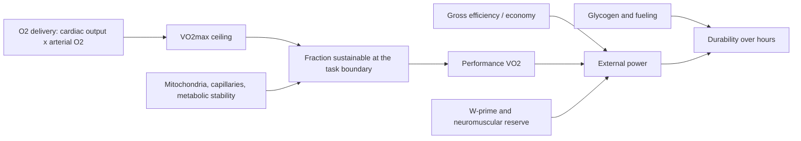

# Physiology, volume and easy intensity

**Last checked:** 2026-10-02

This brief is the maintained evidence judgment for [questions 1, 2 and 4](../index.md#question-map): what determines cycling performance, how weekly volume relates to adaptation, and how easy “easy” riding should be. It is a targeted appraisal, not a systematic review. Methods, access limits and update rules are in [research methods](../research-methods.md). Shared terms are in the [glossary](../CONTEXT.md). The [index](../index.md) routes decisions; the [bibliography](../evidence/bibliography.md) holds source records.

No transcript was supplied. Claims described in the prompt — including that a ~30 h/week rider should sit near 60% of FTP rather than 70–75%, and that elites can ride 4–5 h very easily between hard sessions — are **candidate hypotheses**, not confirmed quotations or attributions.

Reading order: [Previous — physiological model and priorities](training-model.md) · [Next — distribution and recovery](distribution-periodization-recovery.md).

## How to use this brief

| Question | Go to |
|---|---|
| What actually limits cycling performance, and how fast does it change? | [Determinants](#q1-determinants) and [PHY-C01](#phy-c01)–[PHY-C04](#phy-c04) |
| How much volume; baseline fitness, the added-hours trial, safe progression, and 4 h versus 2×2 h? | [Volume](#q2-volume) and [PHY-C05](#phy-c05)–[PHY-C07](#phy-c07) |
| 55–60% versus 65–75% FTP, and which “Zone 2”? | [Easy intensity](#q4-easy) and [PHY-C08](#phy-c08)–[PHY-C10](#phy-c10) |
| 6, 8, 10, 12, 20 and 30 h/week | [Hour comparison](#hours-comparison) |
| Durability after prior work, threshold recipes, long-ride design | [Threshold, durability and long rides](threshold-durability-long-rides.md) |
| Polarized versus pyramidal distribution, hard-session frequency, 24–72 h spacing | [Distribution, periodization and recovery](distribution-periodization-recovery.md) |
| Carbohydrate, train-low, glycogen restoration | [Fueling and energy availability](fueling-energy-availability.md) |
| Heavy strength and cycling economy | [Strength, warm-ups and mobility](strength-warmups-mobility.md) |
| Heat, plasma volume and haemoglobin mass as an intervention | [Sleep, heat and iron](sleep-heat-iron.md) |
| VO₂ interval formats | [VO₂-focused intervals](vo2-intervals.md) |
| FTP, CP and W′ testing | [Load and adaptation monitoring](load-monitoring.md) |

Intensities do not adapt separate, exclusive systems. The same mitochondria, capillaries and cardiovascular machinery are stressed, to different degrees, below LT1, between thresholds, and above critical power. A strong mechanism is not a prescription.

---

## Durable conclusions

### PHY-C01 — Sustainable cycling power is an interaction, not an FTP trait

**Classification:** Strong evidence for the interaction model in endurance sport; Moderate evidence for how heavily each term weights a given amateur cyclist.

Over durations from about 30 minutes to several hours, external power is set by how much oxygen can be used (VO₂max), what fraction of that rate can be sustained for the task, and how much power that oxygen uptake produces (efficiency or economy). FTP is one field estimate of a sustainable power, not the physiology underneath it ([Joyner and Coyle, 2008](https://doi.org/10.1113/jphysiol.2007.143834); [Bassett and Howley, 2000](https://doi.org/10.1097/00005768-200001000-00012); [Jones and Carter, 2000](https://doi.org/10.2165/00007256-200029060-00001)).

**Supports:** the three reviews above; [Coyle, 1999](https://doi.org/10.1016/s1440-2440(99)80172-8) on lactate-threshold velocity, fibre type and efficiency. **Complicates:** [Jacobs et al., 2011](https://doi.org/10.1152/japplphysiol.00625.2011) — among 16 already highly trained cyclists, a 26 km time trial was statistically associated with muscle oxidative capacity, submaximal lactate and leg oxygenation rather than with VO₂max alone. That analysis started from a very large variable set; it shows that the ranking of predictors changes once athletes are already highly trained, not that VO₂max is irrelevant.

**Practical implication:** raise the ceiling (VO₂max and power at VO₂max), the fraction that can be held (threshold / critical power), and the power per litre of oxygen (efficiency), and do not treat a single FTP test as proof that all three moved. Durability — whether those numbers still hold after hours of work — is a separate property ([Maunder et al., 2021](https://doi.org/10.1007/s40279-021-01459-0)); see the [durability brief](threshold-durability-long-rides.md).

**Uncertainty:** the model is integrative, not a validated equation for programming 7–12 h/week. Motivational and environmental factors also decide who races well ([Joyner and Coyle, 2008](https://doi.org/10.1113/jphysiol.2007.143834)).

### PHY-C02 — Short-term VO₂max gains are mostly oxygen delivery; muscle oxygen extraction is already high in well-trained athletes

**Classification:** Moderate evidence for the training time course; Strong evidence that delivery, not a unique peripheral “Zone 2” step, sets the ceiling of VO₂max in ordinary large-muscle exercise.

By the Fick relation, VO₂ = cardiac output × arterial–venous oxygen difference. In large-muscle exercise, circulatory oxygen transport is the dominant limiter of VO₂max ([Bassett and Howley, 2000](https://doi.org/10.1097/00005768-200001000-00012); [di Prampero, 2003](https://doi.org/10.1007/s00421-003-0926-z), who estimated circulatory transport at about 75% of the post-lung resistance in two-leg exercise — a model, not a cyclist trial). A 2015 meta-analysis of 13 studies (130 untrained or moderately trained young adults, interventions 5–13 weeks) associated the VO₂max increase with maximal cardiac output, not with a rise in maximal arteriovenous oxygen difference ([Montero, Diaz-Cañestro and Lundby, 2015](https://doi.org/10.1249/mss.0000000000000640)). In 16 untrained men, 6 weeks of endurance training raised VO₂peak by 9 ± 8% and peak cardiac output by 7 ± 6%; red-cell volume, plasma volume and haemoglobin mass rose 8 ± 4%, 4 ± 6% and 6 ± 5%. Returning red-cell volume to baseline by phlebotomy removed most of the VO₂peak gain, despite an 18 ± 16% rise in capillary-to-fibre ratio and a 43 ± 30% rise in mitochondrial volume density ([Montero et al., 2015](https://doi.org/10.1113/jp270250)).

In 23 highly trained cyclists and triathletes (10 women), leg oxygen extraction at maximum was already 91 ± 3% in women and 92 ± 3% in men, with similar mitochondrial and capillary densities. The lower lean-mass-normalised VO₂max in the women was accounted for by lower haemoglobin concentration and oxygen delivery, not by worse muscle extraction ([Skattebo et al., 2025](https://doi.org/10.1113/jp289218)). A 2026 review likewise treats systemic oxygen delivery as the primary limiter of VO₂max in elite athletes, and mitochondrial density plus capillarisation as supports for fractional utilisation and for extraction that can exceed 95% in some elite skiers ([Skattebo et al., 2026](https://doi.org/10.1111/sms.70266)). Invasive female data remain scarce.

**Practical implication:** for a trained amateur, more easy riding is not a specific VO₂max intervention. VO₂max still moves when training includes work above the maximal metabolic steady state ([Rosenblat et al., 2024](https://doi.org/10.1007/s40279-023-01924-y): +2.5 mL·kg⁻¹·min⁻¹, 95% CI 1.4–3.6, versus training only below that boundary, across 14 studies of 2–12 weeks). Interval design belongs in the [VO₂ brief](vo2-intervals.md). Plasma-volume expansion is not the same thing as a larger haemoglobin mass; heat protocols are in the [sleep, heat and iron brief](sleep-heat-iron.md).

**Uncertainty:** the phlebotomy and cardiac-output reviews are untrained to moderately trained. Highly trained athletes can still raise haemoglobin mass and stroke volume over longer periods ([Lundby, Montero and Joyner, 2017](https://doi.org/10.1111/apha.12827)), but the size of that gain at 7–12 h/week is not established here.

### PHY-C03 — Critical power, MLSS, LT2/VT2 and FTP are related and not interchangeable

**Classification:** Strong evidence for non-equivalence; Moderate evidence for how large the individual error is in trained cyclists.

Critical power (CP) is the heavy–severe boundary in the power–duration model. Maximal lactate steady state (MLSS) is an operational lactate-stability test and, as usually performed, sits somewhat below CP; exercise at CP is typically sustainable for roughly 20–30 minutes, not for an hour ([Jones et al., 2019](https://doi.org/10.14814/phy2.14098)). A meta-analysis of nine studies (104 participants) found correlations between CP and other thresholds (pooled r = 0.73) but systematic offsets: VT1 underestimated CP by about 30%, MLSS by about 11%, RCP overestimated it by about 6%, and VT2 by about 21% ([Galán-Rioja et al., 2020](https://doi.org/10.1007/s40279-020-01314-8)). The first lactate or ventilatory threshold is the moderate–heavy boundary, not an anaerobic or hypoxic threshold ([Poole et al., 2021](https://doi.org/10.1113/jp279963)). W′ is the curvature of the power–duration curve, in kilojoules. It is not a direct assay of one anaerobic fuel tank ([Burnley and Jones, 2018](https://doi.org/10.1080/17461391.2016.1249524)).

FTP, usually 95% of a 20-minute mean, can agree with a lactate marker on average and still miss it by tens of watts in an individual. In 23 trained men, FTP₂₀ and a 60-minute estimate were not interchangeable with the individual anaerobic threshold (limits of agreement roughly −40 to +32 W up to −62 to +60 W); time to exhaustion at FTP₂₀ was 50.9 ± 15.7 minutes, not 60 ([Borszcz et al., 2018](https://doi.org/10.1055/s-0044-101546)). In 15 trained and well-trained cyclists (VO₂max 62.3 ± 6.4 mL·kg⁻¹·min⁻¹), FTP versus MLSS bias was only 1.4% but the 95% limits of agreement were ±9.2% ([Borszcz, Tramontin and Costa, 2019](https://doi.org/10.1123/ijspp.2018-0572)). FTP tracked a lactate threshold more closely in trained than in recreational cyclists ([Valenzuela et al., 2018](https://doi.org/10.1123/ijspp.2018-0008)).

**Practical implication:** use FTP as a convenient performance anchor, then check it against how the athlete actually responds (talk test, heart rate, lactate or a CP test). Do not prescribe “88% FTP” as if it were MLSS, CP and LT2 at once. Testing choices are in the [monitoring brief](load-monitoring.md); threshold session recipes are in the [threshold brief](threshold-durability-long-rides.md).

**Uncertainty:** threshold methods themselves disagree ([Faude, Kindermann and Meyer, 2009](https://doi.org/10.2165/00007256-200939060-00003)). The Galán-Rioja inclusion rules were unusually strict for a correlation review; the direction of the offsets is consistent with the Jones 2019 argument, the exact percentages should not be treated as constants for every cyclist.

### PHY-C04 — Mitochondria and capillaries respond to training load, not to a private Zone 2 pathway

**Classification:** Moderate evidence for the load relationship in the published training literature; Strong evidence against the claim of a proven, exclusive Zone 2 mitochondrial pathway. The well-trained dose–response is much less certain.

The 2025 meta-regression of Mølmen, Almquist and Skattebo (search to 2 February 2022; 5,973 participants; 353 mitochondrial and 131 capillary articles) is the best current synthesis. After adjustment, mitochondrial content rose similarly with endurance training below the second threshold (23 ± 5%), high-intensity training (27 ± 5%) and sprint-interval training (27 ± 7%). Higher weekly frequency (6 > 4 > 2 sessions) and more weeks of endurance or high-intensity training were associated with larger gains. Per hour, sprint intervals were ~3.9 times and high-intensity training ~1.7 times as efficient as endurance training. The authors’ conclusion is that training load — volume × intensity — predicts mitochondrial content, so intensity can compensate for volume and volume for intensity ([Mølmen, Almquist and Skattebo, 2025](https://doi.org/10.1007/s40279-024-02120-2); [full text](https://europepmc.org/article/PMC/PMC11787188)).

That is not evidence of a unique Zone 2 pathway. Their “endurance training” bin is everything below VT2 / 4 mmol·L⁻¹ / 87% HRmax / 75% of Wmax. It mixes very easy riding with tempo. Capillaries per fibre rose similarly across modalities (about 10–15%) and mostly in the first four weeks in untrained and moderately trained groups. In well-trained participants (mean VO₂max 62.2 ± 6.7 mL·kg⁻¹·min⁻¹; few groups, 97% men) the pooled mitochondrial-content estimate was 6.6 ± 6.5% (P = 0.046): imprecise, but distinguished from zero in that model. Per hour of endurance training, the same well-trained estimate was not statistically distinguished from zero (P = 0.933). That is an imprecise null in a per-hour model, not proof that additional easy hours cannot change mitochondria. Well-trained capillary estimates were likewise imprecise and not statistically distinguished from zero. A 2025 expert commentary reached a related practical point: adaptations expected from “zone 2” might also be induced slightly above or below that intensity ([Sitko et al., 2025](https://doi.org/10.1123/ijspp.2024-0303)).

Work-matched human comparisons usually favour higher intensity for mitochondrial content when total work is fixed ([MacInnis et al., 2017](https://doi.org/10.1113/jp272570): 10 active men, single-leg cycling, six sessions). When absolute intensity was also matched, a 2023 single-leg study did not find greater mitochondrial-content gains from an interval pattern ([Skelly et al., 2023](https://doi.org/10.1111/sms.14332)). Granata, Jamnick and Bishop (2018) argued that volume may matter more for mitochondrial content and relative intensity more for respiratory function — a review conclusion, and one the later meta-regression partly reconciles by separating “per hour” from “total load.”

A targeted 2025–2026 search did not find a newer mitochondrial or capillary dose–response meta-analysis that supersedes Mølmen. Papers after the February 2022 search cutoff can still change the well-trained estimate; they have not yet been pooled.

**Practical implication:** accumulated easy riding can contribute mitochondrial stimulus if the hours are real and the athlete is not already near a ceiling, but it is the less efficient route per hour. It does not replace work above the heavy–severe boundary if VO₂max is the goal, and it does not require a mystical wattage inside “Zone 2.”

**Uncertainty:** most biopsy studies are untrained. Enzyme activity is an imperfect content marker. Sex-specific dose–response in trained women is thin. Acute signalling (PGC-1α and similar) is not longitudinal proof.

### PHY-C05 — Volume matters; lower gains at higher baseline fitness and a null volume regression are not a randomized hour-dose trial

**Classification:** Moderate evidence that, in the biopsy meta-regression, less-fit participants gained more mitochondrial content, capillarisation and VO₂max, and that study-level weekly or total volume was not associated with larger gains in already-training cyclist interventions. Plausible but uncertain that weekly hours themselves show a particular diminishing-returns curve. One small randomized added-volume trial in moderately trained cyclists/triathletes is described below; it does not establish a general weekly-hour optimum.

In the Mølmen meta-regression, initial fitness was the dominant moderator of mitochondrial, capillary and VO₂max gains. Untrained participants improved most; well-trained participants least. Separately, Cove and colleagues meta-analysed training interventions lasting more than 4 weeks. The abstract’s “VO₂max ≥ 59” cut oversimplifies the rule. Methods 2.2, from the parent’s direct PDF read and not re-opened here, required a Tier 3 **group-mean** VO₂max of at least 59 mL·kg⁻¹·min⁻¹ in men and 54.4 in women, not every individual cyclist at or above 59. Body 3.2 reports a baseline mean of 60.4 ± 4.8 (range 54.0–69.1). The abstract reports 41 studies and 797 participants; those two figures are used as abstract-reported, not as counts checked against the PDF. Training improved VO₂max (g = 0.42, 95% CI 0.31–0.53) and time-trial performance (g = 0.39, 95% CI 0.25–0.53). Longer interventions were positively associated with both outcomes. Weekly volume and total intervention volume were **not** associated with either outcome. Their polarized and non-polarized labels also did not differ (P > 0.05), but that contrast is not a test of 80/20 or of time below LT1. In section 2.4, as extracted by the distribution review from the open PDF and not re-read here, “polarized” required some low-intensity or habitual training plus high-intensity intervals shorter than 5 minutes at the highest sustainable intensity or above MLSS. Intervals longer than 5 minutes were classed non-polarized. That rule is a weak stand-in for polarized versus pyramidal distribution; the distribution brief owns that comparison. The authors wrote that beyond a necessary volume, further increases did not appear to enhance performance ([Cove et al., 2025](https://doi.org/10.1016/j.jsams.2024.12.005); [PubMed](https://pubmed.ncbi.nlm.nih.gov/39788807/)). The volume point estimates are unchanged by these eligibility and classification caveats. The PDF search ended 23 October 2023, despite the 2025 issue.

That sentence must be read as what the regression found, not as a causal trial of extra low-intensity hours and not as a safe weekly-hour optimum. The included studies were already training interventions in fit cyclists, defined by group-mean fitness as above. Volume was a study-level covariate, not a randomized dose. The distribution review’s full-text read (not re-opened here) reports that the volume regression used only the subsets that reported volume, with low certainty (GRADE) for the VO₂max and time-trial analyses. The parent’s PDF read also found internal count disagreements: the abstract says 41 studies, the discussion 44, and the body 23 randomised plus 21 non-randomised, while 37 acceptable plus 7 low also sum to 44. Those extra counts are not treated as validated. A mean weekly volume of 4.9 ± 7.3 h (range 2.6–14.3) is internally questionable; the 7.3 SD is not used. The abstract retrieved for this brief does not report the hour range. A null association can mean the reporting subset sat on a flat part of the curve, that volume was poorly measured, or that intensity distribution and baseline fitness absorbed the variance. It does **not** show that adding recoverable easy riding to an under-stimulated amateur is useless.

There is direct, limited volume-manipulation evidence: [Moran-MacDonald et al. (2026)](https://doi.org/10.1007/s00421-026-06380-w) randomly allocated 19 moderately trained cyclists/triathletes (17 men) to three weekly HIIT days with or without an additional 240 minutes/week of moderate-domain cycling for six weeks. Both groups reduced TT time by an average of 8.5 ± 1.2%; no time × group interaction was detected for TT, peak work rate, LT1 or LT2 despite about 23 additional hours. The retrieved [original abstract](https://pubmed.ncbi.nlm.nih.gov/42560532/) does not report VO₂max change. This small, short, unmatched-total-load comparison does not prove equivalence, give a 6/8/10/12-hour dose curve, or settle long-term effects in well-trained cyclists.

Observational elite practice still uses a lot of easy time. Norwegian world-class coaches, including one road-cycling coach, described high-load preparation weeks of about 20–24 h for road cycling and competition weeks of about 18–22 h, mostly specific cycling, with 2–3 intensive days ([Sandbakk et al., 2025](https://doi.org/10.1186/s40798-025-00848-3); [full text](https://europepmc.org/article/PMC/PMC12031707)). That is coach-reported best practice from one cycling informant, cross-checked against logs, not an experiment. Olympic and world-champion cross-country skiers and biathletes logged about 800 h/year, with about 90% of aerobic time below the first lactate threshold ([Tønnessen et al., 2014](https://doi.org/10.1371/journal.pone.0101796)). Those are not cyclists, and 800 h/year is about 15 h/week on average, not 30.

**Practical implication:** for a trained amateur, moving from inconsistent riding to a recoverable, consistent 7–12-hour pattern is a plausible lever, not a guarantee that each extra hour increases VO₂max. Protect quality and recovery before adding easy time. Cove's study-level null regression and the small six-week added-volume trial constrain simple “more is always better” claims; neither establishes an optimal dose or proves extra hours are useless. Distribution of the hours is handled in the [distribution brief](distribution-periodization-recovery.md).

**Uncertainty:** no randomized dose–response trial has assigned trained cyclists to 6 versus 8 versus 10 versus 12 h/week with intensity held constant. A measured 10-week WorldTour pre-season block is now in hand ([Mateo-March et al., 2026](https://doi.org/10.5114/biolsport.2026.156234)); it is not a full-season mean (see [volume](#q2-volume)).

### PHY-C06 — Increase volume by recoverable steps; there is no validated 10% rule for cyclists

**Classification:** Mostly coaching practice for any exact percentage. Moderate evidence that a universal 10% rule is not protective, from novice running, which transfers poorly to cycling. Moderate evidence that abrupt load spikes and unmanaged total stress raise injury and illness risk in sport generally.

The Groningen novice-running trial randomized 532 beginners to a 13-week programme built on the 10% rule or a standard 8-week programme. Injury incidence was 20.8% versus 20.3% (P = 0.90) ([Buist et al., 2008](https://doi.org/10.1177/0363546507307505)). In 874 novice runners, progressing weekly distance by less than 10%, 10–30%, or more than 30% did not produce a statistically significant difference in overall injury rate; some distance-related injuries were higher above 30% ([Nielsen et al., 2014](https://doi.org/10.2519/jospt.2014.5164)). A later systematic review found only sparse evidence linking training-load changes to running injuries ([Damsted et al., 2018](https://doi.org/10.26603/ijspt20180931)). The acute:chronic workload ratio is not a validated causal tool and should not be used to set cycling weeks ([Impellizzeri et al., 2020](https://doi.org/10.1123/ijspp.2019-0864)). IOC consensus statements do support the broader claim that poorly managed load — rapid changes, calendar congestion, travel, psychological stress — is a risk factor for injury and illness ([Soligard et al., 2016](https://doi.org/10.1136/bjsports-2016-096581); [Schwellnus et al., 2016](https://doi.org/10.1136/bjsports-2016-096572)). They do not nominate a cycling percentage.

Cycling tolerates more specific hours than running because it is non-weight-bearing, includes coasting, and allows drafting ([Sandbakk et al., 2025](https://europepmc.org/article/PMC/PMC12031707)). The injury that matters is often overuse of the knee, neck, saddle region or low back, plus illness from non-functional overreaching ([Meeusen et al., 2013](https://doi.org/10.1249/mss.0b013e318279a10a)), not the novice-runner model.

**Practical implication:** add one stressor at a time. Extend easy duration or add an easy day before raising intensity. Keep the added time below LT1/VT1. Protect the quality of the existing hard sessions. Use sleep, mood, illness, niggles and the next hard session — not a spreadsheet ratio — as the brake. An easier week every few weeks is common elite-coach practice (Sandbakk’s informants described 25–35% fewer hours every third or fourth week). That cadence is not an evidence-based optimum.

**Uncertainty:** there is no cycling RCT of progression rates. Sudden large jumps can still be stupid without a proven percentage that separates safe from unsafe.

### PHY-C07 — One long ride and two shorter rides of the same total time are not known to be equal stimuli

**Classification:** Plausible but uncertain. The closest controlled comparison is acute, in runners, and not a training study.

No retrieved trial has trained cyclists with a weekly volume matched as one 4 h easy ride versus two 2 h easy rides and then measured mitochondria, thresholds or performance. Sandbakk and colleagues state the gap directly: road cyclists typically ride one long session of 3–6 h rather than twice a day, “while the physiological effects of one long versus two short training sessions per day remains to be examined” ([Sandbakk et al., 2025](https://europepmc.org/article/PMC/PMC12031707)).

The nearest experiment compared, in 14 well-trained male endurance athletes (VO₂max 69.2 ± 4.2 mL·kg⁻¹·min⁻¹), one running session of 6 × 10 min moderate-intensity with two sessions of 3 × 10 min separated by 6.5 h, matched for time and external intensity. The single session produced a second-half drift in heart rate, lactate and RPE, higher supine heart rate in the following hour, and higher session RPE. The second short session showed lower heart rate and lactate than the first. The authors treat this as a signal-to-stress observation and explicitly call for training-intervention studies ([Kjøsen Talsnes et al., 2024](https://doi.org/10.3389/fphys.2024.1428536); [full text](https://europepmc.org/article/PMC/PMC11319183)). It is not 4 h versus 2 × 2 h, and it is not cycling.

Continuous duration does change physiology in a way a restart does not. In 12 trained cyclists (VO₂peak 52.3 ± 5.2 mL·kg⁻¹·min⁻¹), power at VT1 fell in a non-linear way during prolonged exercise; time to a 5% drop was 139 ± 78 min and tracked time to task failure ([Gallo et al., 2024](https://doi.org/10.1007/s00421-024-05440-3)). That is an acute durability finding. Whether repeating that exposure improves late-race performance more than the same minutes split across the week is not shown here. Detail and programming belong in the [durability and long-ride brief](threshold-durability-long-rides.md).

**Practical implication:** if the event is multi-hour, some continuous rides long enough to practise fueling, position and late-session physiology are justified even if weekly hours could be split. If the limit is recovery or the calendar, two 2 h easy rides still count as aerobic volume and are preferable to skipping the hours. Do not pretend the split is proven identical, or that 4 h is proven superior for mitochondria.

**Uncertainty:** glycogen status, fueling and sleep confound any real-world comparison. Train-low designs answer a different question; see [fueling](fueling-energy-availability.md).

### PHY-C08 — No retrieved direct longitudinal comparison ranks 55–60% versus 65–75% FTP

**Classification:** Plausible but uncertain whether 55–60% FTP produces a smaller performance adaptation than 65–75% FTP. Moderate evidence, separately, that fixed percentages of maximum misclassify exercise-intensity domains.

Europe PMC searches and, after web search was restored, a targeted web search did not retrieve a direct longitudinal comparison that ranked 55–60% versus 65–75% of FTP for performance or muscle adaptation. That is a limit of what was retrieved, not proof that no such study exists. Coaching tables that call everything from 56–75% FTP “Zone 2” are conventions, not trial results.

What does exist is domain-based, and mostly not in trained cyclists. Inglis and colleagues randomized 84 young healthy adults (42 women, 42 men; not described as trained cyclists) to six weeks of cycling, three sessions per week. Moderate, lower-heavy, upper-heavy and severe-interval groups were work-matched; sprint intervals were not. Versus the control change in VO₂max (0.1 ± 1.2 mL·kg⁻¹·min⁻¹), the moderate group’s change (1.8 ± 2.7) was not statistically different from control, and nor was its change at the estimated lactate threshold. Lower heavy (3.3 ± 2.4), upper heavy (5.4 ± 2.3), severe HIIT (6.2 ± 2.8) and sprint intervals (4.7 ± 2.3) did show a between-group increase versus control ([Inglis et al., 2024](https://doi.org/10.1249/MSS.0000000000003406); [PubMed](https://pubmed.ncbi.nlm.nih.gov/38376995/)). No clear between-group benefit versus control is not proof that moderate-domain training is ineffective. The trial also does not rank 55–60% versus 65–75% FTP, and it does not show that moderate riding is useless for durability, fat oxidation or recovery of hard sessions.

In rats, cytochrome c rose with both intensity and daily duration; higher intensity reached its plateau in less daily time ([Dudley, Abraham and Terjung, 1982](https://doi.org/10.1152/jappl.1982.53.4.844)). That is the classic “duration can compensate” result. It is not human, and the compensation was not infinite: the ceiling still depended on intensity. Mølmen’s per-hour gradient is the human analogue, with the well-trained caveat in [PHY-C04](#phy-c04).

Fixed anchors miss domains. In 100 adults, lactate threshold occurred anywhere from 45–74% VO₂max and MLSS from 69–96% VO₂max; the same percentages of peak power and HRmax scattered people across moderate, heavy and severe domains ([Iannetta et al., 2020](https://doi.org/10.1249/mss.0000000000002147)). Prescribing heavy work as a fixed %VO₂max put 70% of a small sample above critical power, so the bout was no longer heavy ([Meyler et al., 2023](https://doi.org/10.1113/ep090878)). FTP percentages inherit that problem plus FTP’s own error ([PHY-C03](#phy-c03)).

**Practical implication:** do not fine-tune 60% versus 70% FTP as if a trial had ranked them. First decide whether the ride is below the individual’s LT1/VT1. If both 60% and 72% FTP are below that boundary, any adaptation gap is unproven and probably smaller than the gap between below-LT1 and above-LT1 riding. If 72% FTP is above LT1, it is not an easy ride, whatever the zone chart says.

**Uncertainty:** LT1 as a percentage of FTP was not established by a retrieved cyclist trial. In one U23 professional cohort the group-mean first ventilatory threshold was 256 W and group-mean critical power was 382 W ([Leo et al., 2020](https://doi.org/10.3390/sports8120167)); that is about two-thirds of CP, not a prescription, and individual ratios were not reported.

### PHY-C09 — “Zone 2” is three different ideas that got the same name

**Classification:** Strong evidence that the labels differ. The confusion is definitional, not a small measurement error.

| Label | What it actually is | Typical boundary |
|---|---|---|
| Research three-zone model, Zone 1 | Time below the first lactate or ventilatory threshold | LT1 / VT1. Seiler’s elite descriptions put most sessions here ([Seiler and Kjerland, 2006](https://doi.org/10.1111/j.1600-0838.2004.00418.x); [Seiler, 2010](https://doi.org/10.1123/ijspp.5.3.276)) |
| Research three-zone model, Zone 2 | Between first and second thresholds | Heavy domain. This is tempo / threshold-adjacent, not “easy” |
| Five-, six- or seven-zone cycling models, “Zone 2” | A power band on an FTP chart, classically something like 56–75% FTP | Often intended to sit inside research Zone 1, but FTP error and individual LT1 placement mean it can spill into research Zone 2 |
| Popular “Zone 2” | Usually “the highest easy intensity,” often sold as a mitochondrial sweet spot | 2025 expert consensus: preferably immediately below LT1/VT1, and not a unique adaptation ([Sitko et al., 2025](https://pubmed.ncbi.nlm.nih.gov/40010355/)) |
| Norwegian coach I-zones in Sandbakk et al. | A multi-zone scale in which most low-intensity time is zone 1, and zones 3–5 are the intensive minutes | Not Coggan Zone 2. In their cycling description, zone 2 time accumulates from racing and low-cadence work, not as the intended bulk |

The 2010 Seiler review’s “80/20” figure is about **sessions** in athletes training 10–13 times per week, not a proven optimal percentage of minutes, and not a cyclist prescription. Whether polarized distribution beats pyramidal distribution is a different question. Cove et al. (2025) reported no difference between labels they called polarized and non-polarized, but those labels were not a measured 80/20 split or a proportion below LT1: polarized required intervals shorter than 5 minutes, and longer intervals were classed non-polarized (classification from the distribution review’s full-text read, not re-opened here). That comparison is maintained in the [distribution brief](distribution-periodization-recovery.md).

**Practical implication:** when a plan says Zone 2, name the model. In this platform, low-intensity endurance riding means predominantly below the athlete’s LT1/VT1 ([glossary](../CONTEXT.md)).

**Uncertainty:** laboratory LT1 and field talk-test or heart-rate breakpoints are not identical. A wrong threshold method will mis-file the ride even if the wording is careful.

### PHY-C10 — Riding easier as weekly hours rise is a recovery-oriented coaching choice, not a proven workload rule

**Classification:** Mostly coaching practice for lowering easy intensity as weekly hours rise. Moderate evidence, separately, that crossing LT1/VT1 raised acute autonomic recovery cost in a small sample of highly trained runners. Not a direct test that a 25–30 h week must be ridden at a lower percentage of FTP than an 8 h week.

In nine highly trained male runners (VO₂max 72 ± 5 mL·kg⁻¹·min⁻¹, 14 ± 3 h/week), heart-rate variability returned to baseline within 5–10 minutes after both 60 and 120 minutes below VT1. Threshold work and work above VT2 delayed recovery to about 30 minutes, with no further delay from the harder of those two. Less-trained runners (VO₂max 60 ± 5, 7 ± 1 h/week) recovered more slowly after the same intervals ([Seiler, Haugen and Kuffel, 2007](https://doi.org/10.1249/mss.0b013e318060f17d)). This is an acute autonomic marker in runners, n = 9 and 8, not a cycling adaptation trial, and it did not test 4 h rides. It is still the cleanest evidence that, in people who already tolerate high volume, the first threshold behaves like a step in recovery cost.

World-class endurance coaches in the Sandbakk synthesis emphasised keeping low-intensity work at the lower end of their easiest zone during preparation, especially in running and cycling, so that intensive days could be done well. Their road-cycling picture was one daily ride of 3–6 h, not a 30 h template at a stated percentage of FTP. The prompt’s 60% versus 70–75% FTP claim was not confirmed against a transcript and was not retrieved as a tested prescription.

**Practical implication:** at 7–12 h/week, a reasonable coaching choice is to keep easy days below LT1, toward the upper part of that range only if the next hard session is still good. At 20–30 h/week, the same choice is to keep more of the bulk clearly below LT1, using power as a ceiling rather than a target, so hard days remain possible. That is recovery management, not a demonstrated rule that easy watts must fall in proportion to hours. The difference between 58% and 64% FTP, if both are below LT1, is not where the programme is won or lost.

**Uncertainty:** individual LT1 can move with fatigue, heat, cadence and glycogen. A fixed FTP percentage will be wrong on some days even if it was right in a fresh test. Durability of the moderate–heavy transition is covered in the [durability brief](threshold-durability-long-rides.md).

---

## Q1. What determines cycling performance?

### The interaction

Joyner and Coyle (2008) put champion endurance performance on three interacting terms: VO₂max, lactate threshold (the sustainable fraction), and efficiency. Jones and Carter (2000) add oxygen-uptake kinetics and note that velocity at VO₂max and MLSS/CP are related expressions of the same aerobic package. Bassett and Howley (2000) separate the ceiling (oxygen delivery) from the submaximal machinery (mitochondria, fat oxidation, less lactate at a given VO₂). None of these reviews treats FTP as a physiological primitive.

For a trained amateur the useful translation is:

1. **Ceiling.** How high can oxygen uptake go, and what power does that correspond to?
2. **Boundary.** What power still allows a metabolic steady state (CP / a carefully interpreted MLSS), and what fraction of VO₂max is that?
3. **Conversion.** How many watts per litre? Gross efficiency is work divided by metabolic energy cost; economy is the cost of a given output. They are related and not identical ([glossary](../CONTEXT.md)).
4. **Reserve above the boundary.** W′ and neuromuscular qualities decide surges, climbs and the last minutes.
5. **Whether 1–4 still exist after 1,500–3,000 kJ.** That is durability, not a fresh FTP.

### Central delivery, extraction and fractional use

Training-induced VO₂max increases in previously untrained people are largely a blood-volume and stroke-volume story ([PHY-C02](#phy-c02)). Convertino’s 1991 review concluded that plasma-volume expansion accounts for nearly all of the early hypervolemia for about 2–4 weeks, after which the expansion is shared with red-cell volume ([Convertino, 1991](https://doi.org/10.1249/00005768-199112000-00004)). That is a narrative review of the literature of its time, not a modern cyclist cohort. An acute cycling-versus-treadmill study in 10 subjects found similar plasma-volume expansion (~4–7% at 24 h) after high-intensity intervals, and similar expansion after four, six or eight intervals ([Nelson et al., 2023](https://doi.org/10.14814/phy2.15601)). Acute expansion is not a season-long haemoglobin-mass adaptation.

Haemoglobin mass and VO₂max are tightly related in developmental data (about 3.6 mL·min⁻¹ of VO₂max per gram of haemoglobin in one childhood cohort), but growth and training were entangled ([Prommer et al., 2018](https://doi.org/10.3389/fphys.2018.00251)). Do not read a ferritin or a haemoglobin concentration as haemoglobin mass. Concentration falls when plasma volume rises. Heat exposure, iron and true haemoglobin-mass change are in the [sleep, heat and iron brief](sleep-heat-iron.md).

Fractional utilisation is the fraction of VO₂max sustained for a specified task or at a specified boundary. It is not one lifelong percentage. Peripheral adaptations — mitochondria, capillaries, and the ability to oxidise fat and clear or reuse lactate — support a higher fraction and a more stable heavy-domain metabolic rate ([Bassett and Howley, 2000](https://doi.org/10.1097/00005768-200001000-00012); [Skattebo et al., 2026](https://doi.org/10.1111/sms.70266)). They do not, by themselves, prove that a particular easy wattage will raise FTP.

Among already highly trained cyclists, Jacobs and colleagues (2011) found muscle oxidative phosphorylation capacity, submaximal lactate and leg oxygenation accounting for 78% of the variance in a 26 km time trial, whereas maximal incremental power tracked haemoglobin mass, VO₂max and leg oxygenation. Sixteen athletes and a large predictor set: hypothesis-generating, not a programming formula. It does warn against assuming that the limiter in an untrained phlebotomy study is the limiter in a 65 mL·kg⁻¹·min⁻¹ amateur.

### Thresholds, CP and the steady state

Moderate domain: below LT1/VT1. Fatigue is slow and, in the Burnley and Jones (2018) synthesis, predominantly central. Heavy domain: LT1 to CP. Both central and peripheral fatigue; glycogen depletion is a frequent correlate. Severe domain: above CP. Muscle metabolites drift, VO₂ climbs toward maximum, and task failure occurs with a similar peripheral disturbance across work rates above CP. W′ is the finite work that can be done above CP before that failure. It is model-dependent.

MLSS is not CP ([PHY-C03](#phy-c03)). FTP is not either of them. A 20-minute test is a performance test. Using it to set every other zone imports its bias into the whole week.

### Efficiency and neuromuscular traits

Hopker and colleagues’ 2009 review argued that well-controlled studies do show training-related gains in gross efficiency, and that cross-sectional “trained versus untrained” comparisons were often methodologically weak ([Hopker et al., 2009](https://doi.org/10.1055/s-0029-1237712)). Their later within-cyclist work found an inverse relationship between gross efficiency and VO₂max across a season (r = −0.32) and during a high-intensity block (r = −0.78), with efficiency rising when VO₂max did not ([Hopker et al., 2012](https://doi.org/10.1055/s-0032-1304640)). Efficiency and VO₂max are not a single dial. Coyle (1999) reported that, at 80 rpm, gross efficiency related positively to type I fibre proportion. Mølmen’s meta-regression did not find a consistent shift in type I proportion with ordinary endurance, high-intensity or sprint training (P > 0.116). Heavy strength can improve economy and fractional utilisation in some cyclist trials; that evidence is maintained in the [strength brief](strength-warmups-mobility.md), not re-litigated here.

Cadence, position and pedalling technique change efficiency acutely. A bike-fit change is not a mitochondrial adaptation. Prolonged exercise itself lowers gross efficiency ([Hopker, O’Grady and Pageaux, 2017](https://doi.org/10.1111/sms.12673) — cited from the search record as an acute observation; do not treat a single ride’s efficiency drop as a training effect).

### Muscle oxidative capacity, mitochondria, capillaries

See [PHY-C04](#phy-c04). The practical split:

- **Content** (how much mitochondrial machinery) responds to total load in the meta-regression. Easy volume can contribute. Higher intensity was more efficient per hour in that model. In well-trained groups the per-hour endurance-training estimate was not statistically distinguished from zero; the interval was wide ([PHY-C04](#phy-c04)).
- **Function** (how well the mitochondria respire) may track intensity more than volume ([Granata, Jamnick and Bishop, 2018](https://doi.org/10.1007/s40279-018-0936-y)). That dissociation means “citrate synthase went up” is not “FTP went up.”
- **Capillaries** increased early, similarly per fibre across intensities. Further weeks were not associated with additional capillary gains after about four weeks in the meta-regression. Capillary density (per square millimetre) rose more after endurance training because fibres hypertrophied less. Well-trained capillary estimates were imprecise and not statistically distinguished from zero.

San-Millán and Brooks (2018) showed, cross-sectionally, higher fat oxidation and lower lactate at a given power in professional endurance athletes than in moderately active people and people with metabolic syndrome, and an inverse relationship between fat oxidation and lactate. That describes a fit phenotype. It is not a trial of Zone 2 training, and it does not isolate a wattage.

### Glycogen

Glycogen availability limits prolonged heavy exercise and is one reason the heavy domain feels different from the moderate domain ([Burnley and Jones, 2018](https://doi.org/10.1080/17461391.2016.1249524); [Coyle, 1999](https://doi.org/10.1016/s1440-2440(99)80172-8)). Starting a long ride with low glycogen changes both the acute response and the recovery of the next hard session. Whether deliberately training low adds a useful adaptation in already trained cyclists is a fueling question, not a volume question ([fueling brief](fueling-energy-availability.md)). A 4 h ride depletes more glycogen than a 2 h ride even at the same easy power; that is a reason they are not interchangeable ([PHY-C07](#phy-c07)), not a reason to under-fuel quality sessions.

### Durability, in one paragraph

Fresh FTP and fresh VO₂max do not describe the athlete after several hours. Power at the moderate–heavy transition falls during prolonged cycling ([Gallo et al., 2024](https://doi.org/10.1007/s00421-024-05440-3)). In professional and U23 cohorts, the power that remains after large prior work is related to training characteristics, including time below VT1 and a shift toward a more polarized distribution, in observational season data ([Spragg, Leo and Swart, 2023](https://doi.org/10.1080/17461391.2022.2049886)). Those correlations (r about 0.38–0.43 for time below VT1 and fatigued 5- and 12-minute power) are not proof that easy volume trains durability. Mechanisms, late-ride intervals and long-ride design are in the [durability brief](threshold-durability-long-rides.md).

### What changes quickly, and what takes months or years

| Adaptation | Typical time course in the retrieved evidence | Who it applies to | Do not assume |
|---|---|---|---|
| Plasma volume | Hours to a few weeks; can move after one hard session | Untrained and trained; acute data n = 10 for the cycling comparison | That a lower haemoglobin concentration means lost red cells |
| Red-cell / haemoglobin mass | Shares blood-volume expansion after the first 2–4 weeks in the classic review; measurable by ~6 weeks in untrained men | Untrained longitudinal data are stronger than elite data here | That sauna or easy volume will reproduce a phlebotomy-scale VO₂max change in a trained amateur |
| Mitochondrial content | Detectable at 2 weeks; endurance and high-intensity training still rising between 2–6 and 6–10 weeks | Mostly untrained and moderately trained biopsy studies | The same percent gain in someone at 62 mL·kg⁻¹·min⁻¹ |
| Capillarisation | Mostly within 4 weeks, then little further association with weeks | Untrained and moderately trained; not clear in well-trained | That a winter of Zone 2 will keep adding capillaries |
| VO₂max | Several weeks if intensity is high enough; longer interventions associated with larger gains in trained cyclists | Untrained: delivery-dominated. Trained cyclists: still trainable, smaller, and not tightly tied to weekly hours in Cove 2025 | That easy volume alone is the VO₂max tool |
| Fractional utilisation, efficiency, durability, tolerance of high volume | Observed across seasons and careers; not pinned to a week count | Elite observational and coach-reported | That an amateur needs years before any of these can move |

Untrained people are a poor template for a 7–12 h amateur, and a 7–12 h amateur is a poor template for a 25 h professional. The direction of adaptation is shared. The remaining headroom is not.

---

## Q2. Volume and dose–response

### How strongly does volume predict improvement?

It depends who is asking, and whether “volume” means hours, frequency, weeks of consistency, or joules above a threshold.

- **Untrained and moderately trained muscle:** more sessions per week and more weeks produce larger mitochondrial and VO₂max gains, after intensity is accounted for ([Mølmen, Almquist and Skattebo, 2025](https://europepmc.org/article/PMC/PMC11787188)). This is the cleanest volume signal, and it is not a cyclist performance trial.
- **Already trained cyclists in intervention studies:** Cove et al. (2025) found no association between weekly or total volume and the size of VO₂max or time-trial gains, and a positive association with how many weeks the intervention lasted. Read [PHY-C05](#phy-c05) before turning that into “hours don’t matter.”
- **Adding work above the steady state:** in endurance-trained athletes, a mesocycle that includes training above the maximal metabolic steady state improved VO₂peak by an extra 2.5 mL·kg⁻¹·min⁻¹ versus training only below it. The same review did not have enough evidence to conclude that peak power or time-trial performance followed ([Rosenblat et al., 2024](https://doi.org/10.1007/s40279-023-01924-y)). Volume of easy riding did not substitute for that intensity in a short block.
- **Elite careers:** successful endurance athletes accumulate large lifetime and annual volumes of low-intensity work ([Seiler, 2010](https://doi.org/10.1123/ijspp.5.3.276); [Tønnessen et al., 2014](https://doi.org/10.1371/journal.pone.0101796); [Sandbakk et al., 2025](https://europepmc.org/article/PMC/PMC12031707)). That is how champions train. It is not a randomized demonstration that the 25th hour beats the 12th hour for an amateur.

Male professional cyclists in a four-year team sample rode longer and spent more time in low-intensity zones than the women on the same programme; absolute session load (TSS, TRIMP) was similar, and load per kilometre was higher in the women ([van Erp, Sanders and de Koning, 2020](https://doi.org/10.1123/ijspp.2019-0320)). That abstract does not state weekly hours. A full-text report of 16 female and 16 male WorldTour riders over the 10 weeks before the first race found 16.7 ± 2.6 versus 19.1 ± 2.7 h/week (p = 0.016), peaking in week 9 at 20.1 ± 3.2 h and 22.5 ± 2.8 h, then tapering to 11.2 ± 4.6 h and 17.7 ± 4.9 h ([Mateo-March et al., 2026](https://doi.org/10.5114/biolsport.2026.156234); [full text](https://europepmc.org/article/PMC/PMC13217385)). More than 90% showed a pyramidal distribution. Low intensity was time below an assumed 70% of estimated critical power, not a measured LT1. By power, that bin was 70.4 ± 6.2% of time in the men and 59.7 ± 10.4% in the women. This is one pre-competitive block, not a full-season mean and not a 30 h week.

U23 professionals in Leo et al. (2020; 30 men, VO₂max 73.7 ± 2.5 mL·kg⁻¹·min⁻¹) accumulated 167 ± 46 h in November–January, 202 ± 28 h in February–April, 219 ± 26 h in May–July and 150 ± 36 h in August–October, racing included. Spread evenly across those calendar windows, that is roughly 11–17 h/week. The paper does not report weekly means; this is derived arithmetic, not a result. Their heart-rate distribution was threshold-heavy (about 17–19% of time below VT1, 51–63% between VT1 and VT2, 8–9% above VT2). The authors suggest racing and/or poor intensity discipline. It is a counter-example to the idea that every professional week is 80% below LT1, and it is one team.

Session duration, not weekly hours, was higher in professionals (2.6 ± 0.3 h) than U23 riders (2.2 ± 0.3 h) in a 2019-season comparison; the retrieved abstract is incomplete for the other load figures ([Gallo et al., 2022](https://doi.org/10.1055/a-1847-5414)). Junior riders who later reached WorldTour level had competed more at age 18 (91.5 ± 19.1 h versus 62.8 ± 21.8 h in those who remained club riders). That is competition exposure, not a training-volume prescription ([Svendsen et al., 2018](https://doi.org/10.1123/ijspp.2017-0824)).

### Baseline fitness, not a proven hour-dose curve

Less-fit groups gained more mitochondrial content, capillarisation and VO₂max in the biopsy meta-regression ([PHY-C04](#phy-c04)). That moderator is not a randomized comparison of weekly hours. Extra hours can still become unproductive if they displace sleep, carbohydrate or the quality of the hard sessions ([PHY-C05](#phy-c05)). A professional week of about 19 h in the measured pre-season block is organised around training. An amateur who adds the same hours on top of a job may buy fatigue rather than a larger VO₂max. That is a practical constraint, not a tested hour optimum.

Per hour, higher intensity is the more efficient mitochondrial stimulus ([Mølmen, Almquist and Skattebo, 2025](https://europepmc.org/article/PMC/PMC11787188); [MacInnis and Gibala, 2017](https://doi.org/10.1113/JP273196)). That efficiency is exactly why amateurs with 8 h should not copy the professional’s intensity distribution minute for minute: the professional’s easy hours are how they keep intensity sustainable, not proof that easy hours are the highest-yield use of a scarce hour.

### What is particularly volume-dependent?

| More volume-dependent, on current evidence | Less volume-dependent, or more intensity-dependent |
|---|---|
| Tolerance of long duration, fueling practice, position, and durability exposures | Short-block VO₂max gains once a minimum of hard work is present (Inglis 2024 in untrained; Rosenblat 2024 in trained) |
| Mitochondrial content when intensity is modest, especially if the athlete is not already well trained | Mitochondrial content per hour (higher intensity wins) |
| The ability to keep easy days from becoming moderate days when the week is very long | Capillary number after the first month, in the meta-regression |
| Event-specific metabolic stability over 3–6 h | W′ and sprint neuromuscular qualities |

“Volume-dependent” does not mean “only Zone 2.” A 3 h ride with 30 minutes above CP is still a volume stress.

### When does extra volume interfere?

There is no retrieved hour at which interference begins. The pattern, from acute recovery data and from overreaching consensus, is:

- Easy riding **below VT1** has a small autonomic cost in highly trained athletes, at least up to 2 h ([Seiler, Haugen and Kuffel, 2007](https://doi.org/10.1249/mss.0b013e318060f17d)).
- The same minutes **above VT1** cost more, even if they feel “moderate.”
- Interference shows up as a worse hard session, rising resting fatigue, illness, or loss of power — not as a TSS threshold. Overreaching versus overtraining syndrome cannot be diagnosed from a spreadsheet ([Meeusen et al., 2013](https://doi.org/10.1249/mss.0b013e318279a10a)).
- Low energy availability will imitate a programming failure. If volume rises and intake does not, the limiter may be food, not the zone chart ([fueling brief](fueling-energy-availability.md)).

Leo and colleagues’ practical note from the U23 season is worth keeping: once racing starts, do not keep stacking work; lowering the intensity of the remaining volume may be how total stress stays tolerable. That is interpretation of one observational season, not a trial.

### Safe progression, without a fake percentage

1. Hold intensity distribution roughly steady and add easy duration, or add one easy day, for 2–4 weeks.
2. If sleep, mood, and the hard sessions hold, repeat. If they do not, remove the last addition before adding intensity.
3. Do not add volume and a new interval format in the same week.
4. Do not use the 10% rule, the acute:chronic workload ratio, or any other single ratio as a safety certificate ([PHY-C06](#phy-c06)).
5. Persistent chest pain, syncope, unexplained performance collapse, or disordered eating is a medical problem, not a deload problem.

### 6, 8, 10, 12, 20 and 30 hours

These rows are a **reasoned transfer** of the evidence above. They are not experimentally validated optima. “Hard sessions” here means cycling sessions with a real threshold, VO₂ or race stimulus. Strength is extra and is scheduled in the [strength brief](strength-warmups-mobility.md).

| Weekly cycling | What the evidence supports | Easy-intensity bias | Long ride | Main risk if you copy the row above |
|---|---|---|---|---|
| **6 h** | Enough for general fitness if 1–2 sessions are truly hard. Cove’s null volume slope does not mean 6 h equals 12 h. | Stay below LT1 when the aim is easy riding. No retrieved comparison ranks 55% versus 65–75% FTP, so the lower end of that band is not proven insufficient. | 2–2.5 h is plenty. A 4 h ride consumes most of the week and is rarely the best trade. | Adding a third hard session instead of sleep. |
| **8 h** | A workable amateur week: two hard sessions plus enough easy time to arrive at them fresh. Still intensity-limited more than volume-limited for VO₂max. | Mostly below LT1. The top of that range is acceptable if heart rate is stable and the next hard day is good. | About 2.5–3 h if the event is long; otherwise two 2 h rides are a fair substitute ([PHY-C07](#phy-c07)). | Letting “endurance” creep above LT1 so both hard days and the long ride are moderate. |
| **10 h** | More easy time than 8 h, still below the measured WorldTour pre-season means. Whether 10 h beats 8 h has not been tested. | Keep the bulk below LT1. One longer ride can sit at the upper easy edge; other easy days can be quieter. | 3 h is a reasonable longest ride, not half the week. | Stacking volume and life stress until the hard sessions degrade. |
| **12 h** | Near the top of the target amateur budget. Cove’s regression did not associate higher study-level volume with larger gains; that is not a test that 12 h is a ceiling. | A recovery-oriented choice, not a proven wattage rule: more of the week needs to stay below LT1 if the two hard sessions are to stay hard. | 3–4 h can be justified for durability and fueling. Splitting is acceptable in busy weeks. | Treating 12 h like a compressed 25 h plan: too much threshold, not enough easy. |
| **20 h** | Near the measured WorldTour pre-season mean in men (19.1 ± 2.7 h/week over 10 weeks; peak week 22.5 ± 2.8 h) and the coach-described 20–24 h preparation week. Requires a life organised around training. Not a target for the 7–12 h reader. | Coaching choice, not a tested rule: sit lower in the easy range than an 8 h athlete so the week stays recoverable. Time between VT1 and VT2 should not be the accidental default. | 4–6 h sessions are how the hours fit, not because 4 h is proven better than 2 × 2 h for mitochondria. | An amateur copying the hours without the recovery, fueling or intensity discipline. |
| **30 h** | Above both the measured 10-week WorldTour pre-season means and the road-cycling coach row (20–24 h). Triathlon informants described up to the low 30s. Some race weeks may be higher; that was not the pre-season mean retrieved here. | Coaching choice, not a proven %FTP rule: keep most minutes below the individual’s LT1 so hard days remain possible. The prompt’s “60% FTP” figure was not tested. | Long rides are how that volume is usually organised. They are also a large glycogen and sleep stress. | Assuming 30 h at 70–75% FTP is automatically “more aerobic.” It may simply be more fatigue. |

**7–12 h versus 20–30 h, in one line:** the amateur’s scarce resource is usually high-quality hard work plus enough easy riding to recover from it. The professional’s scarce resource is the ability to absorb huge specific volume without the easy riding becoming moderate. Transfer the principle (most minutes below LT1, a small amount of work above the steady state, progression that preserves quality). Do not transfer the hours.

---

## Q4. How easy should easy riding be?

### What changes at low intensity, and what does not

Below LT1/VT1 the muscle is in the moderate domain: lactate and VO₂ stabilise, fat oxidation covers more of the cost than it does in the heavy domain, and autonomic recovery is fast in highly trained athletes ([Burnley and Jones, 2018](https://doi.org/10.1080/17461391.2016.1249524); [Seiler, Haugen and Kuffel, 2007](https://doi.org/10.1249/mss.0b013e318060f17d)). Repeated exposure can contribute to mitochondrial content if volume is high enough and the athlete has headroom ([PHY-C04](#phy-c04)). It is a weak short-term VO₂max stimulus when work-matched against heavy and severe training ([Inglis et al., 2024](https://pubmed.ncbi.nlm.nih.gov/38376995/)).

Between LT1 and LT2 — research Zone 2, often called tempo — the stress per minute rises. Some of that stress is useful threshold work. A lot of it, scattered through “easy” rides, is how weeks become threshold-heavy without a plan. U23 data show that this can happen even in professionals ([Leo et al., 2020](https://europepmc.org/article/PMC/PMC7766290)).

Above LT2/CP the ride is no longer endurance riding. It may still be good training. It is a different tool.

### Minimum effective intensity

There is a floor and a ceiling, and neither is a percentage of FTP.

- **Floor.** Very light activity is not automatically “endurance training.” Dudley’s rats needed either more intensity or more daily minutes to move cytochrome c. Mølmen’s per-hour ranking is the human analogue in a meta-regression: endurance training was less efficient per hour than higher-intensity training, with wide uncertainty in well-trained groups. That does not show that 55% FTP is an inadequate stimulus for a trained amateur. No retrieved trial ranks that percentage against 65–75% FTP.
- **Ceiling for “easy.”** Once power exceeds the individual’s LT1/VT1, recovery cost and carbohydrate use rise. That ceiling is the minimum specification for high-volume easy riding.
- **No retrieved minimum percentage.** 55% FTP is not a validated floor. 65% FTP is not a validated optimum. Sitko and colleagues’ 2025 panel — 14 applied scientists and coaches, a commentary, not a trial — agreed that so-called zone 2 should sit immediately below LT1/VT1, and that the expected adaptations are probably not unique to that sliver.

### Does duration compensate?

Partly, and less so as the athlete gets fitter.

- In the meta-regression, more weeks and more sessions compensated for the lower per-hour effect of endurance training on mitochondrial content, in untrained and moderately trained people.
- In well-trained groups, the per-hour endurance-training estimate for mitochondrial content was not statistically distinguished from zero (P = 0.933). The confidence interval was wide. That does not prove additional easy hours are futile.
- A longer continuous ride adds drift, glycogen use and durability stress that extra short rides do not ([PHY-C07](#phy-c07)). That is compensation of a different kind: specificity, not mitochondrial efficiency.
- Inglis 2024 found no clear between-group VO₂max benefit of work-matched moderate-domain cycling versus control over six weeks in young healthy adults. That is not proof of ineffectiveness, and it is not a ranking of FTP percentages. High-volume athletes are not work-matched against their interval sessions; they do far more easy minutes than hard minutes. Both descriptions can be true.

### Recovery cost as endurance intensity rises

Seiler, Haugen and Kuffel (2007) is the best acute evidence: below VT1, 60 and 120 minutes looked similar and cheap in highly trained runners; crossing VT1 was the expensive step. Talsnes et al. (2024) add that, even inside moderate-intensity intervals, making the session one long bout rather than two short bouts raised internal load and next-hour heart rate. Neither study licenses a cyclist to do 5 h at 75% FTP and call it recovery.

Subjective cost still matters. Saddle pain, low-back load and poor fueling can make a “physiologically easy” 4 h ride expensive. That is a reason to shorten or split, not a reason to ride the short ride harder.

### 8 hours versus 25–30 hours

| | About 8 h/week | About 25–30 h/week |
|---|---|---|
| What easy riding is for | Recover hard sessions and add a modest aerobic dose | Make the week possible at all, and accumulate specific duration |
| Where in the moderate domain | Upper half of below-LT1 is usually tolerable | Lower half, or the ride stops being easy by Thursday |
| FTP percentage | A ceiling after the fact, not the target. 65–75% FTP is fine only if it is still below LT1 | 70–75% FTP for most minutes is a hypothesis the prompt offered, not a result. It will be above LT1 for many riders |
| Main error | Riding so easily that the week has almost no stimulus, or so “moderately” that both hard days suffer | Copying amateur “sweet spot endurance” across 25 h |
| Evidence grade | Mostly coaching practice on the exact watts; moderate evidence for the below-LT1 rule | Same, with less direct amateur-to-pro trial evidence |

### How to prescribe the easy ride

Use a combination. No single channel is good enough.

1. **Primary anchor: below LT1/VT1.** If a recent test exists, set the cap a little under that power and heart rate. If it does not, use the field proxies below and accept more uncertainty.
2. **Power:** a ceiling. Expect it to fall on a long ride if heart rate is the constant, or expect heart rate to rise if power is the constant. Chasing a watt target up a climb pushes the ride through LT1.
3. **Heart rate:** useful for drift. A rising heart rate at constant power is information, not a reason to sprint back to the watt target. Cardiac drift also reflects heat and hydration.
4. **RPE and speech:** sentences should be comfortable. If breathing locks into a rhythm that would stop conversation, the ride has probably left research Zone 1. This is a coarse tool and fails in people who are poor at rating exertion.
5. **Lactate:** the laboratory standard for LT1, not a daily requirement. A single 2 mmol·L⁻¹ rule is not an individual threshold ([Faude, Kindermann and Meyer, 2009](https://doi.org/10.2165/00007256-200939060-00003)).
6. **Do not use FTP percentage alone.** Borszcz’s limits of agreement are wide enough to move a rider from easy to tempo.

Re-estimate the anchor when FTP, CP or body mass has clearly changed, and on days when heat, poor sleep or a hard session yesterday has already raised heart rate. The [monitoring brief](load-monitoring.md) covers which tests are stable enough to trust.

### A conservative easy-ride rule for 7–12 h/week

- Most non-hard minutes below the individual’s LT1/VT1.
- Power cap, not power target. If the only number available is FTP, start near 60–70% of a recent estimate **and then ignore it** if speech, heart rate or a known LT1 say otherwise. That band is a starting guess, not a finding that 62% beats 68%.
- One continuous ride of about 2.5–3.5 h if the event is longer than that; otherwise splitting is acceptable.
- If the next hard session is flat, the easy rides were too hard, too long, or under-fueled. Remove stress before adding a fancier zone.
- Do not add volume by the 10% rule. Add a small, reversible amount of easy time and keep the hard sessions.

For a 20–30 h week, using a lower average easy intensity is a recovery-oriented coaching choice so that hard days and races can stay hard. It is not a demonstrated rule that easy watts must fall as hours rise. Exact Zone 2 wattage is on the “false precision” list in the original request. Staying on the correct side of LT1 is the better-supported boundary.

---

## Evidence capsules

Capsules record what was retrieved. “Abstract” means sample sizes and outcomes below are from the abstract or PubMed record, not from a methods audit of the full paper.

### Mølmen, Almquist and Skattebo, 2025 — full text

Systematic review and meta-regression, search to 2 February 2022. Mitochondrial content: endurance 23 ± 5%, high-intensity 27 ± 5%, sprint intervals 27 ± 7% after covariate adjustment; per hour, sprint > high-intensity > endurance. Frequency and weeks add stimulus. Well-trained pooled gain 6.6 ± 6.5% (P = 0.046); the per-hour endurance-training estimate in that stratum was not statistically distinguished from zero. Capillary gains mostly early; well-trained capillary estimates imprecise. **Limit:** training bins are wide; cycling performance is not the outcome; well-trained cells are sparse and male. **Transfer:** supports training load, not a unique Zone 2 pathway. Do not expect untrained percent gains in a trained amateur.

### Cove et al., 2025 — abstract for effect sizes; classification from the distribution review’s full text

Abstract reports 41 studies and 797 participants; interventions > 4 weeks. Do not read “VO₂max ≥ 59” as every cyclist. Methods 2.2, parent PDF handoff, is a Tier 3 group-mean cut (men ≥ 59 mL·kg⁻¹·min⁻¹, women ≥ 54.4). Body 3.2 baseline mean about 60.4 ± 4.8 (range 54.0–69.1). VO₂max g = 0.42 (0.31–0.53); time trial g = 0.39 (0.25–0.53). Duration of intervention positive; weekly and total volume not associated in the reporting subset. GRADE low. Authors conclude that past a necessary volume, more volume did not enhance performance; that is not a causal optimum. A null contrast between their polarized and non-polarized labels (P > 0.05) is not evidence that 80/20 equals a pyramidal week. Section 2.4, distribution-review PDF read, not independently opened here, defined polarized as low-intensity or habitual training plus intervals shorter than 5 minutes at the highest sustainable intensity or above MLSS; longer intervals were non-polarized. **Limit:** study-level regression; PDF counts disagree (discussion/body arithmetic reach 44); do not use the reported weekly-volume SD of 7.3; search ended 23 October 2023. **Transfer:** do not cite the volume result as proof that adding easy hours never helps, and do not cite the label contrast as a polarized-versus-pyramidal trial.

### Inglis et al., 2024 — abstract

84 young healthy adults, 14 per group, 6 weeks, 3 sessions/week, cycling. The moderate-domain change in VO₂max and estimated lactate threshold was not statistically different from control. Heavy, severe and extreme domains showed a between-group increase versus control. Work-matched except sprints. **Limit:** not trained cyclists; not 55% versus 75% FTP; not high-volume. No clear between-group benefit is not proof of ineffectiveness. **Transfer:** does not rank easy wattages inside the moderate domain, and does not by itself make a short block of only moderate riding a VO₂max plan.

### Montero et al., 2015 — abstract

16 untrained men, 6 weeks. VO₂peak +9 ± 8%. Phlebotomy back to baseline red-cell volume removed the gain. Mitochondria +43 ± 30% anyway. **Limit:** untrained men. **Transfer:** early VO₂max is not a mitochondrial-content trophy.

### Seiler, Haugen and Kuffel, 2007 — abstract

Highly trained runners, n = 9. Below VT1, 60 or 120 min, heart-rate variability back in 5–10 min. Above VT1, delayed to ~30 min. **Limit:** runners, acute, small, no 4 h arm. **Transfer:** the first threshold is a reasonable recovery boundary for people who already train a lot.

### Kjøsen Talsnes et al., 2024 — full text

14 well-trained men, running, acute crossover. One 6 × 10 min moderate session cost more internal load than two 3 × 10 min sessions 6.5 h apart. Authors request training studies. **Limit:** not cycling, not 4 h, not longitudinal. **Transfer:** matched minutes are not matched stress once the bout is long. Do not overclaim a chronic adaptation.

### Sandbakk et al., 2025 — full text

12 Norwegian world-class coaches, one of them road cycling. Preparation weeks described as 20–24 h, competition weeks 18–22 h, one long ride of 3–6 h, 2–3 key days. Explicitly says one-versus-two sessions per day is untested. **Limit:** qualitative, one cycling coach, Norwegian context. **Transfer:** professional hours are high but not a universal 30 h prescription, and they are not an amateur target.

### Leo et al., 2020 — full text

30 male U23 professionals, VO₂max 73.7. Period totals imply roughly 11–17 h/week if spread across the stated months (derived). Heart-rate time was mostly between VT1 and VT2. **Limit:** one system, heart-rate zones, racing included. **Transfer:** “ride like a pro” is not automatically polarized or 25 h.

### Mateo-March et al., 2026 — full text

16 female and 16 male WorldTour cyclists, 10 weeks before the first race (published 23 February 2026). Sessions 5.9 ± 0.9 versus 6.0 ± 0.9 per week. Hours 16.7 ± 2.6 versus 19.1 ± 2.7 (p = 0.016). Week-9 peak 20.1 ± 3.2 h and 22.5 ± 2.8 h; week-10 taper 11.2 ± 4.6 h and 17.7 ± 4.9 h. More than 90% pyramidal. Low intensity was assumed below 70% of estimated critical power, not measured LT1; by power that bin was 59.7 ± 10.4% of time in women and 70.4 ± 6.2% in men. **Limit:** one pre-season block, not a full year, and the LIT cut is assumed. **Transfer:** measured professional preparation weeks sit near 17–19 h, with peaks in the low 20s, not a standing 30 h week.

### Sitko et al., 2025 — abstract

Expert commentary, 14 scientists and coaches. Zone 2 preferably just below LT1/VT1; expected adaptations probably not unique. **Limit:** consensus, not data. **Transfer:** use it against a unique-pathway claim, not to set watts.

---

## Open questions

- A randomized comparison of 55–60% versus 65–75% FTP, or of two powers both known to be below LT1, over months, in trained men and women, with performance and muscle outcomes.
- A training study of one weekly 4 h easy ride versus two 2 h rides, volume and hard sessions matched, in cyclists.
- Whether extra low-intensity hours raise durability or time-trial performance in trained cyclists who already train regularly. Cove’s 2025 regression cannot answer that: it was not a randomized hour dose, used only studies that reported volume, and was graded low certainty in the full text read by the distribution review.
- Sex-specific volume and intensity dose–response in trained women. Mølmen’s well-trained cells were almost all men. Skattebo 2025 shows similar extraction, not similar training doses.
- A full-season weekly-hour distribution for WorldTour men and women. Mateo-March et al. (2026) cover 10 pre-season weeks (about 17 h/week in women and 19 h/week in men), not the whole year. van Erp 2020’s abstract still does not report weekly hours. Neither source supports inflating a typical week to 30 h.
- How much of the professional LT1-as-percent-of-FTP difference is physiology versus simply more time spent truly below LT1.

## Safety

This is educational guidance, not medical care. Rapid unexplained performance loss, chest pain, fainting, recurrent illness, or signs of low energy availability need a qualified assessment, not another easy week. Do not use this brief to justify iron supplements, dehydration, or heat stress. Those topics have their own safeguards in the [sleep, heat and iron](sleep-heat-iron.md) and [fueling](fueling-energy-availability.md) briefs.

## Access and searches

Initial retrieval used Europe PMC REST (`resultType=core` or full-text XML). General web search was unavailable for the first part of the investigation and was used again on 2026-10-02 for discovery and the 2025–2026 update. Search snippets were not treated as results. Numbers above come from retrieved abstracts, PubMed records, or full texts, except Cove eligibility, baseline mean, search date, and internal count notes, which are a parent full-text handoff and were not re-opened here. Full text was read for Mølmen 2025, Leo 2020, Sandbakk 2025, Talsnes 2024, and Mateo-March et al. 2026 (PMID 42220588, PMC13217385). Jones 2019 was read from the open record plus abstract. Cove 2025 effect sizes in this brief are **abstract-level** (41 studies and 797 participants as the abstract reports them; g = 0.42 and 0.39). The polarized-label rule was taken from the distribution review’s reading of the CC BY PDF, section 2.4, and was not independently opened here. Methods 2.2 and body 3.2 limits are from the parent’s PDF read. Inglis 2024, Sitko 2025, van Erp 2020, and most reviews are **abstract-level**. Where an abstract was truncated in Europe PMC, PubMed was used to complete it (Cove, Inglis, Sitko). Publication dates after 2026-10-02 were excluded. A newer mitochondrial/capillary dose–response meta-analysis than Mølmen was not found.

## References

- Bassett DR, Howley ET. Limiting factors for maximum oxygen uptake and determinants of endurance performance. *Med Sci Sports Exerc.* 2000. [doi:10.1097/00005768-200001000-00012](https://doi.org/10.1097/00005768-200001000-00012)
- Borszcz FK, Tramontin AF, Bossi AH, Carminatti LJ, Costa VP. Functional threshold power in cyclists: validity of the concept and physiological responses. *Int J Sports Med.* 2018. [doi:10.1055/s-0044-101546](https://doi.org/10.1055/s-0044-101546)
- Borszcz FK, Tramontin AF, Costa VP. Is the functional threshold power interchangeable with the maximal lactate steady state in trained cyclists? *Int J Sports Physiol Perform.* 2019. [doi:10.1123/ijspp.2018-0572](https://doi.org/10.1123/ijspp.2018-0572)
- Buist I, et al. No effect of a graded training program on the number of running-related injuries in novice runners. *Am J Sports Med.* 2008. [doi:10.1177/0363546507307505](https://doi.org/10.1177/0363546507307505)
- Burnley M, Jones AM. Power–duration relationship: physiology, fatigue, and the limits of human performance. *Eur J Sport Sci.* 2018. [doi:10.1080/17461391.2016.1249524](https://doi.org/10.1080/17461391.2016.1249524)
- Convertino VA. Blood volume: its adaptation to endurance training. *Med Sci Sports Exerc.* 1991. [doi:10.1249/00005768-199112000-00004](https://doi.org/10.1249/00005768-199112000-00004)
- Cove B, Chalmers S, Nelson MJ, Anderson M, Bennett H. The effect of training distribution, duration, and volume on VO₂max and performance in trained cyclists. *J Sci Med Sport.* 2025. [doi:10.1016/j.jsams.2024.12.005](https://doi.org/10.1016/j.jsams.2024.12.005) · [PubMed 39788807](https://pubmed.ncbi.nlm.nih.gov/39788807/)
- Coyle EF. Physiological determinants of endurance exercise performance. *J Sci Med Sport.* 1999. [doi:10.1016/s1440-2440(99)80172-8](https://doi.org/10.1016/s1440-2440(99)80172-8)
- Damsted C, et al. Is there evidence for an association between changes in training load and running-related injuries? *Int J Sports Phys Ther.* 2018. [doi:10.26603/ijspt20180931](https://doi.org/10.26603/ijspt20180931)
- di Prampero PE. Factors limiting maximal performance in humans. *Eur J Appl Physiol.* 2003. [doi:10.1007/s00421-003-0926-z](https://doi.org/10.1007/s00421-003-0926-z)
- Dudley GA, Abraham WM, Terjung RL. Influence of exercise intensity and duration on biochemical adaptations in skeletal muscle. *J Appl Physiol.* 1982. [doi:10.1152/jappl.1982.53.4.844](https://doi.org/10.1152/jappl.1982.53.4.844)
- Faude O, Kindermann W, Meyer T. Lactate threshold concepts: how valid are they? *Sports Med.* 2009. [doi:10.2165/00007256-200939060-00003](https://doi.org/10.2165/00007256-200939060-00003)
- Galán-Rioja MÁ, et al. Relative proximity of critical power and metabolic/ventilatory thresholds. *Sports Med.* 2020. [doi:10.1007/s40279-020-01314-8](https://doi.org/10.1007/s40279-020-01314-8)
- Gallo G, et al. Differences in training characteristics between junior, under-23 and professional cyclists. *Int J Sports Med.* 2022. [doi:10.1055/a-1847-5414](https://doi.org/10.1055/a-1847-5414)
- Gallo G, et al. Power output at the moderate-to-heavy intensity transition decreases in a non-linear fashion during prolonged exercise. *Eur J Appl Physiol.* 2024. [doi:10.1007/s00421-024-05440-3](https://doi.org/10.1007/s00421-024-05440-3)
- Granata C, Jamnick NA, Bishop DJ. Training-induced changes in mitochondrial content and respiratory function. *Sports Med.* 2018. [doi:10.1007/s40279-018-0936-y](https://doi.org/10.1007/s40279-018-0936-y)
- Hopker J, et al. The effects of training on gross efficiency in cycling: a review. *Int J Sports Med.* 2009. [doi:10.1055/s-0029-1237712](https://doi.org/10.1055/s-0029-1237712)
- Hopker J, Coleman D, Jobson SA, Passfield L. Inverse relationship between VO₂max and gross efficiency. *Int J Sports Med.* 2012. [doi:10.1055/s-0032-1304640](https://doi.org/10.1055/s-0032-1304640)
- Hopker JG, O'Grady C, Pageaux B. Prolonged constant-load cycling is associated with reduced gross efficiency. *Scand J Med Sci Sports.* 2017. [doi:10.1111/sms.12673](https://doi.org/10.1111/sms.12673)
- Iannetta D, et al. A critical evaluation of current methods for exercise prescription in women and men. *Med Sci Sports Exerc.* 2020. [doi:10.1249/mss.0000000000002147](https://doi.org/10.1249/mss.0000000000002147)
- Impellizzeri FM, et al. Acute:chronic workload ratio: conceptual issues and fundamental pitfalls. *Int J Sports Physiol Perform.* 2020. [doi:10.1123/ijspp.2019-0864](https://doi.org/10.1123/ijspp.2019-0864)
- Inglis EC, et al. Heavy-, severe-, and extreme-, but not moderate-intensity exercise increase VO₂max and thresholds after 6 wk of training. *Med Sci Sports Exerc.* 2024. [doi:10.1249/MSS.0000000000003406](https://doi.org/10.1249/MSS.0000000000003406) · [PubMed 38376995](https://pubmed.ncbi.nlm.nih.gov/38376995/)
- Jacobs RA, et al. Determinants of time trial performance and maximal incremental exercise in highly trained endurance athletes. *J Appl Physiol.* 2011. [doi:10.1152/japplphysiol.00625.2011](https://doi.org/10.1152/japplphysiol.00625.2011)
- Jones AM, Carter H. The effect of endurance training on parameters of aerobic fitness. *Sports Med.* 2000. [doi:10.2165/00007256-200029060-00001](https://doi.org/10.2165/00007256-200029060-00001)
- Jones AM, et al. The maximal metabolic steady state: redefining the ‘gold standard’. *Physiol Rep.* 2019. [doi:10.14814/phy2.14098](https://doi.org/10.14814/phy2.14098)
- Joyner MJ, Coyle EF. Endurance exercise performance: the physiology of champions. *J Physiol.* 2008. [doi:10.1113/jphysiol.2007.143834](https://doi.org/10.1113/jphysiol.2007.143834)
- Kjøsen Talsnes R, et al. Comparison of acute physiological responses between one long and two short sessions of moderate-intensity training. *Front Physiol.* 2024. [doi:10.3389/fphys.2024.1428536](https://doi.org/10.3389/fphys.2024.1428536)
- Leo P, et al. Training characteristics and power profile of professional U23 cyclists. *Sports.* 2020. [doi:10.3390/sports8120167](https://doi.org/10.3390/sports8120167)
- Lundby C, Montero D, Joyner M. Biology of VO₂max: looking under the physiology lamp. *Acta Physiol.* 2017. [doi:10.1111/apha.12827](https://doi.org/10.1111/apha.12827)
- MacInnis MJ, Gibala MJ. Physiological adaptations to interval training and the role of exercise intensity. *J Physiol.* 2017. [doi:10.1113/JP273196](https://doi.org/10.1113/JP273196)
- MacInnis MJ, et al. Superior mitochondrial adaptations after interval compared to continuous single-leg cycling matched for total work. *J Physiol.* 2017. [doi:10.1113/jp272570](https://doi.org/10.1113/jp272570)
- Mateo-March M, et al. Training characteristics of male and female WorldTour professional road cyclists before the competitive phase. *Biol Sport.* 2026. [doi:10.5114/biolsport.2026.156234](https://doi.org/10.5114/biolsport.2026.156234) · [PMC13217385](https://europepmc.org/article/PMC/PMC13217385)
- Maunder E, et al. The importance of ‘durability’ in the physiological profiling of endurance athletes. *Sports Med.* 2021. [doi:10.1007/s40279-021-01459-0](https://doi.org/10.1007/s40279-021-01459-0)
- Meeusen R, et al. Prevention, diagnosis and treatment of the overtraining syndrome. *Med Sci Sports Exerc.* 2013. [doi:10.1249/mss.0b013e318279a10a](https://doi.org/10.1249/mss.0b013e318279a10a)
- Meyler S, et al. Variability in exercise tolerance and physiological responses to exercise prescribed relative to physiological thresholds and to maximum oxygen uptake. *Exp Physiol.* 2023. [doi:10.1113/ep090878](https://doi.org/10.1113/ep090878)
- Mølmen KS, Almquist NW, Skattebo Ø. Effects of exercise training on mitochondrial and capillary growth in human skeletal muscle. *Sports Med.* 2025. [doi:10.1007/s40279-024-02120-2](https://doi.org/10.1007/s40279-024-02120-2)
- Montero D, Diaz-Cañestro C, Lundby C. Endurance training and VO₂max: role of maximal cardiac output and oxygen extraction. *Med Sci Sports Exerc.* 2015. [doi:10.1249/mss.0000000000000640](https://doi.org/10.1249/mss.0000000000000640)
- Montero D, et al. Haematological rather than skeletal muscle adaptations contribute to the increase in peak oxygen uptake. *J Physiol.* 2015. [doi:10.1113/jp270250](https://doi.org/10.1113/jp270250)
- Moran-MacDonald A, et al. The effectiveness of polarized versus high-intensity training in moderately trained cyclists: a randomized parallel-design study. *Eur J Appl Physiol.* 2026. [doi:10.1007/s00421-026-06380-w](https://doi.org/10.1007/s00421-026-06380-w) · [PubMed 42560532](https://pubmed.ncbi.nlm.nih.gov/42560532/)
- Nelson WB, et al. The influence of exercise volume and posture on exercise-induced plasma volume expansion. *Physiol Rep.* 2023. [doi:10.14814/phy2.15601](https://doi.org/10.14814/phy2.15601)
- Nielsen RØ, et al. Excessive progression in weekly running distance and risk of running-related injuries. *J Orthop Sports Phys Ther.* 2014. [doi:10.2519/jospt.2014.5164](https://doi.org/10.2519/jospt.2014.5164)
- Poole DC, et al. The anaerobic threshold: 50+ years of controversy. *J Physiol.* 2021. [doi:10.1113/jp279963](https://doi.org/10.1113/jp279963)
- Prommer N, et al. Influence of endurance training during childhood on total hemoglobin mass. *Front Physiol.* 2018. [doi:10.3389/fphys.2018.00251](https://doi.org/10.3389/fphys.2018.00251)
- Rosenblat MA, et al. The additional effect of training above the maximal metabolic steady state on VO₂peak, Wpeak and time-trial performance. *Sports Med.* 2024. [doi:10.1007/s40279-023-01924-y](https://doi.org/10.1007/s40279-023-01924-y)
- San-Millán I, Brooks GA. Assessment of metabolic flexibility by blood lactate, fat and carbohydrate oxidation. *Sports Med.* 2018. [doi:10.1007/s40279-017-0751-x](https://doi.org/10.1007/s40279-017-0751-x)
- Sandbakk Ø, et al. Best-practice training characteristics within Olympic endurance sports. *Sports Med Open.* 2025. [doi:10.1186/s40798-025-00848-3](https://doi.org/10.1186/s40798-025-00848-3)
- Schwellnus M, et al. How much is too much? (Part 2) IOC consensus statement on load and risk of illness. *Br J Sports Med.* 2016. [doi:10.1136/bjsports-2016-096572](https://doi.org/10.1136/bjsports-2016-096572)
- Seiler S. What is best practice for training intensity and duration distribution in endurance athletes? *Int J Sports Physiol Perform.* 2010. [doi:10.1123/ijspp.5.3.276](https://doi.org/10.1123/ijspp.5.3.276)
- Seiler KS, Kjerland GØ. Quantifying training intensity distribution in elite endurance athletes. *Scand J Med Sci Sports.* 2006. [doi:10.1111/j.1600-0838.2004.00418.x](https://doi.org/10.1111/j.1600-0838.2004.00418.x)
- Seiler S, Haugen O, Kuffel E. Autonomic recovery after exercise in trained athletes: intensity and duration effects. *Med Sci Sports Exerc.* 2007. [doi:10.1249/mss.0b013e318060f17d](https://doi.org/10.1249/mss.0b013e318060f17d)
- Sitko S, et al. What is “zone 2 training”? Experts’ viewpoint. *Int J Sports Physiol Perform.* 2025. [doi:10.1123/ijspp.2024-0303](https://doi.org/10.1123/ijspp.2024-0303) · [PubMed 40010355](https://pubmed.ncbi.nlm.nih.gov/40010355/)
- Skattebo Ø, et al. Determinants of maximal oxygen uptake in highly trained females and males. *J Physiol.* 2025. [doi:10.1113/jp289218](https://doi.org/10.1113/jp289218)
- Skattebo Ø, et al. A review of central and peripheral limitations to endurance exercise performance. *Scand J Med Sci Sports.* 2026. [doi:10.1111/sms.70266](https://doi.org/10.1111/sms.70266)
- Skelly LE, et al. Human skeletal muscle mitochondrial responses to single-leg intermittent or continuous cycle exercise matched for absolute intensity and total work. *Scand J Med Sci Sports.* 2023. [doi:10.1111/sms.14332](https://doi.org/10.1111/sms.14332)
- Soligard T, et al. How much is too much? (Part 1) IOC consensus statement on load and risk of injury. *Br J Sports Med.* 2016. [doi:10.1136/bjsports-2016-096581](https://doi.org/10.1136/bjsports-2016-096581)
- Spragg J, Leo P, Swart J. The relationship between training characteristics and durability in professional cyclists. *Eur J Sport Sci.* 2023. [doi:10.1080/17461391.2022.2049886](https://doi.org/10.1080/17461391.2022.2049886)
- Svendsen IS, et al. Training, performance, and physiological predictors of a successful elite senior career in junior competitive road cyclists. *Int J Sports Physiol Perform.* 2018. [doi:10.1123/ijspp.2017-0824](https://doi.org/10.1123/ijspp.2017-0824)
- Tønnessen E, et al. The road to gold. *PLoS One.* 2014. [doi:10.1371/journal.pone.0101796](https://doi.org/10.1371/journal.pone.0101796)
- Valenzuela PL, et al. Is the functional threshold power a valid surrogate of the lactate threshold? *Int J Sports Physiol Perform.* 2018. [doi:10.1123/ijspp.2018-0008](https://doi.org/10.1123/ijspp.2018-0008)
- van Erp T, Sanders D, de Koning JJ. Training characteristics of male and female professional road cyclists. *Int J Sports Physiol Perform.* 2020. [doi:10.1123/ijspp.2019-0320](https://doi.org/10.1123/ijspp.2019-0320)
