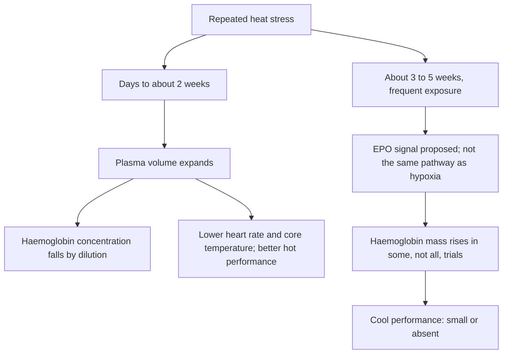

# Sleep, heat and iron

**Last checked:** 2026-10-02

This is a living brief for a trained amateur cyclist training about 7–12 hours per week, with goals of VO₂max, FTP/threshold, and general fitness. It covers [questions 15, 16, and 17](../index.md#question-map) — sleep and naps, heat acclimation and sauna, and iron. It is not a medical prescription and not a copy of a professional 20–30 hour week.

No transcript was supplied to this review. The prompt reports a candidate claim that very high-volume athletes may benefit from about 9 hours of night sleep plus naps. That claim is tested here as a hypothesis. It is not treated as a confirmed quotation from a named speaker or paper.

Navigation: [platform overview](../index.md) · [terminology](../CONTEXT.md) · [bibliography](../evidence/bibliography.md)

Reading order: [Previous — fueling and energy availability](fueling-energy-availability.md) · [Next — strength and warm-ups](strength-warmups-mobility.md).

**Question navigation:** [15 Sleep](#q15) · [16 Heat](#q16) · [17 Iron](#q17) · [Conclusions](#conclusions) · [Transfer to 7–12 h](#transfer) · [Open questions](#open) · [References](#references)

## How grades are used

Each conclusion is graded on its own, not the whole topic. Allowed grades are only **Strong evidence**, **Moderate evidence**, **Plausible but uncertain**, and **Mostly coaching practice**. A strong mechanism does not validate an exact prescription. Acute performance is not the same as a demonstrated training adaptation. Effect sizes, sample sizes, and protocol details below are taken from retrieved abstracts or, where noted, open full texts. If a number was not in the retrieved source, it is not stated. Many important trials remain **abstract-only**.

Evidence was searched through 2026-10-02. Papers with a first-publication date after that day were excluded. Europe PMC was the primary retrieval route. Web search was unavailable at the start of this investigation and was used after access was restored for original-paper discovery and 2025–2026 update scans. Search summaries were not used as quantitative evidence unless the abstract or full text was then retrieved.

## Durable conclusions

### REC-C01 — Acute sleep loss impairs physical performance; endurance is affected, but not every short night is equal

**Classification:** Strong evidence for a performance cost of substantial acute sleep loss; Moderate evidence that partial restriction over 1–3 nights is smaller and more context-dependent than total deprivation.

**Support:** Craven et al. (2022) pooled 69 publications and found sleep loss (≤6 h in 24 h versus >6 h) reduced exercise performance by a mean 7.56% (95% CI −11.9 to −3.13), including endurance, with high heterogeneity (I² = 98%). Consistent harm was seen with total deprivation and late restriction (waking earlier), not with every early-night restriction protocol. Afternoon tests were more vulnerable than morning tests. Kong et al. (2025; search to September 2024) found sleep deprivation impaired aerobic endurance in athletes (SMD −0.66, 95% CI −1.28 to −0.04) and raised RPE. Gong et al. (2024) ranked aerobic endurance among the abilities impaired by acute sleep deprivation in athletes, with a larger hit from end-of-night partial loss than from loss at the start of the night. In endurance athletes, one night of total sleep deprivation slowed a cycling time trial by about 10–11% the next day (Roberts et al., 2019, n = 13).

**Contradiction / limits:** Walsh et al. (2021 expert consensus) state that a full night without sleep reduces performance, but that partial restriction over 1–3 nights — the real-world pattern — remains unclear. Craven’s overall effect is dominated by male participants (89%) and by protocols harsher than “slept 6.5 h instead of 7.5 h.”

**Practical implication:** Protect the night before a key session or race, especially if the session is late in the day. A slightly short night is not automatically a lost workout. Do not treat one bad night as proof that the training block has failed.

**Uncertainty:** The pooled −7.6% is not a cyclist-specific time-trial effect. Heterogeneity is extreme. Sex-specific endurance data remain thin.

### REC-C02 — “9 hours plus a nap” is not a proven requirement, and short sleep in elites is often a schedule problem

**Classification:** Moderate evidence that many elite athletes sleep less than they say they need; Mostly coaching practice that training load itself creates a biological requirement for 9 h plus naps.

**Support:** Actigraphy studies find habitual athlete sleep around 6.5–7 h, not 9 h. Sargent et al. (2014): 70 nationally ranked athletes, mean 6 h 30 min asleep, less sleep before training days than rest days, and shorter sleep linked to higher pre-training fatigue. Lastella et al. (2015): 124 elite athletes, 6.8 ± 1.1 h, less in individual sports (6.5 h) than team sports (7.0 h). Sargent et al. (2021): 175 elite athletes self-rated need 8.3 ± 0.9 h but obtained 6.7 ± 0.8 h; only 3% met their own stated need; individual-sport athletes slept less despite a similar stated need. Leeder et al. (2012): Olympic athletes had poorer sleep efficiency and more fragmentation than controls, but time asleep was not clearly shorter. Walsh et al. (2021) explicitly reject a one-size 7–9 h rule and recommend individualised perceived need. They state that benefits of napping and sleep extension still need research.

**Contradiction / limits:** The 8.3 h figure is a self-report of “hours to feel rested,” not an experimentally determined optimum, and it is not 9 h. No retrieved longitudinal study shows that raising weekly cycling from 8 h to 25 h increases sleep need by a fixed amount. Early starts, not metabolic load alone, cut sleep (Sargent et al., 2014).

**Practical implication:** Ask whether you wake rested and can train, not whether you copied a professional’s 9 h plus nap. If mornings are early, the lever is bedtime and a planned nap, not an untested extra hour of biological “need.”

**Uncertainty:** Self-assessed need can be biased. Cyclists are not separated from other individual sports in these cohorts.

### REC-C03 — Sleep extension can maintain endurance performance over a few nights in trained cyclists who are extending from a short baseline; it is not proof of a chronic adaptation dose

**Classification:** Moderate evidence for short-term time-trial maintenance in one small cyclist crossover; Plausible but uncertain for weeks-long VO₂max or FTP adaptation.

**Support:** Roberts et al. (2019): 9 endurance cyclists/triathletes, crossover, three nights of time-in-bed reduced 30%, habitual, or extended 30%. Actigraphic sleep on those nights was longer in extension than in normal sleep (about 7.9–8.6 h versus about 6.5–7.1 h; restriction about 4.5–4.9 h). Versus normal sleep, the time trial was slower on day 3 of restriction (60.4 ± 3.7 vs 58.8 ± 2.5 min) and faster on day 4 of extension (56.8 ± 3.1 vs 58.7 ± 3.4 min). The authors concluded athletes should sleep >8 h/night to optimise performance. Silva et al. (2021) systematic review: only a handful of athlete extension trials (sleep increased 26–106 min); some large effects on sport measures, but evidence quality very low to moderate and bias often high. Mah et al. (2011) is the best-known extension trial and is **not** endurance cycling: 11 male collegiate basketball players, 5–7 weeks aiming for ≥10 h in bed, objective sleep +110.9 ± 79.7 min, faster sprint and about +9 percentage points shooting accuracy. Schwartz and Simon (2015) is a tennis serving-accuracy study, also not cycling.

**Contradiction / limits:** Walsh et al. (2021) still call sleep-extension benefits a research gap. Basketball and tennis skill gains do not transfer as a VO₂max result. Roberts measured repeated time trials over four days, not a training adaptation of haemoglobin mass, lactate threshold, or FTP. The authors’ “>8 h” conclusion is their interpretation of a 9-person crossover, not a dose-finding trial of 9 h versus 8 h.

**Practical implication:** If you habitually sleep about 6.5–7 h and feel flat, a few nights of genuine extension (more time in bed, not just time in bed awake) is a reasonable experiment before a key block. Do not treat 9 h plus a nap as a prerequisite for a 7–12 h week.

**Uncertainty:** No retrieved trial has extended sleep for a full mesocycle in trained cyclists and measured VO₂max or threshold change.

### REC-C04 — Naps can help acute performance and perceived fatigue; 20–30 minutes do not reliably avoid sleep inertia, and cycling time-trial evidence is thin

**Classification:** Moderate evidence for acute nap benefits in young men and team-sport tests; Plausible but uncertain as a routine endurance-cycling tool; Mostly coaching practice as a required add-on to 9 h of night sleep.

**Support:** Mesas et al. (2023): 22 randomised trials, 291 men aged 18–35 (164 athletes). After a normal night, naps from 12:30 to 16:50 improved physical performance (SMD 0.99, 95% CI 0.67 to 1.31, I² = 89%) and reduced perceived fatigue. Benefits were larger for naps of 30 to <60 min and when testing was >1 h after waking. Effects were also seen after partial sleep deprivation, on fewer studies. Boukhris et al. (2023/2024): after 7–9 h night sleep, naps improved 5 m shuttle-run distance and fatigue index, not muscle force; other endurance measures were too few for a firm conclusion. Zheng et al. (2026; search to 18 December 2025; first published 2026-07-22): 12 trials, 179 team ball-sport athletes; early-afternoon naps improved “endurance” (mostly intermittent tests) with SMD 0.96; naps >60 min had the largest endurance effect. Yu et al. (2025) narrative review suggests 13:00–15:00, 20–40 or 60–90 min depending on the night, and ≥60 min before exercise. Blanchfield et al. (2018): 11 trained male runners, afternoon nap 20 ± 10 min about 90 min before an evening run; group time-to-exhaustion was unchanged, but runners who slept <7 h at night improved, and those who slept more did not.

**Contradiction / limits:** Hilditch, Dorrian and Banks (2017) reviewed naps ≤30 min and found mixed onset of slow-wave sleep and mixed inertia. The common claim that a 20–30 min nap avoids inertia is **not** securely supported; prior sleep and time of day matter, and a blanket short-nap rule can mislead. Lastella et al. (2021) and Souabni et al. (2021) are broader athlete nap reviews; populations and tests are heterogeneous. Zheng’s “endurance” outcome is not a cycling time trial. Mesas included no women.

**Practical implication:** If the previous night was short, an early-afternoon nap can be useful. Leave at least an hour before a hard session. Do not assume a 20-minute nap is inertia-free, and do not assume a 90-minute nap is better for a cyclist just because team-sport shuttle tests improved. A nap is a countermeasure, not a second training system.

**Uncertainty:** Almost no trained-cyclist time-trial nap trials were retrieved. Whether naps add anything once night sleep is already adequate and the athlete is not sleepy is uncertain outside intermittent-sport tests.

### REC-C05 — Sleep loss can disturb muscle protein synthesis; that is not evidence that a short night blocks VO₂max or FTP adaptation

**Classification:** Moderate evidence for an acute myofibrillar protein-synthesis effect in young adults under severe restriction; Plausible but uncertain for endurance-training adaptation. Overreaching can worsen objective sleep efficiency (Moderate evidence) without a clear subjective signal.

**Support:** Saner et al. (2020): young men, five nights at 4 h in bed, lower myofibrillar protein synthesis than 8 h in bed (1.24 ± 0.21 vs 1.53 ± 0.09 %/day); three high-intensity interval sessions during the restriction period kept synthesis at control levels. Lamon et al. (2021): 13 young adults, one night of total deprivation, postprandial muscle protein synthesis −18%, cortisol +21%, testosterone −24%. These are recovery-process findings, not cycling performance trials. Murphy et al. (2024): endurance overreaching protocols (mean 16 days; cycling, rowing, triathlon, running, swimming) reduced actigraphic sleep efficiency by 2.0 percentage points (95% CI −3.2 to −0.8) with no clear subjective sleep-quality change. No included study was low risk of bias.

**Contradiction / limits:** Neither Saner nor Lamon studied trained cyclists in a training block, and neither measured VO₂max, threshold, or haemoglobin mass. High-intensity work itself preserved protein synthesis in Saner, so “do not train if sleep is short” is not what that trial showed. A search for sleep-restriction trials of VO₂ or endurance-training adaptation did not return a usable controlled cyclist study.

**Practical implication:** Repeated severe sleep debt is a recovery problem, not just a next-day power problem. It is not a reason to invent a 9-hour rule, and it is not a reason to skip all training after one short night. If you are functionally overreached, trust objective sleep and performance more than “I feel I slept fine.”

**Uncertainty:** Whether ordinary 1–2 h nightly shortfalls for a few weeks blunt mitochondrial or haematological adaptation in amateurs is untested.

### REC-C06 — Performance benefits of heat acclimation are clearer in the heat than in cool conditions

**Classification:** Strong evidence that repeated exercise-heat exposure improves subsequent performance and tolerance **in the heat**. Moderate evidence for smaller cool- or temperate-condition gains from some longer or specific protocols. Plausible but uncertain that post-exercise sauna or hot-water immersion improves cool cycling performance.

**Support:** Tyler et al. (2016) meta-analysis (96 papers): heat adaptation had a moderate benefit on exercise capacity and performance **in the heat**; regimens longer than 14 days beat shorter ones. McDonald et al. (2025) Bayesian meta-regression of exercise heat acclimation (211 papers; typical protocol about 8 exposures, 90 min, ~39°C): time-to-exhaustion +49% (90% CrI 35 to 61), incremental exercise time +14%, time-trial performance +3.1% (1.8 to 4.5), alongside lower heart rate and core temperature and plasma-volume expansion of 5.6% (3.8 to 7.0). These performance syntheses are about exercise **in the heat**, not a cool FTP test. Racinais et al. (2015) consensus: the main way to reduce heat strain and protect performance in hot sport is repeated exercise-heat exposure over 1–2 weeks. Zurawlew et al. (2016): six days of post-exercise 40°C hot-water immersion improved a 5 km treadmill time trial by 4.9% at 33°C and **not** at 18°C. Kirby et al. (2019): in eight female endurance athletes, 4 days of isothermic heat acclimation did not improve a 15 min self-paced cycling trial in 35°C; 9 days did (distance +3.2%, power +8.1% versus baseline).

**Contradiction / limits:** Lorenzo et al. (2010) reported cool (13°C) time-trial work +6% and hot (38°C) +8% after 10 days of exercise in 40°C in trained cyclists (cool VO₂max from 66.8 ± 2.1 to 70.2 ± 2.3 ml·kg⁻¹·min⁻¹), with plasma volume +6.5 ± 1.5% and no change in a cool-training control. Full text was not retrieved. The abstract says hot and cool VO₂max and lactate-threshold tests were preceded by warm or thermoneutral immersion, so the thermal state of the cool time trial is not fully resolved here. Later well-trained male cyclists doing six days of post-exercise hot-water immersion did not improve 20 km time trials at 27°C or 35°C (Kjertakov et al., first published 2025-12-23). Solomon and Laye (2025) meta-analysis of post-exercise sauna or hot-water immersion (10 studies, 199 adults): effect on hot performance trivial and imprecise (ratio of means 1.04, 95% CI 0.94–1.15); thermoneutral performance also trivial; certainty low to very low. Ahokas et al. (2025) systematic review: chronic post-exercise heat may help running in the heat; repeated heat exposure had no clear effect on cycling performance or VO₂max in the studies they included; evidence low to moderate.

**Practical implication:** Use heat primarily because you will race or ride in the heat, not as a default cool-weather FTP hack. If the goal is a hot event, active exercise in the heat has a stronger evidence base than a sauna add-on. Cool-condition gains exist in some trials and should be described as small and inconsistent, not as a second altitude camp.

**Uncertainty:** How much of Lorenzo’s cool gain would replicate in already well-trained amateurs, without the laboratory preload design, is unknown.

### REC-C07 — Plasma-volume expansion and a rise in red-cell mass are different adaptations; a lower haemoglobin concentration is often dilution

**Classification:** Strong evidence for this distinction. Strong evidence that short heat acclimation expands plasma volume and lowers thermal and cardiovascular strain. Moderate evidence that some multi-week heat-training protocols raise haemoglobin mass. Plausible but uncertain that the erythropoietic pathway is the same as hypoxia — the retrieved mechanistic review argues it is not.

**Support:** Classic heat acclimation expands plasma volume within days. Stanley et al. (2015): seven well-trained male cyclists, 30 min sauna at 87°C and 11% relative humidity immediately after training for 10 days; plasma volume peaked after four exposures at +17.8% (90% CL 7.4 to 29.2). McDonald et al. (2025): mean plasma-volume expansion 5.6% across exercise heat-acclimation studies. Rendell et al. (2017): 10 days of isothermal exercise-heat acclimation in men (VO₂max 58.5 ± 8.3 ml·kg⁻¹·min⁻¹) raised plasma volume +5.9 (7.3)% and erythropoietin +1.8 (2.4) mIU/ml, but **total haemoglobin mass was unchanged**. Scoon et al. (2007): red-cell volume +3.5% after 3 weeks of post-exercise sauna, with a confidence interval crossing zero (−0.8% to 8.1%); performance tracked plasma volume, not clearly red-cell volume. Longer protocols are a different question. Rønnestad et al. (2021): elite male cyclists, 1 h easy cycling in 37.8°C, 5 days/week for 5 weeks, haemoglobin mass +42 g versus +6 g in a cool control. Rønnestad et al. (2022): 5 × 50 min/week for 5 weeks, chamber or heat suit, haemoglobin mass +2.4% and +2.6% versus −0.7% control. Lundby et al. (2023): elite women and men, 5 × 50 min/week for 5 weeks, haemoglobin mass +4.0 ± 1.6% in women and +3.5 ± 2.3% in men; muscle citrate synthase, fibre type, and capillary density did not change. Cubel et al. (2024): elite men, six 1 h heat-suit sessions/week for 5 weeks, haemoglobin mass +30 g (+3%) at 3 weeks and +40 g (+4%) at 5 weeks, back to baseline 2 weeks after stopping.

**Contradiction / limits:** Oberholzer et al. (2019): trained male cyclists (VO₂peak 59.1 ± 5.2 ml·min⁻¹·kg⁻¹), 1 h at 60% VO₂peak in 40°C, 5 days/week for 5.5 weeks. Plasma volume rose in both heat and cold-training groups. Haemoglobin mass +34 ± 36 g versus +2 ± 33 g, interaction p = 0.061 — a tendency, not a clear effect. Reticulocytes and blood-volume hormones were unchanged. Rønnestad et al. (2022, skiers): heat-suit training raised haemoglobin mass versus control, with **no** detectable group difference in economy, VO₂max, or a 15 min performance trial. Sitkowski et al. (2022): 3 × 30 min post-exercise sauna/week for 4 weeks in students did not add haemoglobin mass or fitness beyond training; haemoglobin-mass changes stayed inside typical error (<1.8%). Jenkins et al. (2025, review) propose heat-driven erythropoiesis via renal oxygen tension, plasma-volume “critmeter” signals, or cellular stress, diverging from hypoxia-driven HIF signalling. That is a mechanistic review, not a trial. Rendell’s added overnight hypoxia did not change the heat-acclimation response, which also argues against treating heat as a mild version of altitude. Lundby and Robach (2025) conclude that 3–5 weeks of heat training repeatedly raises haemoglobin mass, but performance gains are only small, and heat should not displace the rest of elite preparation.

**Practical implication:** Do not read a fall in haemoglobin concentration after a hot week or a big training week as iron-deficiency anaemia. Concentration falls when plasma expands. Do not read a stable concentration as proof that red-cell mass did not change either. Haemoglobin mass, not a routine full blood count, is what the heat-training trials measured (carbon monoxide rebreathing).

**Uncertainty:** Whether amateurs doing 7–12 h/week, without elite baseline haemoglobin mass and without 5 weekly heat sessions, show the same red-cell response is not established. Oberholzer’s non-significant result in trained but not elite cyclists is the relevant caution.

### REC-C08 — Exact heat protocols must be copied from trials that exist; no retrieved trial specifically tested 3 × 45 min/week sauna, and daily is not automatically better

**Classification:** Moderate evidence for the specific protocols that were actually run. No retrieved trial specifically tested 3 × 45 min/week sauna, so that sauna dose should not be declared effective or ineffective. A 45-minute passive dose that was retrieved was hot-water immersion at five sessions per week, not sauna at three. The claim that daily exposure is substantially more effective than three sessions per week, for the same modality and outcome, is untested head-to-head. Mostly coaching practice if those doses are prescribed as if they were trial arms.

**Support:** Retrieved protocols are listed in [the protocol table](#protocols). The nearest intermittent sauna dose is Kirby et al. (2021): trained middle-distance runners, **3 ± 1 sessions/week of 28 ± 2 min** at **101–108°C**, 5–10% relative humidity, for 3 weeks, after normal training. Versus training alone, sauna lowered heat-tolerance rectal temperature, skin temperature, and heart rate, and improved temperate VO₂max (+0.27 L/min) and speed at 4 mmol·L⁻¹ lactate (+0.6 km/h). Extending to 7 weeks only marginally lowered rectal temperature further. A sex-comparison cohort using **29 ± 1 min, 3 ± 1 times/week** found similar temperate VO₂max (+5%) and lactate-speed gains in women and men, with different sweat-gland and forearm-blood-flow responses (Kirby et al., 2021). Scoon et al. (2007) used about **12.7 sessions in 3 weeks** (not a fixed 3×/week), **31 ± 5 min** at **89.9 ± 2.0°C** humid sauna, in six male runners. Jenkins et al. (2025; first published 2025-11-20) tested passive hot-water immersion at **≥40°C, 45 min, 5 times/week for 5 weeks** in 10 well-trained runners. Haemoglobin mass +33 g (95% CI 18 to 49), VO₂max +2.7 ml·kg⁻¹·min⁻¹ (95% CI 1.4 to 4.1). That is hot-water immersion, not sauna, and it does not stand in for an untested 3 × 45 min/week sauna dose.

**Contradiction / limits:** No retrieved trial specifically tested 3 × 45 min/week sauna. Do not collapse that gap with hot-water immersion: Jenkins et al. (2025) tested 45-minute immersion at five sessions per week, a different modality and frequency. No retrieved trial randomised 3 × 45 min/week sauna against daily sauna for the same outcome. Daily or near-daily exposure is what most short heat-acclimation studies used, and more exposures are associated with more complete thermoregulatory adaptation (Tyler et al., 2016; McDonald et al., 2025: an extra exposure associated with +1.9 g haemoglobin mass [0.6 to 3.2] in meta-regression — an across-study slope, not a promise that every extra day adds 1.9 g forever). Kirby’s ~3 sauna sessions/week still produced thermoregulatory and temperate-marker changes in runners. Three sessions/week of heat-suit training **maintained** an already elevated haemoglobin mass after a 5-week induction (Rønnestad et al., 2022) and after an altitude camp (Rønnestad et al., 2025), which is maintenance of a different stimulus, not proof that 3 × 45 min/week sauna induces the same gain from scratch. Cubel et al. (2024) used six 1 h heat-suit sessions/week, not three sauna sessions.

**Practical implication:** If you copy a protocol, copy one that was studied, including modality, population, and outcome. Do not downgrade Kirby’s ~3 × 30 min sauna result to “useless” because it was not daily. Do not upgrade a 3 × 45 min/week sauna habit to a haemoglobin-mass programme: no retrieved trial specifically tested that sauna dose. For red-cell mass, the cyclist trials that worked used about five or six 50–60 min heat or heat-suit sessions per week for about five weeks, in elites, and the gain decayed within about two weeks of stopping (Cubel et al., 2024). The passive 45-minute result is Jenkins’s 5×/week hot-water immersion in runners, not a 3×/week sauna.

**Uncertainty:** No retrieved trial specifically tested 3 × 45 min/week sauna against training alone for haemoglobin mass or a cool time trial. That is a sauna gap, not a statement that every 45-minute heat exposure is untested.

### REC-C09 — Heat is a stressor: dehydration, heat illness, and training quality matter more than maximising dose, especially for a 7–12 h amateur

**Classification:** Strong evidence that unacclimatised exercise in the heat raises thermal and cardiovascular strain and that acclimation reduces that risk. Moderate evidence that a studied post-exercise hot-water block need not worsen overreaching markers. Plausible but uncertain that evening sauna systematically wrecks sleep — one medium-term trial did not detect a sleep difference.

**Support:** Racinais et al. (2015): heat acclimatisation over 1–2 weeks is the main protective intervention; start euhydrated and limit dehydration. Daanen, Racinais and Périard (2018): after heat acclimation, about 2.5% of the heart-rate and core-temperature adaptation is lost per day without heat; re-induction is faster than the original induction. McIntyre et al. (2022): 12 days of post-exercise 40°C immersion produced fuller thermal adaptation than work-matched exercise in the heat, **without** differences in endurance capacity or overreaching markers including sleep (P ≥ 0.190). Sitkowski et al. (2022): withholding fluid during exercise and sauna did **not** add haematological or fitness benefits beyond training. Kirby et al. (2019) used permissive dehydration during isothermic acclimation; that is a laboratory choice, not a model to copy casually. Ahokas et al. (2025): acute post-exercise heat had mixed recovery effects (no effect, benefit, or harm), so heat is not a proven recovery modality.

**Contradiction / limits:** “Sauna always ruins the next session or the night’s sleep” is stronger than the retrieved trials. McIntyre did not find a sleep or mood penalty after 12 days of hot-water immersion in men. That does not clear a late, very hot sauna in a dehydrated amateur before an early alarm.

**Practical implication:** Do not prescribe maximal heat to a general amateur. If heat is used, build gradually, replace fluid, stop for confusion, collapse, or unusual distress, and do not stack it onto already poor sleep, illness, or a low-iron state. A hot-event acclimation block of roughly 1–2 weeks is the consensus use case. A five-week elite heat-suit block is not the default for a 7–12 h week. Decay is fast, so heat done a month before a hot event will not still be “in the bank” without maintenance.

**Uncertainty:** Female-specific heat-illness risk, medication interactions, and pregnancy are clinical questions, not settled by these training papers. Seek individual medical advice rather than a generic sauna dose.

### REC-C10 — Low iron stores are a real endurance problem; indiscriminate iron supplements are not the solution

**Classification:** Strong evidence that exercise can raise hepcidin and that iron treatment helps athletes with documented deficiency, including aerobic-capacity benefits in iron-deficient non-anaemic endurance athletes. Strong evidence against indiscriminate supplementation in an iron-replete athlete. A normal or high ferritin alone does not exclude iron deficiency, because ferritin is an acute-phase reactant, and it does not by itself make treatment categorically contraindicated. Moderate evidence that cycling causes less foot-strike haemolysis than running, and that one temperate cycling bout loses only a small amount of iron in sweat. Which loss route matters most is sex- and context-dependent, not a universal ranking. Mostly coaching practice to treat every endurance athlete with iron “just in case.”

**Support:** Sim et al. (2019): iron deficiency in about 15–35% of female athlete cohorts and 5–11% of male cohorts in the studies they summarised. Peeling et al. (2008) listed haemolysis, sweat, gastrointestinal bleeding, and inflammation-driven hepcidin as routes, without ranking them for every athlete. Fensham et al. (2023): exercise associated with a 1.5–2.5-fold hepcidin rise; duration explained much of the change score. Peeling et al. (2014): athletes with ferritin <30 µg/L did not show the same post-exercise hepcidin rise as those with higher stores. Clénin et al. (2015) gives operational cut-offs (<15 µg/L empty, 15–30 low, 30 µg/L a cut-off for athletes >15 years, 50 µg/L before altitude) and says long-term daily or intravenous iron in the presence of normal or high ferritin does not make sense and may be harmful. Read that as a warning against indiscriminate supplementation in an athlete assessed as replete, not as proof that one ferritin number excludes deficiency or forbids treatment. Burden et al. (2015): in iron-deficient non-anaemic endurance athletes, iron treatment had a moderate effect on VO₂max (Hedges’ g = 0.610, 95% CI 0.399 to 0.821). Šmid et al. (2024): oral iron raised ferritin mainly when baseline ferritin was ≤12 µg/L. Pengelly et al. (2025): in high-level women included at ferritin <40 µg/L, deficiency was associated with about 3–4% worse endurance. McCarthy et al. (2026): ferrous sulfate raised haemoglobin and ferritin in active females; the abstract does not show a performance benefit.

**Contradiction / limits:** Cut-offs are not universal. Clénin uses 30 µg/L, Pengelly’s review inclusion used <40 µg/L, altitude practice often uses 50 µg/L, and Šmid saw a clear ferritin response mainly at ≤12 µg/L. A laboratory “normal” range is not an athlete decision rule, and a single sports cut-off is not either (Pedlar et al., 2018; McKay et al., 2022). Ferritin is an acute-phase protein and rises with inflammation. Haemoglobin concentration falls when plasma volume expands (training or heat), which can look like anaemia or hide a true change in red-cell mass. Telford et al. (2003): 10 male triathletes, 1 h running versus cycling at 75% peak VO₂; plasma free haemoglobin rose after both, but the rise was fourfold greater after running, and haptoglobin fell after running only. Cycling is not haemolysis-free. DeRuisseau et al. (2002): 2 h of temperate cycling, sweat iron losses about 3% and 1% of the then RDA for men and women over that bout — small. Waller and Haymes (1996): exercise increased estimated sweat iron loss versus rest, but concentrations were not higher in a hotter exercise condition. Gastrointestinal blood loss is repeatedly listed for athletes, especially runners (Peeling et al., 2008). A quantified cycling-versus-running faecal-blood study with usable numbers was not retrieved here, so cycling GI loss should not be assigned a fake magnitude.

**Practical implication:** No indiscriminate supplementation in an iron-replete athlete. Treat documented deficiency under professional assessment, not a ferritin-alone rule. The clinician uses haemoglobin, ferritin, transferrin saturation or other iron markers, inflammation, symptoms, and context. Do not start iron because you train, or because haemoglobin concentration dipped after a hot or high-volume week (that dip may be plasma-volume dilution). Do arrange assessment for fatigue out of proportion to training, heavy menstrual bleeding, low energy availability, a diet very low in iron, unexplained performance loss, planned altitude, or a long heat block.

**Uncertainty:** The best ferritin threshold for a trained amateur cyclist who is not anaemic and not going to altitude is still contested. Heat-block effects on seasonal iron balance in cyclists are not well quantified.

## 15. Sleep and naps

### What was claimed, and what can be checked

The prompt’s candidate claim is that athletes at extremely high volume may benefit from about 9 hours at night plus naps. That is a hypothesis about high-volume practice, not a retrieved trial result. The literature supports three narrower statements: substantial sleep loss impairs performance; many elites sleep less than they believe they need, often because of the clock; and extension or naps can help some athletes acutely. It does not establish 9 h plus a nap as a requirement for adaptation.

### Habitual duration is not the same as need

| Study | Who | What was measured | Result that is safe to use |
| --- | --- | --- | --- |
| Leeder et al. 2012 | 47 Olympic athletes vs 20 controls | Actigraphy | Poorer efficiency (80.6 ± 6.4% vs 88.7 ± 3.6%) and more fragmentation; time asleep not significantly different |
| Sargent et al. 2014 | 70 nationally ranked athletes, 7 sports | 2 weeks actigraphy during normal training | 6 h 30 min sleep; less sleep on nights before training days; shorter sleep, higher pre-training fatigue |
| Lastella et al. 2015 | 124 elite athletes | ≥7 nights | 6.8 ± 1.1 h; individual sports 6.5 h vs team 7.0 h |
| Sargent et al. 2021 | 175 elite athletes, 12 sports | ~12 nights plus “hours to feel rested” | Need 8.3 ± 0.9 h, obtained 6.7 ± 0.8 h; 3% met their own need |

These are observational. They do not show that forcing 9 h would raise VO₂max. They do show that early training, not a mysterious extra sleep drive, is a major reason elites sleep less (Sargent et al., 2014). Walsh et al. (2021) describe habitual short sleep (<7 h) and fragmentation as common, and warn that athlete sleep studies often lack experimental control, include few women, and use tools of uncertain validity.

### Partial restriction and total deprivation

**Evidence capsule — Roberts et al. 2019 (total deprivation).** Thirteen endurance athletes, crossover. A time trial the day after a night of no sleep was 10% slower than after normal sleep (64 ± 7 vs 59 ± 4 min) and 11% slower than the same athletes’ previous-day trial. RPE relative to heart rate rose. This is an acute performance hit, not an adaptation study. Abstract-only.

**Evidence capsule — Roberts et al. 2019 (three nights).** Nine cyclists/triathletes. Restriction to about 4.5–4.9 h slowed the day-3 time trial by roughly 1.6 min versus normal sleep. Extension to roughly 8 h made the day-4 trial about 1.9 min faster than normal sleep. RPE was not different between conditions; the authors interpret the performance change as a shift in the effort of a given intensity. Abstract-only. Small, highly controlled, and the best endurance-cycling evidence retrieved.

**Evidence capsule — meta-analyses.** Craven et al. (2022) is the broadest physical-performance synthesis: harm across task types, clearest for deprivation and late restriction, about 0.4% worse per extra hour awake before the task in those protocols, and afternoon testing more affected. Kong et al. (2025) separate athletes from non-athletes and still find an aerobic-endurance decrement in athletes, with wide confidence intervals. Gong et al. (2024) agree that end-of-night loss and afternoon testing are the harsher patterns. Fullagar et al. (2015), an earlier narrative review, already emphasised submaximal prolonged work as sensitive to sleep loss; it is superseded for effect size by Craven and Kong but remains useful historically.

A night cut short at the end (alarm earlier) is not the same stress as going to bed later, and a morning test is not the same as a 6 pm interval session. That is why “any restriction hurts FTP” is too coarse.

### Extension: athletes versus basketball

Mah et al. (2011) is constantly cited and constantly over-transferred. The participants were 11 male collegiate basketball players. The outcome was sprint time and shooting, after 5–7 weeks of trying to spend 10 h in bed. It shows that extending sleep in young team-sport men who can do so may improve skill and speed. It does not show that a cyclist needs 10 h in bed, and it has no control group that kept habitual sleep while training.

Silva et al. (2021) is the retrieved systematic review focused on athlete sleep extension. Eligible trials were few. Sleep was extended by 26–106 min. Some performance effects were large, many were not, and the authors called the conclusions tentative. A 2023 open review of sleep interventions (Cunha et al., Sports Medicine – Open, DOI 10.1186/s40798-023-00599-z) was identified by web search after access was restored, but its abstract was not retrieved in this pass, so it is not used for numbers.

The endurance-relevant extension experiment remains Roberts et al. (2019), three nights, nine athletes, time-trial maintenance — not a season-long adaptation trial.

### Naps, duration, and inertia

| Question | Best retrieved answer | Grade |
| --- | --- | --- |
| Do naps help performance? | Yes, on average, in randomised trials of young men and in team-sport intermittent tests (Mesas 2023; Boukhris 2023/24; Zheng 2026) | Moderate evidence |
| Best duration? | 30 to <60 min had the clearest benefit in Mesas; >60 min looked larger for team-sport “endurance” in Zheng; 20 ± 10 min helped only short-sleeping runners in Blanchfield | Moderate evidence that one duration does not fit all |
| Does 20–30 min avoid inertia? | No reliable guarantee. Hilditch et al. (2017): mixed slow-wave sleep and mixed inertia after naps ≤30 min; a blanket industry rule is potentially misleading | Moderate evidence against the simple rule |
| Timing | Early afternoon is the studied window (Mesas; Yu 2025). Leave >60 min before the performance test when possible | Moderate evidence |
| Endurance cycling time trial? | Not established. Blanchfield is a treadmill time-to-exhaustion in runners, and the group effect was null | Insufficient |

Sleep inertia is the grogginess after waking. Longer naps that enter deep sleep can worsen it; short naps do not reliably escape it (Hilditch et al., 2017). The practical buffer in the athlete meta-analyses is at least an hour before hard work (Mesas et al., 2023; Yu et al., 2025), not a belief that 20 minutes is magically clean.

### Adaptation, not just the next session

What would count as an adaptation finding is a change in VO₂max, threshold, haemoglobin mass, economy, or training tolerance after weeks of altered sleep, with training load matched. That trial was not found. What exists is:

- acute and short-run performance loss (Craven, Kong, Gong, Roberts);
- a few nights of extension preserving time-trial speed (Roberts 2019);
- severe restriction lowering muscle protein synthesis in young men, reversed if they still did intervals (Saner 2020);
- one night of total deprivation lowering protein synthesis and shifting cortisol and testosterone (Lamon 2021);
- endurance overreaching slightly worsening sleep efficiency even when athletes do not feel it (Murphy 2024).

Bonnar et al. (2018) reviewed sleep interventions aimed at athlete performance and recovery and found the evidence base small and methodologically uneven. Vitale et al. (2019) is a sleep-hygiene narrative review, useful for behaviour, not for a dose of sleep that grows mitochondria.

So: sleep is part of recovery physiology. The leap from that sentence to “you must sleep 9 h and nap or the training does not adapt” is not evidenced.

### Do athletes need more sleep as load rises?

Sargent et al. (2014) show that **schedule** changes sleep as training days are added, especially early starts. They do not show a dose-response of sleep need against weekly hours. Individual-sport athletes sleep less than team-sport athletes despite similar stated need (Sargent et al., 2021; Lastella et al., 2015), which fits early solo training more than “harder physiology needs more sleep.” A 30 h professional week and a 10 h amateur week can both destroy sleep if the alarm is 5:30 and bedtime is midnight. The professional has more fatigue to recover from, and more opportunity for a daytime nap. Neither fact has been turned into a verified extra-hour-per-X-hours-of-riding rule.

## 16. Heat acclimation and sauna

### Two clocks, not one “blood volume” effect

Calling both “blood-volume gains” hides the difference that matters for VO₂max. Plasma volume supports stroke volume and heat tolerance and appears within days (Stanley et al., 2015; McDonald et al., 2025; Périard, Racinais and Sawka, 2015). Red-cell mass is what carries oxygen. It did not rise in a 10-day heat-acclimation study that did raise erythropoietin slightly (Rendell et al., 2017). It rose about 2–4% in several 5-week elite heat-training studies, and not clearly in a 5.5-week study of trained but not elite cyclists (Oberholzer et al., 2019). A lower haemoglobin concentration after plasma expansion can be dilution, not fewer red cells. A fall in haemoglobin concentration after heat alone is not an indication for iron. Distinguish plasma-volume dilution from possible iron deficiency through professional assessment using haemoglobin, ferritin, transferrin saturation or other iron markers, inflammation, symptoms, and context ([Pedlar et al., 2018](https://pubmed.ncbi.nlm.nih.gov/29280410/); [Šmid et al., 2024](https://pmc.ncbi.nlm.nih.gov/articles/PMC11127818/)). A low ferritin is not required before that assessment: inflammation can raise ferritin and hide deficiency, and dilution and deficiency can coexist. See [question 17](#q17).

### Hot versus cool

| Outcome | Active exercise in the heat | Post-exercise sauna or hot bath |
| --- | --- | --- |
| Lower core temperature, heart rate, earlier sweating | Strong, quantitative (Tyler 2016; McDonald 2025; Périard 2015) | Shown in several small trials (Zurawlew 2016, 2018; Kirby 2021; Stanley 2015 for plasma volume) |
| Performance in the heat | Moderate-to-large in meta-analysis; time-trial about +3% in McDonald 2025 | Single trials positive (Zurawlew 5 km +4.9% at 33°C) but 2025 meta-analysis uncertain and low certainty (Solomon and Laye) |
| Performance in cool or temperate conditions | Lorenzo 2010 positive in trained cyclists; several 5-week elite heat-training trials small or mixed; Lundby and Robach 2025: gains only small | Kirby 2021: temperate VO₂max and lactate speed up in runners. Zurawlew 2016: 18°C time trial unchanged. Kjertakov: no 20 km gain at 27°C in well-trained cyclists. Solomon 2025: trivial, imprecise |
| Haemoglobin mass | Unchanged at 10 days (Rendell). About +2–4% at 5 weeks in several elite cyclist trials. Not clear in Oberholzer | Scoon: red-cell volume change unclear. Sitkowski 3×30 min × 4 weeks: no added haemoglobin mass. Jenkins 2025 runners: 5×45 min/week × 5 weeks hot-water immersion raised haemoglobin mass |

Benefits are stronger and more consistent for **hot** performance and heat tolerance than for cool performance. Cool gains should not be sold as the reason for a sauna habit.

### Protocols that were actually run

Numbers below are from retrieved abstracts. They are not rounded into a coaching menu.

| Study | Who | Exact exposure retrieved | Main result | Does not show |
| --- | --- | --- | --- | --- |
| Scoon et al. 2007 | 6 male distance runners, crossover | 3 weeks; humid sauna 89.9 ± 2.0°C immediately post-exercise; 31 ± 5 min; 12.7 ± 2.1 sessions | Time-to-exhaustion +32% (90% CL 21–43%), equated by the authors to ~1.9% in a time trial; plasma volume +7.1% (5.6–8.7%); red-cell volume +3.5% (−0.8 to 8.1) | Not 3×45. Not cyclists. Time-to-exhaustion inflates percent gains. Red-cell change unclear |
| Stanley et al. 2015 | 7 well-trained male cyclists | 10 consecutive days; 30 min; 87°C; 11% RH; immediately after normal training | Plasma volume +17.8% (90% CL 7.4–29.2) after four exposures. No performance test | Not a performance trial. Magnitude-based inference, wide interval, n = 7 |
| Zurawlew et al. 2016 | 17 non-heat-acclimatised men | 6 consecutive days; 40 min run at 65% VO₂max in 18°C, then ≤40 min at 40°C water (n = 10) or 34°C (n = 7) | 5 km treadmill time trial +4.9% at 33°C, not at 18°C; resting rectal temperature −0.27°C | Not trained cyclists. Not cool performance |
| Zurawlew et al. 2018 | 8 endurance-trained men (~9 h/week) and 8 recreational (~3 h/week) | Same 6-day post-exercise 40°C immersion | Both groups reduced thermal strain in a 33°C run. End-exercise heart rate fell in recreational men, not clearly in the trained men | No temperate performance test in the abstract |
| Kirby et al. 2021 | 20 runners (13 female), VO₂max 56.1 ± 8.7 | 3 weeks; 28 ± 2 min; 101–108°C; 5–10% RH; 3 ± 1 times/week after training (n = 12) vs training only (n = 8) | Heat-test peak rectal temperature −0.2°C, heart rate −11 beats/min vs control; temperate VO₂max +0.27 L/min; speed at 4 mmol·L⁻¹ +0.6 km/h. 7 weeks: only a further 0.1°C rectal-temperature change | Not 45 min. Not cyclists. Haemoglobin mass not measured |
| Kirby et al. 2021, sex comparison | 26 trained runners (16 female) | 29 ± 1 min; 101–108°C; 3 ± 1/week; 3 weeks | Both sexes: heat-tolerance improvements; VO₂max +5%; lactate speed +0.4 km/h. Sweat-gland and blood-flow adaptations differed by sex | Same limits as above |
| Kirby et al. 2019 | 8 female endurance athletes, VO₂peak 47 ± 6 | 4 then 9 days; 90 min cycling in 40°C holding rectal temperature ~38.5°C; permissive dehydration | 15 min cycling trial in 35°C unchanged after 4 days; after 9 days distance +3.2%, power +8.1% vs baseline | Hot performance only. Not a sauna protocol. Small female sample |
| Lorenzo et al. 2010 | 12 trained cyclists, cool VO₂max ~67; 8 controls | 10 days, ~50% VO₂max in 40°C | Cool time-trial work +6%, hot +8%; plasma volume +6.5%. Controls unchanged | Full text not retrieved; immersion preload on some tests unresolved. Not elite. Not sauna |
| Rendell et al. 2017 | 8 men, VO₂max 58.5 | 10 days isothermal exercise-heat (target rectal temperature ~38.5°C), with or without overnight hypoxia | Plasma volume up, erythropoietin slightly up, haemoglobin mass unchanged. Small temperate performance gains. Hypoxia added nothing | Short heat is not a red-cell intervention |
| Rønnestad et al. 2021 | 23 elite male cyclists, VO₂max 76.2 | 1 h easy cycling, 37.8 ± 0.5°C, 65% RH, 5×/week, 5 weeks (n = 11) vs 15.5°C (n = 12). Tests at 16–19°C | Haemoglobin mass +42 g vs +6 g. VO₂max increase not greater than control. Small-to-moderate effects on lactate-threshold power, fatigued economy, 15 min power | Not sauna. Cool performance not clearly superior on the primary VO₂max contrast |
| Rønnestad et al. 2022, cyclists | Elite cyclists | 5 × 50 min/week, 5 weeks, heat chamber or heat suit, vs control. Then 3 sessions/week for 3 weeks in a subset | Haemoglobin mass +2.6% suit, +2.4% chamber, −0.7% control. Pooled performance index +4.9% vs +1.7%. Three sessions/week maintained the rise better than stopping | Maintenance dose is not an induction dose. Abstract-only |
| Rønnestad et al. 2022, skiers | 25 elite male skiers | 5 × 50 min/week heat suit, 5 weeks | +30 g haemoglobin mass vs control (95% CI 8.5 to 51.7). No group difference in performance determinants or a 15 min trial | Red-cell gain without a performance gain |
| Lundby et al. 2023 | 20 elite women (VO₂max 58.2) and 27 elite men (76.4) | 5 × 50 min/week, 5 weeks, inside normal training. Environment not specified in the abstract | Women +4.0 ± 1.6% haemoglobin mass (650 to 675 g); men +3.5 ± 2.3% (1008 to 1041 g). Lactate threshold, VO₂max, and 15 min power improved in thermoneutral conditions. Muscle unchanged | Not a sauna prescription. Abstract does not give chamber temperature |
| Oberholzer et al. 2019 | 21 male cyclists, VO₂peak 59 | 1 h at 60% VO₂peak in 40°C, 5 days/week, 5.5 weeks, plus usual training | Plasma volume up in heat and control. Haemoglobin-mass interaction p = 0.061 | Do not cite this as a positive haemoglobin-mass trial |
| Cubel et al. 2024 | 20 elite male cyclists | Six 1 h heat-suit sessions/week, 5 weeks | Haemoglobin mass +3% at 3 weeks, +4% at 5 weeks; back to baseline at 2-week decay. Incremental peak power +12 W; VO₂max p = 0.094. Hot time-to-exhaustion +15 min, also decayed by 2 weeks | Not three sessions. VO₂max not significant. Elite men only |
| Cubel et al. 2025/26, first published 2025-09-10 | 12 elite male cyclists; 7 also did off-season heat | 21 days live-high train-high at 3000 m; heat comparison was six 1 h sessions/week for 5 weeks | Altitude +3.5 ± 2.0% haemoglobin mass, gone 10 days after descent. In the paired subset, heat +5.4 ± 3.9%, not different from that altitude response. No performance gain after the altitude camp | Not evidence that heat and altitude share a mechanism. Small paired n |
| Rønnestad et al. 2025 | 18 elite male cyclists, VO₂max 76 ± 5 | After 3 weeks at ~2100 m, 3 heat sessions/week for 3.5 weeks, subtracted from usual training, vs usual training. Title specifies heat suit; session duration not in the retrieved abstract | Altitude camp +4.1% haemoglobin mass. Heat maintained it (0.2%) vs −3.3% in controls. Heat also raised plasma volume 11.6% | Maintenance after altitude, not a sea-level induction protocol. Duration not verified |
| Jenkins et al. 2025, runners, first published 2025-11-20 | 10 well-trained runners (9 male), VO₂max 64.5 ± 8.1; crossover | Hot-water immersion ≥40°C, 45 min, 5×/week, 5 weeks, plus habitual training, vs time-matched control | Haemoglobin mass +33 g (95% CI 18–49); blood volume +284 ml; VO₂max +2.7 ml·kg⁻¹·min⁻¹ (1.4–4.1) | Not 3×/week. Not cyclists. Not sauna. Small sample |
| Sitkowski et al. 2022 | 13 physical-education students, crossover | 3×/week, 4 weeks, 60 min cycling plus 30 min sauna at 89 ± 3°C, 10% RH, **no fluid** during exercise or sauna | No added haemoglobin mass, erythropoietin benefit, or fitness versus training alone. Changes inside typical error | Closest “3× sauna” trial retrieved, and it was negative for red-cell mass. Students, fluid withheld, 30 not 45 min |
| Kjertakov et al., first published 2025-12-23 | 16 well-trained male cyclists | 6 days; 40 min at 50% peak power in ~14°C, then 40 min hot or thermoneutral water | Lower thermal sensation and some heart-rate/RPE changes at 27°C. No 20 km time-trial benefit at 27°C or 35°C | Short passive heat is a poor substitute for active heat acclimation in trained cyclists |
| McIntyre et al. 2022 | Men; recreational training model | Up to 12 days; run at 65% VO₂peak then 40°C bath, vs exercise at 33°C or 19°C | 12 days of immersion gave fuller thermal adaptation than exercise-heat, without a detected sleep or mood overreaching signal | Not elite cyclists. Not a cool performance win (endurance capacity did not differ) |

### Does 3 × 45 min/week sauna work? Is daily better?

**No retrieved trial specifically tested 3 × 45 min/week sauna.** Saying that sauna dose fails would be an inference from absence. Saying it works would be an inference from nearby doses. Hot-water immersion is a different modality: Jenkins et al. (2025) tested 45 min at five sessions per week, not three sauna sessions.

Nearby facts, which must not be collapsed into one prescription:

- About **3 × 28–29 min/week** of very hot sauna for **3 weeks** improved heat tolerance and temperate running markers in young runners (Kirby et al., 2021). Haemoglobin mass was not measured.
- About **4 sessions/week × 31 min** for 3 weeks improved runner time-to-exhaustion and plasma volume; red-cell volume was unclear (Scoon et al., 2007).
- **3 × 30 min/week for 4 weeks** of post-exercise sauna without drinking did not beat training alone for haemoglobin mass in students (Sitkowski et al., 2022).
- **5 × 45 min/week for 5 weeks** of ≥40°C immersion raised haemoglobin mass and VO₂max in 10 runners (Jenkins et al., 2025). That is the 45-minute passive dose that exists, and it was daily on weekdays for five weeks, not three times.
- **5 × 50–60 min/week of exercise in heat or a heat suit for 5 weeks** is the cyclist haemoglobin-mass protocol with repeated positive trials (Rønnestad, Lundby, Cubel). Three sessions/week has been tested as **maintenance**, not as the induction dose.
- **Daily** exposure for 6–14 days is the pattern that builds short-term heat tolerance (Tyler, Racinais, Zurawlew, Kirby 2019: 9 days beat 4 days for hot cycling in women). Daily is better supported for **becoming heat tolerant quickly**. It has not been shown, in a head-to-head trial, to be substantially better than 3×/week for cool cycling performance or for haemoglobin mass.

### Heat training is not hypoxia

Altitude raises haemoglobin mass by sustained hypoxaemia and erythropoietin. Heat may also raise erythropoietin, but the proposed drivers are different: acute renal blood-flow redistribution, a plasma-volume signal that the kidney reads as low oxygen-carrying concentration, or other cellular stress (Jenkins et al., 2025, review). Rendell et al. (2017) added moderate overnight hypoxia to 10-day heat acclimation and did not change the adaptation. Cubel et al. (2025/26) found a similar haemoglobin-mass percent change after a 5-week heat block and a later 21-day camp at 3000 m in seven elites, which is a within-athlete comparison of magnitude, not proof of a shared mechanism. Nybo, Rønnestad and Lundby (first published 2022) discuss heat as an alternative or adjunct to altitude for stage-race preparation; that paper is perspective and experience, not a trial.

Do not stack “heat plus altitude plus iron” as if they were one lever. Iron sufficiency matters **before** an altitude camp (Clénin et al., 2015, ferritin target 50 µg/L in that consensus). Heat does not remove the post-exercise hepcidin rise (Sumi et al., 2022).

### Recovery, dehydration, sleep, and the next session

- **Dehydration.** Heat acclimation increases sweat rate (McDonald et al., 2025: +163 ml/h, 90% CrI 94 to 226). Racinais et al. (2015) tell athletes to start euhydrated and limit dehydration. Withholding fluid during sauna did not buy extra haemoglobin mass (Sitkowski et al., 2022). Permissive dehydration appears in some laboratory acclimation protocols (Kirby et al., 2019) and is a poor amateur default.
- **Heat illness.** Acclimation lowers risk; it does not remove it. Stop the exposure for neurological symptoms, collapse, or distress that does not match the workout. This brief does not set a core-temperature target for home saunas.
- **Next-day quality.** A five-week block of five or six extra heat hours is a large fraction of a 7–12 h week. Lundby and Robach (2025) say heat training should not be done at the expense of the rest of elite preparation. That warning is stricter, not looser, for an amateur whose quality sessions are already scarce.
- **Sleep.** McIntyre et al. (2022) did not detect a sleep difference as an overreaching marker after 12 days of post-exercise hot-water immersion. That is the retrieved controlled observation. It does not prove that a late, dehydrating sauna is sleep-neutral. Evening heat is a plausible sleep-onset risk because sleep onset prefers a falling core temperature; that mechanism was not tested as an outcome in the trials retrieved here, so it stays **Plausible but uncertain**.
- **Decay.** Thermoregulatory adaptation fades by roughly 2.5% per day off heat for heart rate and core temperature (Daanen et al., 2018). Cubel et al. (2024) found both hot performance and the haemoglobin-mass gain gone at a two-week decay test. Heat done “sometime in base” will not still be present for a July event unless it is maintained.

## 17. Iron and why supplements are not a default

### Why stores fall, and what is smaller in cycling

| Route | What the retrieved evidence supports | Cycling versus running |
| --- | --- | --- |
| Hepcidin after exercise | 1.5–2.5-fold rise; duration is a major driver of the change; peak discussed at 3–6 h (Fensham et al., 2023; Peeling et al., 2014) | Applies to hard cycling sessions, not only running. Low ferritin blunts the rise (Peeling et al., 2014) |
| Foot-strike haemolysis | Running caused a fourfold greater rise in plasma free haemoglobin than cycling at the same VO₂; haptoglobin fell after running only (Telford et al., 2003, 10 male triathletes, 1 h at 75% peak VO₂) | Cycling still caused some haemolysis. It is not the dominant route that running studies describe |
| Sweat | 2 h temperate cycling: sweat iron about 3% (men) and 1% (women) of the then RDA for that bout (DeRuisseau et al., 2002). Exercise increased estimated loss versus rest; hotter exercise did not simply mean higher iron concentration (Waller and Haymes, 1996) | A single temperate bout is a small absolute loss. Whether that is smaller than menstrual loss or hepcidin-limited absorption depends on sex, menstrual blood loss, and how often hard sessions raise hepcidin |
| Gastrointestinal blood | Listed as a mechanism in athlete reviews (Peeling et al., 2008). Quantified cycling faecal-blood loss was not retrieved | Do not assume runner GI-bleed numbers apply to the bike |
| Menstrual loss | Heavy menstrual bleeding was self-reported by 54% of an online exercising sample, 36% of London Marathon registrants, and 37% of elite respondents; associated with self-reported anaemia and iron use; only 22% had sought medical advice (Bruinvels et al., 2016). Survey, not a measured iron-balance study | A major sex-specific route when bleeding is heavy. Not caused by cycling, and not removed by cycling. Not a universal ranking above hepcidin or sweat for every athlete |
| Heat | 10 days of exercise-heat acclimation tended to lower sweat iron concentration (~75%, p = 0.07) as sweat sodium fell (Chinevere et al., 2008, arm sweat, n = 8 men). 10 days of training in 35°C improved thermoregulation but did **not** blunt the hepcidin rise to a subsequent hot session (Sumi et al., 2022) | Heat can add sweat loss and does not switch off the absorption block. It is not a reason to start iron blindly |

Sim et al. (2019) also flag low energy availability, diet, sex hormones, and altitude as modifiers. A 7–12 h cyclist who eats little iron, has heavy periods, or is in low energy availability can be iron-depleted without ever running. A 25 h professional has more hepcidin pulses and more sweat hours, which is why teams monitor; it is not why every amateur should supplement.

### What ferritin and haemoglobin can and cannot say

**Ferritin** estimates storage iron. It also rises in inflammation, so a “normal” value during illness or immediately after a very hard race can hide low stores (Pedlar et al., 2018). Peeling et al. (2014) showed the post-exercise hepcidin response itself depends on baseline ferritin. McKay et al. (2022) is a methods review: timing of blood draws, screening, and which marker is used change the answer. A single ferritin without context is not a diagnosis.

**Haemoglobin concentration** is not haemoglobin mass. Plasma volume expands with endurance training and with heat (Stanley, Oberholzer, McDonald). Concentration can fall while red-cell mass is stable or even rising. That dilutional picture is sometimes called sports pseudoanaemia. The reverse error also happens: a heat-training study can raise haemoglobin mass while concentration looks unimpressive because plasma expanded too (Rønnestad et al., 2025 reported both a preserved haemoglobin mass and an 11.6% plasma-volume rise in the heat-maintenance group).

**There is no universal cut-off.** Use these as published operational definitions, not as a personal target to chase with pills:

| Source | Figure | What it is |
| --- | --- | --- |
| Clénin et al. 2015 | <15 µg/L empty; 15–30 low; 30 µg/L cut-off for athletes >15 years; 50 µg/L before altitude | Swiss sports-medicine consensus, not a randomised threshold trial |
| Pengelly et al. 2025 | Inclusion at <40 µg/L for high-level women | Review definition, tied to a 3–4% endurance association in that literature |
| Šmid et al. 2024 | Ferritin rose clearly after oral iron mainly if baseline ≤12 µg/L | Meta-analysis of supplementation response, not a screening rule |
| Laboratory reference ranges | Often lower than sports cut-offs | Population norms, not proof that an athlete is fine or deficient |

Professional teams monitor serially, with menstrual history, symptoms, diet, and sometimes C-reactive protein or transferrin saturation. That practice is context. Copying a team’s internal flag of “ferritin under 50, start iron” without the rest of the work-up is how replete athletes get supplemented.

### When iron treatment helps, and when it does not

Burden et al. (2015) is the clearest endurance meta-analysis for **iron-deficient non-anaemic** athletes: iron treatment improved ferritin, serum iron, transferrin saturation, haemoglobin concentration, and VO₂max. That is treatment of a deficiency, not an ergogenic in people who already have stores.

Šmid et al. (2024) warn the other direction: if ferritin is not low, oral iron does little to ferritin, and the VO₂max signal is a non-significant trend of low-quality evidence. Doses in trials that moved blood markers were about 16–100 mg elemental iron daily for 6–8 weeks; shorter protocols were ineffective. Those doses are descriptions of trials, not a recommendation to start 100 mg tomorrow.

Pengelly et al. (2025) support a real endurance cost of iron deficiency in high-level women and a benefit of treatment in deficient athletes. Sample sizes were small. McCarthy et al. (2026) confirm that ferrous sulfate raises haemoglobin and ferritin in active females; the retrieved abstract does not establish a performance effect of diet or supplement strategies in general.

Clénin et al. (2015) say athletes with repeatedly low ferritin may benefit from intermittent oral substitution, and that long-term daily oral or intravenous iron when ferritin is normal or high does not make sense and may be harmful. That warning is about athletes assessed as replete, not a ferritin-alone rule: a single “normal” ferritin during inflammation can mask deficiency (Pedlar et al., 2018). Clénin (2017) discusses treatment of iron deficiency without anaemia and is not a licence to supplement every normal ferritin, nor a ban on treating deficiency that a fuller panel would still show. Pedlar et al. (2018) add that nutrition, rest, and leaving altitude can restore balance, and that injection is a time-critical clinical decision, not a routine.

**Why not “just in case”:**

1. If the athlete is iron-replete on a proper assessment, trials do not show a meaningful ferritin or performance return from extra iron (Šmid et al., 2024; Clénin et al., 2015). Repletion is not “one ferritin in the reference range.”
2. Excess iron is not inert. The consensus language is that unnecessary oral or intravenous iron may be harmful. This brief does not catalogue toxicity doses.
3. Iron tablets cause gastrointestinal symptoms, which can themselves hurt training. That is a reason deficient athletes sometimes need a clinician-chosen schedule, not a reason for replete athletes to start.
4. A hard session already raises hepcidin for several hours (Fensham et al., 2023). Adding iron in an iron-replete athlete does not bypass that biology in a way that improves cycling. Timing iron away from the hepcidin peak is a clinical detail for documented deficiency, not a reason to supplement everyone.
5. A low haemoglobin concentration after heat or a volume block may be dilution. Supplementing from that number alone can miss a real deficiency or treat a non-deficiency. Confirmation belongs to a clinician using haemoglobin, ferritin, transferrin saturation or another iron marker, and inflammation — not ferritin alone, and not haemoglobin concentration alone.

**When professional assessment is warranted, without turning this page into a protocol:** symptoms of anaemia or unexplained performance loss; heavy menstrual bleeding (Bruinvels et al., 2016 — most women in that survey had not sought advice); known low ferritin on a previous test; low energy availability or a diet very low in iron; planned altitude; a long heat block if stores are already borderline; gastrointestinal symptoms or blood loss. The clinician, not the training plan, decides whether to supplement, how, and when to retest. Twice-yearly baseline bloods in athletes who have had low values is the Clénin monitoring suggestion, not a mandate to blood-test every amateur monthly.

## 7–12 hours versus 20–30 hours

| Topic | What high-volume practice often does | What transfers to 7–12 h | What does not transfer |
| --- | --- | --- | --- |
| Sleep | Early starts, travel, and a nap culture. Elites often get ~6.5–7 h and say they need ~8.3 h (Sargent 2021) | Protect a consistent night. Extend if you are short and sleepy. Nap if the previous night failed, with a buffer before hard work | A rule of 9 h plus a nap. The idea that each extra training hour requires a proven extra sleep hour |
| Heat for hot events | 1–2 weeks of exercise-heat or a supervised add-on before a hot race (Racinais 2015) | Same goal if **you** will be hot: short active acclimation, fluid, respect decay | Copying a team’s daily sauna in a cool climate “because the pros do it” |
| Heat for haemoglobin mass | 5–6 × 50–60 min/week for ~5 weeks inside an already large week, in elites, with carbon-monoxide rebreathing to check it worked (Rønnestad, Lundby, Cubel) | The mechanism lesson: plasma volume ≠ red cells; gains decay in about 2 weeks; performance gains are small | Adding 5 h of heat suit to a 9 h week. Expecting a 3 × 45 min sauna to reproduce elite haemoglobin-mass trials |
| Iron | Serial monitoring, dietetic support, treatment of confirmed deficiency, altitude targets | Same decision rule: test in context, treat deficiency, do not supplement the replete | Routine iron because volume is “high,” or because haemoglobin concentration moved after a hot week |

A 7–12 h amateur is not a scaled 30 h professional. The amateur’s scarce resource is often sleep opportunity and recovered quality sessions, not missing heat stress. Heat and extra sleep are recovery-sensitive. Spending them badly can remove the VO₂ and threshold sessions that have a stronger training evidence base than an untested sauna dose.

## Open questions

- Does partial sleep restriction of 1–2 h, sustained for a real training mesocycle, change VO₂max, threshold, or haemoglobin mass in trained cyclists of both sexes? Not found.
- Is there a cyclist time-trial trial of nap duration (20 vs 40 vs 90 min) with inertia measured, after normal sleep and after restriction? Not found. Blanchfield is the closest endurance study and used time-to-exhaustion in runners.
- Would 3 × 45 min/week sauna for 3–5 weeks raise haemoglobin mass or cool time-trial performance in trained amateur cyclists versus training alone? No retrieved trial specifically tested that sauna dose. Do not fill the gap with Kirby’s ~3 × 30 min runner sauna data or with Jenkins’s 5 × 45 min/week hot-water immersion, which is a different modality and frequency.
- Why did Oberholzer et al. (2019) not clearly raise haemoglobin mass with a 5.5-week exercise-heat dose that looks similar on paper to later elite heat-training trials? Population, intensity, humidity, and how “heat training” was layered on other work are unresolved without a direct comparison.
- Do cool-condition gains in elite heat-training trials survive when the heat sessions replace, rather than add to, existing easy volume? Rønnestad et al. (2025) subtracted maintenance sessions from usual training after altitude; most induction trials added heat sessions. The amateur case is usually replacement, not addition.
- What ferritin threshold, if any, improves **cycling** performance in non-anaemic trained men and women who are not going to altitude? Existing cut-offs disagree, and cycling-specific trials were not separated in the metas used here.
- How large are cumulative sweat and gastrointestinal iron losses in cyclists across a hot training block, compared with hepcidin-limited absorption and, where relevant, menstrual loss? Per-bout sweat losses look small, but relative importance is sex- and context-dependent. A season-long cyclist balance study was not retrieved.

## References

Access labels: **A** = abstract retrieved; **OA-A** = open full text exists and the abstract was retrieved; claims in this brief follow the retrieved abstract unless noted. Web-search identification alone is not listed as a result source.

### Sleep

- Walsh NP, et al. Sleep and the athlete: narrative review and 2021 expert consensus recommendations. *Br J Sports Med.* 2021. DOI [10.1136/bjsports-2020-102025](https://doi.org/10.1136/bjsports-2020-102025). PMID 33144349. A.
- Craven J, et al. Effects of acute sleep loss on physical performance: a systematic and meta-analytical review. *Sports Med.* 2022. DOI [10.1007/s40279-022-01706-y](https://doi.org/10.1007/s40279-022-01706-y). PMID 35708888. OA-A.
- Kong Y, et al. Effects of sleep deprivation on sports performance and perceived exertion in athletes and non-athletes. *Front Physiol.* 2025. DOI [10.3389/fphys.2025.1544286](https://doi.org/10.3389/fphys.2025.1544286). PMID 40236824. OA-A.
- Gong M, et al. Effects of acute sleep deprivation on sporting performance in athletes. *Nat Sci Sleep.* 2024. DOI [10.2147/NSS.S467531](https://doi.org/10.2147/NSS.S467531). PMID 39006249. OA-A.
- Roberts SSH, et al. Extended sleep maintains endurance performance better than normal or restricted sleep. *Med Sci Sports Exerc.* 2019. DOI [10.1249/MSS.0000000000002071](https://doi.org/10.1249/MSS.0000000000002071). PMID 31246714. A.
- Roberts SSH, et al. Effects of total sleep deprivation on endurance cycling performance. *J Sports Sci.* 2019. DOI [10.1080/02640414.2019.1661561](https://doi.org/10.1080/02640414.2019.1661561). PMID 31526108. A.
- Mah CD, et al. The effects of sleep extension on the athletic performance of collegiate basketball players. *Sleep.* 2011. DOI [10.5665/SLEEP.1132](https://doi.org/10.5665/SLEEP.1132). PMID 21731144. OA-A.
- Silva AC, et al. Sleep extension in athletes: what we know so far — a systematic review. *Sleep Med.* 2021. DOI [10.1016/j.sleep.2020.11.028](https://doi.org/10.1016/j.sleep.2020.11.028). PMID 33352457. A.
- Schwartz J, Simon RD. Sleep extension improves serving accuracy. *Physiol Behav.* 2015. DOI [10.1016/j.physbeh.2015.08.035](https://doi.org/10.1016/j.physbeh.2015.08.035). PMID 26325012. A.
- Sargent C, et al. The impact of training schedules on the sleep and fatigue of elite athletes. *Chronobiol Int.* 2014. DOI [10.3109/07420528.2014.957306](https://doi.org/10.3109/07420528.2014.957306). PMID 25222347. A.
- Sargent C, et al. How much sleep does an elite athlete need? *Int J Sports Physiol Perform.* 2021. DOI [10.1123/ijspp.2020-0896](https://doi.org/10.1123/ijspp.2020-0896). PMID 34021090. A.
- Lastella M, et al. Sleep/wake behaviours of elite athletes from individual and team sports. *Eur J Sport Sci.* 2015. DOI [10.1080/17461391.2014.932016](https://doi.org/10.1080/17461391.2014.932016). PMID 24993935. A.
- Leeder J, et al. Sleep duration and quality in elite athletes measured using wristwatch actigraphy. *J Sports Sci.* 2012. DOI [10.1080/02640414.2012.660188](https://doi.org/10.1080/02640414.2012.660188). PMID 22329779. A.
- Mesas AE, et al. Is daytime napping an effective strategy to improve sport-related cognitive and physical performance and reduce fatigue? *Br J Sports Med.* 2023. DOI [10.1136/bjsports-2022-106355](https://doi.org/10.1136/bjsports-2022-106355). PMID 36690376. A.
- Boukhris O, et al. The impact of daytime napping following normal night-time sleep on physical performance. *Sports Med.* 2024. DOI [10.1007/s40279-023-01920-2](https://doi.org/10.1007/s40279-023-01920-2). PMID 37700141. OA-A.
- Zheng J, et al. The effect of daytime napping on the athletic performance of team ball sports athletes. *Front Physiol.* 2026. DOI [10.3389/fphys.2026.1878224](https://doi.org/10.3389/fphys.2026.1878224). PMID 42558951. First published 2026-07-22. OA-A.
- Yu H, et al. The effects, mechanisms and strategies of daytime napping on athletes: a narrative review. *Eur J Appl Physiol.* 2025. DOI [10.1007/s00421-025-05724-2](https://doi.org/10.1007/s00421-025-05724-2). PMID 39922927. A.
- Lastella M, et al. To nap or not to nap? A systematic review. *Nat Sci Sleep.* 2021. DOI [10.2147/NSS.S315556](https://doi.org/10.2147/NSS.S315556). PMID 34194254. OA-A.
- Souabni M, et al. Benefits of daytime napping opportunity on physical and cognitive performances. *Sports Med.* 2021. DOI [10.1007/s40279-021-01482-1](https://doi.org/10.1007/s40279-021-01482-1). PMID 34043185. A.
- Hilditch CJ, Dorrian J, Banks S. A review of short naps and sleep inertia. *Sleep Med.* 2017. DOI [10.1016/j.sleep.2016.12.016](https://doi.org/10.1016/j.sleep.2016.12.016). PMID 28366332. A.
- Blanchfield AW, et al. The influence of an afternoon nap on the endurance performance of trained runners. *Eur J Sport Sci.* 2018. DOI [10.1080/17461391.2018.1477180](https://doi.org/10.1080/17461391.2018.1477180). PMID 29851569. A.
- Saner NJ, et al. The effect of sleep restriction, with or without high-intensity interval exercise, on myofibrillar protein synthesis. *J Physiol.* 2020. DOI [10.1113/JP278828](https://doi.org/10.1113/JP278828). PMID 32078168. OA-A.
- Lamon S, et al. The effect of acute sleep deprivation on skeletal muscle protein synthesis. *Physiol Rep.* 2021. DOI [10.14814/phy2.14660](https://doi.org/10.14814/phy2.14660). PMID 33400856. OA-A.
- Murphy C, et al. Does overreaching from endurance-based training impair sleep? *PLoS One.* 2024. DOI [10.1371/journal.pone.0303748](https://doi.org/10.1371/journal.pone.0303748). PMID 38809828. OA-A.
- Bonnar D, et al. Sleep interventions designed to improve athletic performance and recovery: a systematic review. *Sports Med.* 2018. DOI [10.1007/s40279-017-0832-x](https://doi.org/10.1007/s40279-017-0832-x). PMID 29352373. A.
- Fullagar HH, et al. Sleep and athletic performance. *Sports Med.* 2015. DOI [10.1007/s40279-014-0260-0](https://doi.org/10.1007/s40279-014-0260-0). PMID 25315456. A.
- Vitale KC, et al. Sleep hygiene for optimizing recovery in athletes. *Int J Sports Med.* 2019. DOI [10.1055/a-0905-3103](https://doi.org/10.1055/a-0905-3103). PMID 31288293. OA-A.

### Heat

- Tyler CJ, et al. The effects of heat adaptation on physiology, perception and exercise performance in the heat: a meta-analysis. *Sports Med.* 2016. DOI [10.1007/s40279-016-0538-5](https://doi.org/10.1007/s40279-016-0538-5). PMID 27106556. A.
- McDonald P, et al. Influence of exercise heat acclimation protocol characteristics on adaptation kinetics. *Compr Physiol.* 2025. DOI [10.1002/cph4.70017](https://doi.org/10.1002/cph4.70017). PMID 40442924. OA-A.
- Solomon TPJ, Laye MJ. The effect of post-exercise heat exposure on endurance exercise performance: a systematic review and meta-analysis. *BMC Sports Sci Med Rehabil.* 2025. DOI [10.1186/s13102-024-01038-6](https://doi.org/10.1186/s13102-024-01038-6). PMID 39762944. OA-A.
- Ahokas EK, et al. Effects of post-exercise heat exposure on acute recovery and training-induced performance adaptations: a systematic review. *Sports Med Open.* 2025. DOI [10.1186/s40798-025-00910-0](https://doi.org/10.1186/s40798-025-00910-0). PMID 41032138. OA-A.
- Périard JD, Racinais S, Sawka MN. Adaptations and mechanisms of human heat acclimation. *Scand J Med Sci Sports.* 2015. DOI [10.1111/sms.12408](https://doi.org/10.1111/sms.12408). PMID 25943654. A.
- Racinais S, et al. Consensus recommendations on training and competing in the heat. *Br J Sports Med.* 2015. DOI [10.1136/bjsports-2015-094915](https://doi.org/10.1136/bjsports-2015-094915). PMID 26069301. OA-A.
- Daanen HAM, Racinais S, Périard JD. Heat acclimation decay and re-induction: a systematic review and meta-analysis. *Sports Med.* 2018. DOI [10.1007/s40279-017-0808-x](https://doi.org/10.1007/s40279-017-0808-x). PMID 29129022. OA-A.
- Scoon GS, et al. Effect of post-exercise sauna bathing on the endurance performance of competitive male runners. *J Sci Med Sport.* 2007. DOI [10.1016/j.jsams.2006.06.009](https://doi.org/10.1016/j.jsams.2006.06.009). PMID 16877041. A.
- Stanley J, et al. Effect of sauna-based heat acclimation on plasma volume and heart rate variability. *Eur J Appl Physiol.* 2015. DOI [10.1007/s00421-014-3060-1](https://doi.org/10.1007/s00421-014-3060-1). PMID 25432420. A.
- Zurawlew MJ, et al. Post-exercise hot water immersion induces heat acclimation and improves endurance exercise performance in the heat. *Scand J Med Sci Sports.* 2016. DOI [10.1111/sms.12638](https://doi.org/10.1111/sms.12638). PMID 26661992. A.
- Zurawlew MJ, Mee JA, Walsh NP. Post-exercise hot water immersion elicits heat acclimation adaptations in endurance trained and recreationally active individuals. *Front Physiol.* 2018. DOI [10.3389/fphys.2018.01824](https://doi.org/10.3389/fphys.2018.01824). PMID 30618833. OA-A.
- Kirby NV, et al. Intermittent post-exercise sauna bathing improves markers of exercise capacity in hot and temperate conditions. *Eur J Appl Physiol.* 2021. DOI [10.1007/s00421-020-04541-z](https://doi.org/10.1007/s00421-020-04541-z). PMID 33211153. OA-A.
- Kirby NV, et al. Sex differences in adaptation to intermittent post-exercise sauna bathing. *Sports Med Open.* 2021. DOI [10.1186/s40798-021-00342-6](https://doi.org/10.1186/s40798-021-00342-6). PMID 34297227. OA-A.
- Kirby NV, Lucas SJE, Lucas RAI. Nine-, but not four-days heat acclimation improves self-paced endurance performance in females. *Front Physiol.* 2019. DOI [10.3389/fphys.2019.00539](https://doi.org/10.3389/fphys.2019.00539). PMID 31156449. OA-A.
- Lorenzo S, et al. Heat acclimation improves exercise performance. *J Appl Physiol.* 2010. DOI [10.1152/japplphysiol.00495.2010](https://doi.org/10.1152/japplphysiol.00495.2010). PMID 20724560. A. Full text not used.
- Rendell RA, et al. Effects of 10 days of separate heat and hypoxic exposure on heat acclimation and temperate exercise performance. *Am J Physiol Regul Integr Comp Physiol.* 2017. DOI [10.1152/ajpregu.00103.2017](https://doi.org/10.1152/ajpregu.00103.2017). PMID 28592459. A.
- Rønnestad BR, et al. Five weeks of heat training increases haemoglobin mass in elite cyclists. *Exp Physiol.* 2021. DOI [10.1113/EP088544](https://doi.org/10.1113/EP088544). PMID 32436633. A.
- Rønnestad BR, et al. Heat training efficiently increases and maintains hemoglobin mass and temperate endurance performance in elite cyclists. *Med Sci Sports Exerc.* 2022. DOI [10.1249/MSS.0000000000002928](https://doi.org/10.1249/MSS.0000000000002928). PMID 35394464. A.
- Rønnestad BR, et al. Heat suit training increases hemoglobin mass in elite cross-country skiers. *Scand J Med Sci Sports.* 2022. DOI [10.1111/sms.14156](https://doi.org/10.1111/sms.14156). PMID 35305278. OA-A.
- Lundby C, et al. Hematological, skeletal muscle fiber, and exercise performance adaptations to heat training in elite female and male cyclists. *J Appl Physiol.* 2023. DOI [10.1152/japplphysiol.00115.2023](https://doi.org/10.1152/japplphysiol.00115.2023). PMID 37262101. A.
- Oberholzer L, et al. Hematological adaptations to prolonged heat acclimation in endurance-trained males. *Front Physiol.* 2019. DOI [10.3389/fphys.2019.01379](https://doi.org/10.3389/fphys.2019.01379). PMID 31749713. OA-A.
- Cubel C, et al. Time-course for onset and decay of physiological adaptations in endurance trained athletes undertaking prolonged heat acclimation training. *Temperature.* 2024. DOI [10.1080/23328940.2024.2383505](https://doi.org/10.1080/23328940.2024.2383505). PMID 39583901. OA-A.
- Cubel C, et al. Haematological adaptations to high-altitude and heat acclimation training in elite male cyclists. *Exp Physiol.* 2026. DOI [10.1113/EP092968](https://doi.org/10.1113/EP092968). PMID 40929090. First published 2025-09-10. OA-A.
- Rønnestad BR, et al. Heat suit training preserves the increased hemoglobin mass after altitude camp in elite cyclists. *Med Sci Sports Exerc.* 2025. DOI [10.1249/MSS.0000000000003542](https://doi.org/10.1249/MSS.0000000000003542). PMID 39160765. A.
- Jenkins EJ, et al. Long-term passive heat acclimation enhances maximal oxygen consumption via haematological and cardiac adaptation in endurance runners. *J Physiol.* 2025. DOI [10.1113/JP289874](https://doi.org/10.1113/JP289874). PMID 41267396. First published 2025-11-20. A.
- Jenkins EJ, et al. Mechanisms of haemoglobin mass expansion following heat stress. *J Physiol.* 2025. DOI [10.1113/JP288997](https://doi.org/10.1113/JP288997). PMID 40836483. A. Mechanistic review.
- Lundby C, Robach P. Altitude or heat training to increase haemoglobin mass and endurance exercise performance in elite sport. *J Physiol.* 2025. DOI [10.1113/JP287700](https://doi.org/10.1113/JP287700). PMID 41139221. A.
- Nybo L, Rønnestad B, Lundby C. High or hot — perspectives on altitude camps and heat-acclimation training. *Scand J Med Sci Sports.* 2024. DOI [10.1111/sms.14268](https://doi.org/10.1111/sms.14268). PMID 36350277. First published 2022-12-22. A. Perspective.
- Sitkowski D, et al. Hematological adaptations to post-exercise sauna bathing with no fluid intake. *Res Q Exerc Sport.* 2022. DOI [10.1080/02701367.2021.1921684](https://doi.org/10.1080/02701367.2021.1921684). PMID 34727008. A.
- Kjertakov M, Aughey R, Petersen A. Limited benefit of repeated post-exercise hot water immersion on exercise performance of well-trained cyclists. *Eur J Appl Physiol.* 2026. DOI [10.1007/s00421-025-06041-4](https://doi.org/10.1007/s00421-025-06041-4). PMID 41432746. First published 2025-12-23. A.
- McIntyre RD, et al. A comparison of medium-term heat acclimation by post-exercise hot water immersion or exercise in the heat. *Am J Physiol Regul Integr Comp Physiol.* 2022. DOI [10.1152/ajpregu.00315.2021](https://doi.org/10.1152/ajpregu.00315.2021). PMID 36094449. OA-A.

### Iron

- Sim M, et al. Iron considerations for the athlete: a narrative review. *Eur J Appl Physiol.* 2019. DOI [10.1007/s00421-019-04157-y](https://doi.org/10.1007/s00421-019-04157-y). PMID 31055680. A.
- Clénin G, et al. Iron deficiency in sports — definition, influence on performance and therapy. *Swiss Med Wkly.* 2015. DOI [10.4414/smw.2015.14196](https://doi.org/10.4414/smw.2015.14196). PMID 26512429. A.
- Clénin GE. The treatment of iron deficiency without anaemia (in otherwise healthy persons). *Swiss Med Wkly.* 2017. DOI [10.4414/smw.2017.14434](https://doi.org/10.4414/smw.2017.14434). PMID 28634965. A.
- Burden RJ, et al. Is iron treatment beneficial in iron-deficient but non-anaemic endurance athletes? A systematic review and meta-analysis. *Br J Sports Med.* 2015. DOI [10.1136/bjsports-2014-093624](https://doi.org/10.1136/bjsports-2014-093624). PMID 25361786. A.
- Šmid AN, et al. Effects of oral iron supplementation on blood iron status in athletes: a systematic review, meta-analysis and meta-regression. *Sports Med.* 2024. DOI [10.1007/s40279-024-01992-8](https://doi.org/10.1007/s40279-024-01992-8). PMID 38407751. OA-A.
- Pengelly M, et al. Iron deficiency, supplementation, and sports performance in female athletes: a systematic review. *J Sport Health Sci.* 2025. DOI [10.1016/j.jshs.2024.101009](https://doi.org/10.1016/j.jshs.2024.101009). PMID 39536912. OA-A.
- McCarthy E, et al. The effect of diet and dietary supplements on iron status of active females. *Sports Med.* 2026. DOI [10.1007/s40279-026-02464-x](https://doi.org/10.1007/s40279-026-02464-x). PMID 42271116. First published 2026-06-10. OA-A.
- Pedlar CR, et al. Iron balance and iron supplementation for the female athlete: a practical approach. *Eur J Sport Sci.* 2018. DOI [10.1080/17461391.2017.1416178](https://doi.org/10.1080/17461391.2017.1416178). PMID 29280410. A.
- McKay AKA, et al. Methodological considerations for investigating iron status and regulation in exercise and sport science studies. *Int J Sport Nutr Exerc Metab.* 2022. DOI [10.1123/ijsnem.2021-0343](https://doi.org/10.1123/ijsnem.2021-0343). PMID 35365588. A.
- Peeling P, et al. Athletic induced iron deficiency: new insights into the role of inflammation, cytokines and hormones. *Eur J Appl Physiol.* 2008. DOI [10.1007/s00421-008-0726-6](https://doi.org/10.1007/s00421-008-0726-6). PMID 18365240. A.
- Peeling P, et al. Iron status and the acute post-exercise hepcidin response in athletes. *PLoS One.* 2014. DOI [10.1371/journal.pone.0093002](https://doi.org/10.1371/journal.pone.0093002). PMID 24667393. OA-A.
- Fensham NC, et al. Factors influencing the hepcidin response to exercise: an individual participant data meta-analysis. *Sports Med.* 2023. DOI [10.1007/s40279-023-01874-5](https://doi.org/10.1007/s40279-023-01874-5). PMID 37347443. A.
- Telford RD, et al. Footstrike is the major cause of hemolysis during running. *J Appl Physiol.* 2003. DOI [10.1152/japplphysiol.00631.2001](https://doi.org/10.1152/japplphysiol.00631.2001). PMID 12391035. A.
- DeRuisseau KC, et al. Sweat iron and zinc losses during prolonged exercise. *Int J Sport Nutr Exerc Metab.* 2002. DOI [10.1123/ijsnem.12.4.428](https://doi.org/10.1123/ijsnem.12.4.428). PMID 12500986. A.
- Waller MF, Haymes EM. The effects of heat and exercise on sweat iron loss. *Med Sci Sports Exerc.* 1996. DOI [10.1097/00005768-199602000-00007](https://doi.org/10.1097/00005768-199602000-00007). PMID 8775154. A.
- Chinevere TD, et al. Effect of heat acclimation on sweat minerals. *Med Sci Sports Exerc.* 2008. DOI [10.1249/MSS.0b013e3181641c04](https://doi.org/10.1249/MSS.0b013e3181641c04). PMID 18408609. A.
- Sumi D, et al. Heat acclimation does not attenuate hepcidin elevation after a single session of endurance exercise under hot conditions. *Eur J Appl Physiol.* 2022. DOI [10.1007/s00421-022-04974-8](https://doi.org/10.1007/s00421-022-04974-8). PMID 35674827. OA-A.
- Bruinvels G, et al. The prevalence and impact of heavy menstrual bleeding in elite and non-elite athletes. *PLoS One.* 2016. DOI [10.1371/journal.pone.0149881](https://doi.org/10.1371/journal.pone.0149881). PMID 26901873. OA-A.
