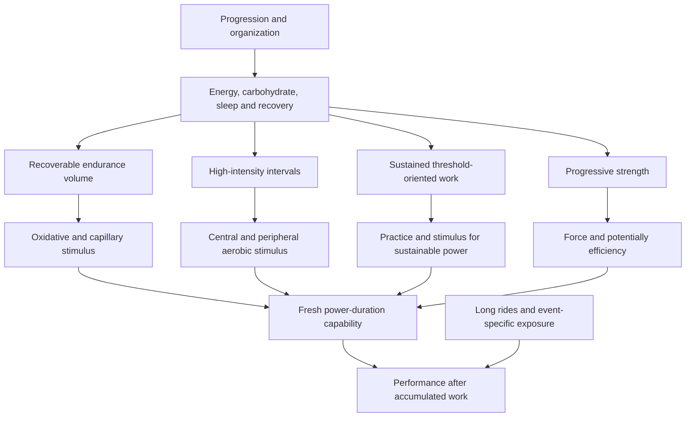

# How cycling performance develops

**Evidence checked: 2026-10-02.** A conceptual starting chapter for a healthy, already-trained amateur seeking higher VO₂max, sustainable cycling power and general fitness with roughly 7–12 total training hours per week.

[Reference contents](../index.md) · Next: [Aerobic fitness, volume and easy intensity](physiology-volume-endurance.md) · [Glossary](../CONTEXT.md)

Read this chapter for the interacting physiological model and priorities, then follow the evidence chapters. The [program-design chapter](program-design.md) turns those priorities into worked examples. Empirical judgments remain in the linked chapters and [stable conclusion register](../evidence/claims.md); this overview does not establish a second set of competing claims.

## In this chapter

- [The main decisions](#main-decisions)
- [Physiological model](#physiology)
- [What matters most—and what is often over-optimized](#what-matters)

## The main decisions

**The highest-leverage decision is a repeatable dose of sufficiently specific training that can be fueled and recovered—not the most elaborate interval recipe.**

- Cycling performance combines aerobic capacity, the sustainable fraction of that capacity, efficiency, anaerobic/neuromuscular characteristics and their preservation after accumulated work. FTP is an operational field estimate, not an isolated physiological organ or a synonym for CP/MLSS.
- Both interval training and accumulated endurance work can improve fitness. Additional volume is useful only insofar as it adds a recoverable stimulus; a trained cyclist's response cannot be inferred from hours alone. There is no validated optimum at 7, 12 or 30 hours.
- Mostly easy riding with a limited deliberate quality dose is a defensible starting pattern. Neither exact 80/20 nor polarized superiority over pyramidal training is established for all trained cyclists. Counting sessions and counting minutes produce different percentages.
- One VO₂-oriented and one sustained/race-specific session is a conservative mixed implementation. Two hard cycling sessions is a successful convention used in trials, not a proven optimum versus one or three. Races and hard group rides replace quality sessions; strength has its own recovery cost.
- Several interval formats work. The strongest cyclist-specific short-versus-long results compare 30/15 series with **4×5**, not every long format. Acute time ≥90% VO₂max is not a validated surrogate for subsequent adaptation.
- Easy intensity should stay compatible with the intended domain and the rest of the week. A universal 55–60 versus 65–75% FTP adaptation ranking has not been established. More weekly volume generally calls for guarding recovery, not automatically copying a professional's percentages.
- Threshold and sweet-spot work can accumulate sustainable-power training, but their exact recipes and supposedly exceptional stimulus-to-fatigue ratio are not experimentally ranked. Durability is a separate outcome: improving a fresh test does not guarantee equal improvement after several hours.
- Adequate energy, carbohydrate and sleep prevent quality from being lost. About 60–90 g carbohydrate/hour is useful for long demanding rides; 100–120+ is an optional practiced strategy, not a default upgrade. Table sugar is a legitimate carbohydrate source, not proof of complete product equivalence.
- Progressive heavy strength can improve cycling performance without raising VO₂max; the evidence is promising but limited. Elaborate activation, generic injury-prevention claims and sauna for cool-weather FTP are lower-priority choices.
- Track comparable performance and session execution alongside fatigue, sleep and RPE. TSS/CTL/HRV are contextual tools, not measured fitness, readiness or a command to increase load.

The numerical programs in the [program-design chapter](program-design.md) are **coaching applications** of these principles. Their exact doses, placements and deload calendar have not been tested as a package.

## Physiological model of cycling performance

### Capacity, utilization, efficiency—and the condition in which they are expressed

A useful schematic is:

**Sustainable aerobic power ∝ VO₂max × sustainable fraction × efficiency.**

This is an explanatory relationship, not a personal FTP calculator. Oxygen's energy equivalent, test duration, substrate use and non-aerobic contributions complicate conversion into watts. Actual race performance also depends on fatigue, fueling, thermal state, aerodynamics, body mass, pacing, drafting and tactics ([Joyner and Coyle 2008](https://doi.org/10.1113/jphysiol.2007.143834); [Coyle 1999](https://doi.org/10.1016/s1440-2440(99)80172-8), physiological reviews).

| Determinant | Trainable contribution | Important distinction |
|---|---|---|
| **VO₂max** | Maximum integrated oxygen delivery/utilization; cardiac output, oxygen-carrying capacity and muscular extraction | Relative VO₂max can rise from weight loss without an equal increase in absolute oxygen delivery |
| **Fractional utilization** | How much of aerobic capacity can be sustained for the relevant duration | Not the same percentage for 20 minutes, 60 minutes and a fatigued race |
| **LT1/VT1; LT2/VT2** | Test-derived changes in lactate/ventilatory behavior that help characterize domains and sustained work | Detection methods differ; fixed lactate concentrations are not universal individual thresholds |
| **CP / maximal metabolic steady state / MLSS** | Characterize the upper boundary of sustainable oxidative responses using different protocols | Related, not interchangeable measured numbers; CP and MLSS can differ systematically |
| **Gross efficiency / economy** | Mechanical power relative to metabolic energy, or oxygen cost at a workload | Economy and efficiency are not identical; cadence, intensity and fuel use affect measurement |
| **W′ / anaerobic characteristics** | Capacity for work above CP, sprinting and repeated surges | W′ is a model parameter, not a literal single anaerobic fuel tank |
| **Durability** | Preservation of thresholds, efficiency and power-duration capability after work | Can change without a proportional change in fresh FTP or VO₂max |
| **Muscle oxidative capacity / mitochondria** | ATP production, substrate handling and local ability to support sustained/repeated work | Enzyme activity, mitochondrial content and function are related but not identical outcomes |
| **Capillarization** | Oxygen/substrate delivery and exchange at the muscle | Muscle-biopsy growth does not by itself prove a specific race improvement |
| **Plasma volume** | Supports circulation, stroke volume and thermoregulation | Rapid expansion may dilute haemoglobin concentration without reducing total haemoglobin mass |
| **Haemoglobin mass** | Total oxygen-carrying capacity | Not measured by a routine haemoglobin concentration or inferred from plasma expansion |
| **Glycogen availability** | Enables high power, sustained work and recovery between sessions | Acute replenishment is not the same as new structural training adaptation |
| **Neuromuscular characteristics** | Force, rate of force development, recruitment and fatigue resistance | Low-load activation is not equivalent to progressive strength training |

Definitions and protocol boundaries are maintained in the [glossary](../CONTEXT.md) and [PHY-C01–C04](../topics/physiology-volume-endurance.md#phy-c01). The framework is strongly supported; assigning each determinant to one exclusive workout is not.

### Why the components interact

**Interpretation:** endurance work supplies substantial oxidative exposure without making every minute highly stressful; intervals can provide a concentrated cardiopulmonary and muscular stimulus; sustained work supplies specific accumulated work at a high sustainable fraction; strength can alter force/efficiency; long-event exposure and fueling determine how much capability remains late. These pathways overlap.

[Mølmen et al. 2025](https://doi.org/10.1007/s40279-024-02120-2), systematic review/meta-regression of human mitochondrial/capillary training studies spanning training statuses, supports growth across endurance and interval approaches, with dose and baseline status affecting responses. It does not identify a unique FTP percentage for trained cyclists. [Rosenblat et al. 2022](https://doi.org/10.1007/s40279-021-01624-5), 32 studies/369 participants including 49 women and mixed fitness, found HIIT-associated maximal cardiac-output/stroke-volume increases and mitochondrial-enzyme responses to both HIIT and sprint intervals; this does not establish a “central-only long interval / peripheral-only short interval” distinction.

The integrated model is supported at the component level. No trial isolates every arrow or proves that the exact example combination is optimal. Fueling and sleep mainly enable execution/recovery; they are not independent guarantees of greater mitochondrial or VO₂max adaptation.

### Time course and diminishing room to improve

| Timescale | Typical observations | What not to infer |
|---|---|---|
| Hours to days | Glycogen depletion/repletion, acute fatigue, signaling, fluid/plasma shifts | A better next-day test is not necessarily new structural fitness |
| Days to a few weeks | Heat acclimation, plasma-volume changes, neural familiarization; early mitochondrial changes | Every early VO₂ change represents greater red-cell mass |
| Several weeks to months | VO₂max/threshold/power changes, strength development, mitochondrial/capillary remodeling | A single universal onset or dose; trained athletes usually have less headroom |
| Months to years | Accumulated training tolerance, event-specific durability, refined efficiency and performance | Everyone improves continuously, or professional tolerance transfers immediately |

These ranges are overlapping review-level descriptions, not biological deadlines ([Jones and Carter 2000](https://doi.org/10.2165/00007256-200029060-00001); [Mølmen 2025](https://doi.org/10.1007/s40279-024-02120-2)). Baseline fitness, prior intensity, sex, training history, nutrition and measurement error affect observed change. A high starting VO₂max does not make all further improvement impossible; nor do large gains in moderately trained runners predict the same gains in competitive cyclists.

## What matters most

### Relatively high-confidence major determinants

- **Consistent recoverable exposure:** sufficient stimulus over weeks, not isolated heroic sessions. The exact weekly optimum is uncertain.
- **Specificity and a meaningful intensity dose:** accumulated endurance/sustained work plus appropriate severe-domain work; not all-easy forever or every ride hard.
- **Adequate energy/carbohydrate and sleep opportunity:** avoid compromising execution, recovery and health.
- **Progression and feedback:** change what is tolerable and track comparable performance; do not force model targets through deteriorating health.
- **Event-relevant fresh and fatigued capacity:** assess the outcome you actually want, not FTP alone.

These are high-priority decisions, not a claim that every numerical implementation has Strong evidence.

### Useful optimization details

- Choose repeatable interval work/recovery and a protocol-consistent intensity anchor.
- Fit the longest ride and occasional event-specific work to the recovery budget.
- Add progressive heavy strength if time, technique and tolerance permit.
- Practice race carbohydrate/fluid strategy and standardize testing conditions.
- Organize emphasis and reduce accumulated fatigue; use heat acclimation for a hot event, not automatically for cool fitness.

### Potential over-optimization

- **4 versus 5 minutes; 30/15 versus 40/20:** current comparisons do not justify universal rankings.
- **Exact easy wattage:** useful domain/recovery boundaries do not establish a single optimal percent.
- **Ascending versus descending power:** protocol-dependent acute effects, uncertain chronic advantage.
- **Precise mesocycle ordering:** some early effects, little evidence of a universal final-outcome advantage.
- **Recovery spin versus rest:** context matters more than an obligatory ritual.
- **Elaborate activation:** EMG/comfort effects are not proof of injury prevention or adaptation.
- **120 g/h, a CTL target, a nap length or a sauna dose for everyone:** precision without a validated comparator can hide the real constraints.

Small details can matter for a specific rider/event; “over-optimization” means confidence and attention exceed the evidence, not that the detail never matters.
