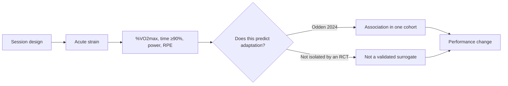

# VO₂max interval design

Last checked: 2026-10-02.

This is a living brief on how to design cycling intervals aimed at VO₂max, power at VO₂max, and the high-intensity end of aerobic performance. Audience: a trained amateur riding about 7–12 hours per week, with goals of VO₂max, FTP, and general fitness. It is not a prescription for a 30-hour professional week, and it is not a claim that one repetition length trains one exclusive physiological system.

Navigation: [platform index](../index.md) · [terminology](../CONTEXT.md) · [shared bibliography](../evidence/bibliography.md). Related evidence is maintained in [distribution, periodization and recovery](distribution-periodization-recovery.md) and [threshold, durability and long rides](threshold-durability-long-rides.md). This file covers [questions 5 and 6](../index.md#question-map), plus the four unnamed transcript studies.

Reading order: [Previous — distribution and recovery](distribution-periodization-recovery.md) · [Next — threshold, durability and long rides](threshold-durability-long-rides.md).

No transcript was supplied. Papers below are **candidates** matched to the prompt’s descriptors. Match confidence is about the descriptor, not about what any speaker said. Attribution is unconfirmed in every row.

## How to read the evidence

Acute responses (oxygen uptake, heart rate, lactate, RPE, muscle deoxygenation during one session) are not adaptations. A format that spends longer above 90% VO₂max can still fail to produce a larger training effect, and a format that produces a larger training effect may never have had oxygen uptake measured. Where full text was not retrieved, sample size, protocol, and effect size are taken only from the abstract, and that limit is stated. Search-engine summaries and coaching blogs were used to find papers, not to supply numbers.

Web search was unavailable at the start of this investigation and was restored before the brief was closed. It was used for discovery and for the 2025–2026 scan. Quantitative claims below come from retrieved abstracts, Europe PMC/PMC full text, PubMed records, or the Rønnestad 2015 PDF. Publications dated after 2026-10-02 were not included.

## Question navigation

- [Source tracing](#source-tracing)
- [Durable conclusions](#durable-conclusions)
- [What “near VO₂max” is measuring](#near-vo2)
- [Format-by-format evidence](#int-c06)
- [Short versus long intervals](#short-vs-long)
- [Sequencing 4, 8, and 16 minutes](#sequencing)
- [Work-rate distribution](#int-c08)
- [How to prescribe intensity](#prescription)
- [How hard, pacing, and progression](#int-c09)
- [Recovery](#recovery)
- [Why %MAP is test-dependent](#int-c10)
- [7–12 h versus 20–30 h](#transfer)
- [Non-lab method and a 4–6 week progression](#practical)
- [Open questions](#open)
- [References](#references)

## Source tracing

| Prompt descriptor | Best candidate | Match confidence | What the paper actually supports | Transcript attribution |
| --- | --- | --- | --- | --- |
| Fractional VO₂max during intervals and subsequent adaptation | [Odden et al. 2024](https://doi.org/10.1002/ejsc.12202), PMC full text. Historical claim: [Wenger and Bell 1986](https://pubmed.ncbi.nlm.nih.gov/3529283/). Related test with a different design: [Turnes et al. 2016](https://doi.org/10.1007/s00421-015-3263-0). | High for Odden as the study that measured %VO₂max in every session of a multi-week cyclist intervention and related it to change scores. | Association, not a randomized stimulus. See [INT-C01](#int-c01). The title’s “the greater is the gain” overstates the design. | Unconfirmed. No transcript. |
| 30/15 versus longer intervals and time ≥90% VO₂max | Acute: [Almquist et al. 2020](https://doi.org/10.1111/sms.13672), [Urianstad et al. 2024](https://doi.org/10.1002/ejsc.12214), [Appelhans et al. 2025](https://doi.org/10.1123/ijspp.2024-0115). Longitudinal performance, not measured time ≥90%: [Rønnestad et al. 2015](https://doi.org/10.1111/sms.12165), [Rønnestad et al. 2020](https://doi.org/10.1111/sms.13627). Running counter-example, acute: [Fleckenstein et al. 2024](https://doi.org/10.3389/fspor.2024.1507957). | High that this cluster is what the descriptor points at. Which single paper was meant is unknown. | 30/15 can raise acute time ≥90% when intensity is fixed or mean power is higher. That advantage disappears when both formats are self-paced and maximal (Appelhans 2025). The 2015 training trial did **not** measure oxygen uptake in sessions. | Unconfirmed. |
| Sequencing 4-, 8-, and ~16-minute intervals | [Sylta et al. 2016](https://doi.org/10.1249/MSS.0000000000001007). Companions from the same project: [Sylta et al. 2017](https://doi.org/10.1249/MSS.0000000000001214), [Seiler and Sylta 2017](https://doi.org/10.1123/ijspp.2016-0464). | Very high. Methods match the descriptor almost verbatim: 4×16, 4×8, 4×4, increasing / decreasing / mixed order, load matched, 12 weeks, cyclists. | Twelve-week outcomes did not differ by order. The first four weeks favored the group accumulating more 4×16 work. This is not a test of exclusive 4×8 versus exclusive 4×4 for the whole period. | Unconfirmed, but the descriptor match is the strongest of the four. |
| Different work-rate distributions, similar time near VO₂max | [Wommer et al. 2022](https://doi.org/10.1055/a-1550-9977), PMID 34261134. | High for the “similar time” wording. | Acute 8×60 s in healthy men: decreasing, increasing, and constant within-rep power gave similar time ≥90% VO₂max. | Unconfirmed. |
| Same descriptor, opposite result | [Bossi et al. 2020](https://doi.org/10.1123/ijspp.2019-0260). Pooled acute estimate: [Schoenmakers et al. 2026](https://doi.org/10.1186/s13102-026-01766-x). | Medium as an alternative candidate. A retelling could have reversed the direction. | In well-trained cyclists, varied-intensity  work intervals produced **more** time >90% VO₂max than constant-intensity intervals matched for duration and mean power. Acute only. | Unconfirmed. |
| Rejected candidate for the work-rate descriptor | PMID 31194601, [Rønnestad et al. 2019](https://doi.org/10.1152/japplphysiol.00798.2018). | Mismatch. | Case study of one athlete moving from alpine skiing to junior time-trial success. Not an interval work-rate comparison. | Not a match. |

The acute precursor cited by Rønnestad et al. 2015 is now retrieved: [Rønnestad and Hansen 2016](https://doi.org/10.1519/JSC.0b013e3182a73e8a) (*J Strength Cond Res* 30(4):999–1006; the DOI was registered in 2013; PMID 23942167). Thirteen well-trained male cyclists (VO₂peak 66.7 ± 6.1 mL·kg⁻¹·min⁻¹; at least 6 h/week) completed three protocols to exhaustion, in randomized order, at the minimal power that elicited VO₂peak (MAP 375 ± 41 W). Recovery was 50% of MAP for half the work duration. Time to exhaustion at continuous MAP (Tmax) was 340 ± 108 s. Fixed 30/15 produced longer time ≥90% VO₂peak (678 ± 270 s) than work bouts at 50% of Tmax (397 ± 156 s; mean bout 170 ± 54 s) or 80% of Tmax (366 ± 127 s; mean bout 272 ± 86 s), both p < 0.01. Time to exhaustion was also longer (1385 ± 547 vs 827 ± 283 vs 642 ± 191 s). Peak RPE was about 19 in all three. In 6 of the 13, time ≥90% of peak stroke volume was longer with 30 s work (787 ± 447 vs 510 ± 336 s versus the 50% Tmax protocol). The authors state that whether this acute difference produces larger training adaptations remained to be investigated. It is not the 2015 training trial, and it is to exhaustion rather than a fixed 3 × 13 prescription.

## Durable conclusions

### INT-C01 — A higher mean fraction of VO₂max during intervals was associated with larger gains in one cyclist cohort. That is not proof that raising the fraction causes the gain.

**Classification:** Moderate evidence for the association. The causal prescription claim is not established.

**Support:** [Odden et al. 2024](https://doi.org/10.1002/ejsc.12202) measured oxygen uptake in all interval sessions of 22 well-trained cyclists (19 men, 3 women; VO₂max 67.1 ± 6.4 mL·kg⁻¹·min⁻¹; performance levels 3–5). For 9 weeks they did about 21 sessions of 5 × 8 min at each rider’s 40-minute maximal mean power (PO40min), with 3 min active recovery at 35% PO40min. The 9 weeks were three 3-week blocks of three work-rate patterns in six randomized orders: 30/15 at 118%/60% of PO40min, 60/60 at 110%/90%, and constant 100%. Mean power of the 8 min was matched across patterns. This is the training companion of the acute work-rate paper [Urianstad et al. 2024](https://doi.org/10.1002/ejsc.12214), not a trial that assigned people to “high fraction” versus “low fraction.”

Multiple regression related mean %VO₂max during work intervals to change scores, with **baseline value, sex, and change in body mass as covariates**. Adjusted R² is the fit of that whole model, not “fraction alone explains 54%.”

| Outcome | Adjusted R² | p | Slope (95% CI) |
| --- | --- | --- | --- |
| VO₂max | 0.54 | 0.029 | 0.25 mL·kg⁻¹·min⁻¹ per percentage point of interval %VO₂max (0.03 to 0.48) |
| 1-min peak incremental power (Wmax) | 0.44 | 0.009 | 0.04 W·kg⁻¹ per point (0.01 to 0.06) |
| Power at 4 mmol·L⁻¹ | 0.25 | 0.035 | 0.02 W·kg⁻¹ per point (0.00 to 0.04) |
| Composite performance index | 0.36 | 0.013 | 0.004 arbitrary units per point (0.001 to 0.007) |
| 15-min maximal power | 0.15 | 0.215 | not significant |
| Hemoglobin mass | — | 0.853 | no relationship |
| Gross efficiency at 175 W | 0.06 | 0.706 | no relationship |

A post-hoc median split (not a randomized stimulus) compared riders whose sessions averaged 86.2 ± 3.8% of VO₂max with those at 79.9 ± 4.0%. VO₂max rose 5.23 ± 2.76 versus 1.78 ± 1.72 mL·kg⁻¹·min⁻¹. Wmax rose 0.51 ± 0.33 versus 0.23 ± 0.14 W·kg⁻¹. Power at 4 mmol·L⁻¹ rose 0.31 ± 0.15 versus 0.12 ± 0.18 W·kg⁻¹. Fifteen-minute power only tended to differ (p = 0.096). Mean interval %VO₂max across the whole cohort ranged from 74.2% to 90.8% despite the same external anchor (PO40min).

**Contradictory or qualifying evidence:** The high-fraction half did significantly more zone 1 (3 h 12 min versus 1 h 48 min per week) and tended to do more total training (9 h 43 min versus 7 h 40 min). The authors note this could have affected results. Riders with higher baseline power at 4 mmol·L⁻¹, higher 15-min power, and higher fractional utilization at 4 mmol·L⁻¹ also reached a higher %VO₂max during the intervals. Baseline VO₂max itself did not (p = 0.757). So the “high fraction” group was partly a group that already sustained a high fraction of VO₂max at threshold, not a group assigned a better workout. [Turnes et al. 2016](https://doi.org/10.1007/s00421-015-3263-0), as described in the Odden discussion, did not find an individual correlation between time at VO₂max and VO₂max gain; that null correlation was not re-extracted from the Turnes paper here. Odden’s own discussion says time ≥90% VO₂max only **tended** to relate to the VO₂max change, and that mean %VO₂max was the better of the two markers. [Boynton et al. 2025](https://doi.org/10.1519/JSC.0000000000005013) found more time >90% VO₂max in cool 5×4 min sessions than in hot ones, without a greater temperate 20 km gain. Heat is a confound, but the dissociation is real.

**Practical implication:** If two riders hold the same PO40min target and one is at ~80% of VO₂max while the other is at ~86–90%, the second is receiving a larger aerobic cardiopulmonary stimulus. That is a reason to care about whether the chosen format and pacing actually drive oxygen uptake up, not a reason to treat %VO₂max as a score that can be optimized in isolation from volume, threshold fitness, and recovery.

**Uncertainty:** One cohort, three women, one laboratory, post-hoc split, easy-volume imbalance, and no trial that independently manipulates fractional VO₂max while holding everything else fixed. Do not say the fraction “predicts” adaptation in a validated prospective sense, and do not say format choice “therefore mainly changes the stimulus.” Format effects on acute VO₂ are a separate, acute question ([Urianstad et al. 2024](https://doi.org/10.1002/ejsc.12214)).

### INT-C02 — Time ≥90% VO₂max is a noisy acute marker, not a validated surrogate for adaptation.

**Classification:** Moderate evidence for this caution.

**Support:** The 90% cut is a programming heuristic. [Buchheit and Laursen 2013](https://doi.org/10.1007/s40279-013-0029-x) wrote that it is *believed* an optimal stimulus includes several minutes in a “red zone” of at least 90% VO₂max, and that team-sport athletes might need less of it than trained endurance athletes. That is a review judgment, not a dose-response trial. [Billat et al. 2000](https://doi.org/10.1007/s004210050029) showed, in eight runners, that 30 s alternations at vVO₂max accumulated more time at VO₂max than a hard continuous run, and explicitly said the acute data do not allow speculation about chronic effects.

Reliability is only moderate. In Odden 2024, session-to-session ICC was 0.61 for mean %VO₂max and 0.56 for time ≥90% VO₂max, versus 0.31 and 0.24 for the heart-rate analogues. [Rønnestad, Bjerkrheim et al. 2022](https://doi.org/10.3389/fspor.2022.948127) reported ICC 0.57 for time ≥90% VO₂max across three sessions in a skier microcycle. [Raimundo et al. 2025](https://doi.org/10.1519/JSC.0000000000005154) found coefficients of variation of 19–35% for 5×2 min and 36–72% for 10×1 min cycling intervals in 15 healthy men, and a same-day VO₂max verification test did not fix it. [Schoenmakers et al. 2026](https://doi.org/10.1186/s13102-026-01766-x), searching to September 2025 (86 articles, 239 protocols), concluded that the dose-response between time near VO₂max and long-term adaptation still needs investigation.

**Contradictory evidence:** Group-level contrasts sometimes point the same way as the heuristic. In [Turnes et al. 2016](https://doi.org/10.1007/s00421-015-3263-0), recreational cyclists doing upper-boundary severe intervals (higher time at VO₂max) gained more VO₂max (6.3 ± 1.9% versus 3.3 ± 1.8%) and lactate-threshold power than a lower severe-domain 4×5 min group over 4 weeks. That confounds intensity domain with the time-at-VO₂max metric. It is not an individual dose-response.

**Practical implication:** Use time ≥90% VO₂max, if it is measured, as one description of a session. Do not extend a workout, or discard a format, solely to chase the clock. Heart rate above 90% of maximum is a worse substitute: in Odden it was less repeatable and related to fewer outcomes; in Fleckenstein 2024, 30 s running intervals produced *more* time above 90% HRmax and *less* time above 90% VO₂max than 3 min intervals.

**Uncertainty:** A trial that assigns trained cyclists to two formats matched for work, RPE, and weekly volume, differs only in measured time ≥90% VO₂max, and follows adaptation has not been retrieved.

### INT-C03 — Effort-matched 30/15 series can beat 4×5 min intervals on several outcomes in trained male cyclists. That is not a universal short-versus-long rule.

**Classification:** Moderate evidence for this specific comparison.

**Support:** Full text of [Rønnestad et al. 2015](https://doi.org/10.1111/sms.12165): 20 trained-to-well-trained male competitive cyclists randomized, stratified by VO₂max; 9 short-interval and 7 long-interval completers after illness and withdrawal. Ten weeks, two HIT sessions per week plus usual easy riding (no group difference in zone hours; short-interval group about 7.8 h/week in 60–82% HRmax, long-interval group about 9.7 h, both with large scatter). Short intervals: 3 × 9.5 min of 13 × 30 s / 15 s, 3 min between series. Long intervals: 4 × 5 min, 2.5 min recovery. Recovery in both was 50% of work-interval power. Both were told to maximize average session power. That is effort matching, not power matching. Work-interval power was higher in the short-interval group (363 ± 32 W versus 324 ± 42 W). Lactate (~10–11 mmol·L⁻¹) and RPE (~17.6–17.8) did not differ.

| Outcome | Short intervals | Long intervals | Between-group |
| --- | --- | --- | --- |
| VO₂max | +8.7 ± 5.0% | +2.6 ± 5.2% (within-group p = 0.28) | p ≤ 0.05, ES 1.54 |
| Incremental Wmax | +8.5 ± 5.2% | +1.6 ± 3.6% | p ≤ 0.05, ES 1.20 |
| Power at 4 mmol·L⁻¹ | +12 ± 9% | +5 ± 6% | p = 0.12, ES 0.86 |
| 40-min power | +12 ± 10% | +4 ± 4% | p = 0.056, ES 1.09 |
| 5-min power | +8 ± 7% | +3 ± 7% | not significant, ES 0.71 |
| 30-s Wingate | +5 ± 3% | +1.4 ± 3.7% | p = 0.10, ES 1.03 |

The authors infer that more time ≥90% VO₂max caused the VO₂max difference. They did not measure oxygen uptake during the 2015 intervention. The inference cites [Rønnestad and Hansen 2016](https://doi.org/10.1519/JSC.0b013e3182a73e8a), an acute to-exhaustion comparison, not a training result. That paper itself says the adaptation question was still open.

[Rønnestad et al. 2020](https://doi.org/10.1111/sms.13627), abstract only: 18 elite cyclists (VO₂max 73 ± 4 mL·kg⁻¹·min⁻¹), 3 weeks, nine sessions, same 3 × 13 × 30/15 versus 4 × 5 min, effort-matched by RPE. Short intervals improved peak aerobic power (+3.7 ± 4.3% versus −0.3 ± 2.8%), fractional utilization at 4 mmol·L⁻¹, power at 4 mmol·L⁻¹, and 20-min power (+4.7 ± 4.4% versus −1.4 ± 2.2%). **VO₂max change did not differ.** So the elite short-block result is a performance result, not a VO₂max result.

**Contradictory evidence:** Broader meta-analyses, mostly not these cyclists, favor longer work intervals for VO₂max ([Wen et al. 2019](https://doi.org/10.1016/j.jsams.2019.01.013); [Bacon et al. 2013](https://doi.org/10.1371/journal.pone.0073182), sedentary or recreational, longer-interval subset ~0.8–0.9 L·min⁻¹). [Rosenblat et al. 2020](https://doi.org/10.1007/s40279-020-01264-1) found long HIIT (≥4 min) about 2% better for time-trial change than sprint interval training across six articles, with no VO₂max difference; “moderately trained” there included people at about 3 h/week. [Schoenmakers et al. 2026](https://doi.org/10.1186/s13102-026-01766-x) found **longer** work intervals (≥2 min) accumulated more acute time near VO₂max than short (≤30 s) or moderate bouts in a mixed-protocol pool. That pool is not “3 × 13 × 30/15 versus 4 × 5 min in trained cyclists.” [Fleckenstein et al. 2024](https://doi.org/10.3389/fspor.2024.1507957): 12 highly trained middle-distance runners, acute; 24 × 30 s at 100% vVO₂max with 30 s recovery accumulated **less** time >90% VO₂max than 4 × 3 min at 95% vVO₂max (201 ± 268 s versus 328 ± 147 s, p = 0.05). A 30/30 at vVO₂max is not a 30/15 series at ~118% of 40-min power.

**Practical implication:** For a trained cyclist who can execute it, a 30/15 series of the Rønnestad type is a legitimate VO₂-oriented session, not a gimmick. It is not automatically better than 4–8 min repeats for every goal, and it wins in the 2015 trial partly because riders could hold higher power at the same RPE.

**Uncertainty:** Male samples, one research group for the positive cyclist trials, small n, and effort matching that deliberately allows higher power and a different recovery structure. Women are almost absent from the longitudinal comparisons. Acute sex comparison in [Urianstad et al. 2024](https://doi.org/10.1002/ejsc.12214) found no sex difference in %VO₂max achieved; that does not prove equal training adaptation.

### INT-C04 — Ordering 4×16, 4×8, and 4×4 over 12 weeks does not detectably change outcomes when load is matched.

**Classification:** Moderate evidence.

**Support:** [Sylta et al. 2016](https://doi.org/10.1249/MSS.0000000000001007): 63 cyclists, VO₂peak 61.3 ± 5.8 mL·kg⁻¹·min⁻¹, 12 weeks, 24 interval sessions plus a high volume of low-intensity training. Increasing group (n = 23): 4×16 min in weeks 1–4, 4×8 in weeks 5–8, 4×4 in weeks 9–12. Decreasing group (n = 20): the reverse. Mixed group (n = 20): all three throughout. Sessions were maximal session efforts, with 2 min recoveries ([Seiler and Sylta 2017](https://doi.org/10.1123/ijspp.2016-0464)). Mean lactate was 4.7, 9.2, and 12.7 mmol·L⁻¹ for 4×16, 4×8, and 4×4. All groups improved about 5–10% in 40-min power, incremental peak power, and VO₂peak. No between-group adaptation difference, and similar rates of large, moderate, and non-response.

**Qualifying evidence, not a contradiction of the 12-week null:** [Sylta et al. 2017](https://doi.org/10.1249/MSS.0000000000001214) shows the path differed. In weeks 1–4, the groups doing 4×16 (about 2–3 h/week of that work) improved power at 4 mmol·L⁻¹ and VO₂peak more than the group starting with 4×4 (about 1 h/week). Most of the eventual change in the increasing and mixed groups arrived in the first month. By week 12 the orders had converged. [Rønnestad et al. 2014a](https://doi.org/10.1111/j.1600-0838.2012.01485.x) and [Rønnestad et al. 2014b](https://doi.org/10.1111/sms.12016) concern **block versus weekly** distribution of HIT, not 4- versus 8- versus 16-minute reps. Those abstracts do not specify repetition length. They are noted so they are not confused with Sylta. A 2022 cyclist trial found no difference between 12 weeks of block and traditional periodization ([Rønnestad-group null, PMID 35299664](https://pubmed.ncbi.nlm.nih.gov/35299664/)); that conflict belongs mainly in the periodization brief.

**Practical implication:** For a 12-week block that will contain a mix of 4, 8, and 16 min maximal-effort intervals, the order is a low-leverage choice if total load stays the same. Early emphasis on longer reps accumulates more work and may move threshold power and VO₂peak sooner. That is not a reason to build an elaborate mesocycle around the order.

**Uncertainty:** One intervention, mostly men (the acute companion analyzed 63 men), self-reported easy volume, and no comparison against a group that did only one duration for 12 weeks. “Order does not matter” is not “duration does not matter.”

### INT-C05 — A unique 4–8 minute sweet spot is not established for well-trained cyclists.

**Classification:** Plausible but uncertain. Moderate evidence only for the narrower claim in recreational cyclists in one trial.

**Support for a duration interaction, not a law:** [Seiler et al. 2013](https://doi.org/10.1111/j.1600-0838.2011.01351.x): 35 recreational cyclists (29 men, 6 women; VO₂peak 52 ± 6 mL·kg⁻¹·min⁻¹; ~6 h/week). Seven weeks, two interval sessions per week at the maximal tolerable intensity, plus easy riding. 4×8 min produced larger gains in VO₂peak, power at VO₂peak, and power at 4 mmol·L⁻¹ than 4×4, 4×16, or low intensity only. The 4×8 gain in the pooled outcome contrast was 11.4% (95% CI 8.0–14.9) versus 5.5% (2.0–9.0) for 4×4, 5.6% (2.1–9.1) for 4×16, and 4.2% (0.4–8.0) for low only. 4×8 was performed at 90 ± 2% HRpeak and 9.6 mmol·L⁻¹; 4×4 at 94 ± 2% HRpeak and 13.2 mmol·L⁻¹; 4×16 at 88 ± 2% HRpeak and 4.9 mmol·L⁻¹. The authors’ interpretation is that 32 min near 90% HRmax beat 16 min near 95% HRmax. That is an intensity-by-accumulated-duration interaction, not proof that minute 5 is physiologically special.

**Why it does not transfer as a rule:** Sylta’s well-trained cyclists (VO₂peak ~61) improved similarly when 4, 8, and 16 min sessions were mixed, and the early advantage went to **more minutes of 4×16**, not to 4×8. [Helgerud et al. 2007](https://doi.org/10.1249/mss.0b013e3180304570) is the classic 4×4 result: 40 moderately trained men, **running**, 8 weeks, 3 days/week, work-matched. 4×4 min at 90–95% HRmax raised VO₂max 7.2% (55.5 to 60.4 mL·kg⁻¹·min⁻¹); 15/15 raised it 5.5% from a higher baseline (60.5 to 64.4). Stroke volume rose about 10% after interval training. Long slow distance and lactate-threshold running did not match those VO₂max gains. Useful for “intensity near VO₂max beats the same work at threshold in moderately trained people.” Not a cycling trial, and not evidence that 4×4 beats 4×8 in trained cyclists. Seiler 2013 found the opposite in recreational cyclists.

**Practical implication:** 4×8 min at the highest sustainable intensity is a well-supported option for a recreational or developing rider who can recover from 32 min of hard work. It is not the uniquely correct VO₂ session for a trained amateur, and it is not superior to 30/15 on current cyclist head-to-heads, because that comparison has not been done inside one Seiler-style design.

**Uncertainty:** Small cells (n = 9), recreational baseline, and no 2024–2026 trial retrieved that re-ranks 4×4, 4×8, and 4×16 in well-trained cyclists.

### INT-C06 — Exact 5×5 and isolated 1-minute formats still lack a trained-cyclist performance head-to-head. 40/20 has one 4-week comparison against 4×8 that did not separate VO₂peak. Calling any of these optimal is coaching practice.

**Classification:** Mostly coaching practice for optimality claims. Absence of a trial is not evidence that the format fails.

| Format | What was retrieved | What was not retrieved |
| --- | --- | --- |
| 4×4 min | Helgerud 2007, running, moderately trained. Seiler 2013 4×4 arm, recreational cyclists, inferior to 4×8 on the pooled aerobic outcomes. Sylta used 4×4 as one of three prescriptions, not as a 12-week exclusive program. | No trained-cyclist RCT of exclusive 4×4 versus 30/15 or versus 4×8 over a full build. |
| 5×4 min | [Boynton et al. 2025](https://doi.org/10.1519/JSC.0000000000005013), abstract: 20 trained cyclists, 4 weeks, eight sessions of 5×4 min, 13°C versus 35°C. Time >90% VO₂max 875 ± 295 s in the cool versus 420 ± 395 s in the heat. Temperate 20 km power rose 3.3 ± 3.4% and 7.3 ± 6.3%, no between-group difference. | No comparison of 5×4 against 4×4, 4×8, or 30/15. The trial is about heat, not about 5 versus 4 minutes. |
| 5×5 min | No title or protocol match for exactly 5×5. Nearby: Rønnestad long intervals were 4×5; Appelhans used 6×5; Turnes used 4×5 at 105% critical power. | No trial isolates the fifth repetition. |
| 4×8 min | Seiler 2013, recreational, best of the three exclusive arms. Sylta, as one ingredient of a mix. [Hanstock et al. 2020](https://doi.org/10.1123/ijspp.2018-0527): well-trained men, 4 weeks of exclusive 4×8 versus two 40/20 prescriptions; cohort VO₂peak rose, with no detected between-group difference. Illness, not performance, was the primary outcome. | Still no exclusive 4×8 versus 30/15 performance trial in well-trained cyclists. |
| 30/15 | Best cyclist-specific evidence. See [INT-C03](#int-c03). Acute to exhaustion at MAP: [Rønnestad and Hansen 2016](https://doi.org/10.1519/JSC.0b013e3182a73e8a). Acute fixed sessions: Almquist 2020, Urianstad 2024, Appelhans 2025. Short blocks: [Solli et al. 2025](https://doi.org/10.1002/ejsc.12223), [Rønnestad et al. 2025](https://doi.org/10.1002/ejsc.70067). | Not tested against 4×8 or 4×16 inside one load-matched trained-cyclist performance RCT. The 2016 advantage is acute and to exhaustion, not a training result. |
| 40/20 | [Hanstock et al. 2020](https://doi.org/10.1123/ijspp.2018-0527), accepted manuscript (journal issue 2020; accepted 2019): 25 of 27 well-trained male cyclists and triathletes analyzed (VO₂peak 64.0 ± 6.4 mL·kg⁻¹·min⁻¹; performance level 3–4), randomized to 12 supervised sessions in 4 weeks plus ad libitum easy riding. Long: 4×8 min, 2 min recovery, 32 min work. SI1: 4×(12×40/20), 2 min between sets, 32 min work if the 20 s rests are excluded. SI2: 4×(8×40/20), 32 min only if the 20 s rests are counted as work. Maximal sustainable intensity; recovery at 50% of work power. Session heart rate (~86–87% HRmax) and RPE (median 17) did not differ. Cohort VO₂peak increased moderately (d = 0.65, 90% CI 0.16 to 1.13); the improvement was not significantly different between groups. Group pre/post means are plotted and were not extracted as numbers. A 2026 bicarbonate crossover used 40 s efforts with 60 s lower-power recovery, not 40/20; those results were not retrieved. | Not a performance-primary trial, not versus 30/15, and not a basis for ranking 40/20 against 4×8. Do not treat 40/20 as interchangeable with 30/15. |
| 1-min repeats | [Stepto et al. 1999](https://doi.org/10.1097/00005768-199905000-00018): 20 male cyclists (VO₂peak 4.8 ± 0.6 L·min⁻¹) split across five protocols, six sessions in 3 weeks. 12×60 s at 100% peak aerobic power did **not** significantly improve 40 km time-trial time. 8×4 min at 85% peak power (~2.8%) and 12×30 s at 175% peak power (~2.4%) did. Cells are about four riders; the polynomial model is fragile. [Seiler and Sjursen 2004](https://doi.org/10.1046/j.1600-0838.2003.00353.x): well-trained runners, self-paced 24×1 min reached only 82 ± 5% VO₂max, versus about 92% for 2, 4, and 6 min bouts, at a similar peak RPE (~17). | No adequately powered trained-cyclist longitudinal trial of 1 min VO₂ intervals. |
| 8–16 min | Seiler 4×16; Sylta 4×16; moderate 10–14 min blocks in [Mølmen et al. 2025](https://doi.org/10.1249/MSS.0000000000003706) and Rønnestad 2025. | These are not automatically “threshold, not VO₂.” At maximal session effort, 4×16 still reached 89 ± 2% HRpeak (Seiler and Sylta 2017) and 4.7 mmol·L⁻¹. At RPE 14–15 they sit lower (Mølmen: 66 ± 5% of power at VO₂max, 85 ± 3% HRmax, 2.8 ± 1.1 mmol·L⁻¹). |

[Etxebarria et al. 2014](https://doi.org/10.1080/17461391.2013.853841), abstract: 14 moderately trained male triathletes, six sessions in 3 weeks. Short efforts (sets of 10, 20, and 40 s — not a pure 40/20) and 6–8 × 5 min both raised VO₂peak about 7%. Only the long intervals substantially improved the run off the bike. Small, and not a cycling race.

**Practical implication:** Choose a format you can repeat with even quality. Do not spend a build debating 4 versus 5 minutes, or 30/15 versus 40/20, as if the literature had ranked them.

**Uncertainty:** Exact 5×5 and isolated 1-minute VO₂ sessions remain without an adequate trained-cyclist performance trial. The 2024–2026 search did not add a new 40/20 ranking; the older Hanstock comparison was missed by that date filter and is now included. It does not show that 40/20 and 4×8 are equivalent, only that this study did not detect a VO₂peak difference.

### INT-C07 — Fixed percentages of FTP, MAP, or VO₂max are weak anchors. Self-paced maximal effort raises the acute VO₂ response, especially for longer intervals.

**Classification:** Moderate evidence for the acute comparison. Plausible but uncertain as a complete prescription system.

**Support:** [Appelhans, Rønnestad, and Skovereng 2025](https://doi.org/10.1123/ijspp.2024-0115), abstract: 12 well-trained cyclists and triathletes (VO₂max 68 ± 6.3 mL·kg⁻¹·min⁻¹). 3 × 13 × 30/15 versus 6 × 5 min, each at a fixed % of maximal aerobic power and again self-paced at maximal effort. Time >90% VO₂max was greater for 30/15 than for long intervals when intensity was fixed (p < 0.01), and not different when both were self-paced maximal (p = 0.321). Self-paced work raised power and the measured physiological responses (all p < 0.001). Time >90% VO₂max rose from 420 ± 259 s to 1130 ± 204 s for 30/15, and from 178 ± 159 s to 1016 ± 312 s for long intervals. A fixed %MAP prescription left a large amount of attainable severe-domain work on the table, and it handicapped the long intervals more.

[Jamnick et al. 2020](https://doi.org/10.1007/s40279-020-01322-8) review the broader problem: a fixed percent of VO₂max, HRmax, or peak work rate does not reliably place people in the same intensity domain. Critical power is the better heavy/severe boundary among common anchors. [Inglis, Iannetta et al. 2024](https://doi.org/10.1249/MSS.0000000000003406): 84 young healthy adults, not trained cyclists, 6 weeks, work-matched except for sprints. Severe-domain intervals raised VO₂max 6.2 ± 2.8 mL·kg⁻¹·min⁻¹; upper heavy continuous work 5.4 ± 2.3; moderate continuous work 1.8 ± 2.7, not different from control. Domain-based prescription produced a more uniform metabolic stimulus than percent-of-max anchors would. Absolute gains of that size do not transfer to cyclists already at 65–75 mL·kg⁻¹·min⁻¹.

What “maximal session effort” actually looks like, from >1400 sessions in well-trained male cyclists ([Seiler and Sylta 2017](https://doi.org/10.1123/ijspp.2016-0464); VO₂peak 62 ± 6):

| Prescription | Power vs 40-min time-trial power | Peak HR | Lactate | Share of sessions at RPE 19–20 |
| --- | --- | --- | --- | --- |
| 4×16 min | 95 ± 5% | 89 ± 2% HRpeak | 4.7 ± 1.6 mmol·L⁻¹ | 8% |
| 4×8 min | 106 ± 5% | 91 ± 2% | 9.2 ± 2.4 | intermediate |
| 4×4 min | 117 ± 6% | 94 ± 2% | 12.7 ± 2.7 | 61% |

Forty-minute power is close to, not identical with, FTP. A single “120% FTP” target will be too hard for some 4×8 sessions and too easy, or too hard, for some 4×4 sessions, depending on the rider’s power-duration curve.

**Practical implication:** Prefer “highest average power you can repeat across the planned reps” over a borrowed percent. If a laboratory MAP exists, use it only with the same test protocol (see [INT-C10](#int-c10)), and expect self-paced maximal work to sit above a cautious %MAP target.

**Uncertainty:** Appelhans is acute and n = 12. No retrieved trial randomizes trained cyclists to %FTP versus maximal session effort for several weeks. [Stepto et al. 1999](https://doi.org/10.1097/00005768-199905000-00018) used fixed % of peak power and may have under-dosed the 4×8 min arm (80% of peak power), which is one reason that old ranking should not be copied.

### INT-C08 — Within-interval power variation sometimes raises acute time near VO₂max and sometimes does not. Adaptation has not been shown.

**Classification:** Plausible but uncertain.

**Support for a difference:** [Bossi et al. 2020](https://doi.org/10.1123/ijspp.2019-0260): 14 cyclists, VO₂max 69.2 ± 6.6 mL·kg⁻¹·min⁻¹, acute crossover. Work intervals matched for duration and mean power. Varied intensity produced more time >90% VO₂max than constant intensity (410 ± 207 s versus 286 ± 162 s, p = 0.02), with higher ventilation and no difference in lactate, RPE, cadence, or heart-rate/perceptual training load. [Schoenmakers et al. 2026](https://doi.org/10.1186/s13102-026-01766-x) pooled a similar contrast: variable-intensity work intervals versus even pacing, SMD 0.80 for time near VO₂max. That meta-analysis is acute, mixed sports, and explicitly does not establish the adaptation link.

**Support for no difference:** [Wommer et al. 2022](https://doi.org/10.1055/a-1550-9977): 10 healthy men (VO₂max 3.82 ± 0.52 L·min⁻¹, not described as trained cyclists), 8×60 s with 60 s recovery, work-matched. Constant 100% peak power, decreasing 110→90%, and increasing 90→110% produced similar time ≥90% VO₂max (274 ± 132, 313 ± 102, and 310 ± 113 s, p = 0.37), similar time at high heart rate, lactate, and final RPE. [Urianstad et al. 2024](https://doi.org/10.1002/ejsc.12214), full text: well-trained women (n = 11, VO₂max 62.5 ± 6.4) and men (n = 8, VO₂max 81.0 ± 5.2), three workload-matched 6 × 8 min patterns at PO40min. 30/15 produced a slightly higher mean %VO₂max (86.7 ± 10.1% versus 85.0 ± 10.4% constant and 85.6 ± 10.0% for 60/60) and longer time ≥90% (1123 ± 787 s versus 879 ± 779 and 917 ± 745 s). The mean difference is about 1–2 percentage points. The standard deviations on time ≥90% are enormous. Fiber type, capillarization, and citrate synthase activity did not explain who reached a high fraction. No sex difference.

**Practical implication:** A fast start or a few surges inside a longer rep can be used if it helps the rider reach a high oxygen uptake without blowing the set. It is not a required pattern, and even pacing is not a proven inferior stimulus. Wommer is the paper that matches “different distributions, similar time.” Bossi is the paper that matches “variation increases time.” Both can be true because the protocols differ. Neither measured subsequent adaptation.

**Uncertainty:** No longitudinal cyclist trial retrieved that assigns constant versus varied within-rep power and follows performance.

### INT-C09 — “Very hard” is not uniquely required, and RPE or breathlessness is not a measurement of %VO₂max.

**Classification:** Moderate evidence that moderate-intensity interval blocks also improve endurance markers in well-trained cyclists. Mostly coaching practice for any exact RPE target or allowable power drop.

**Support:** [Mølmen et al. 2025](https://doi.org/10.1249/MSS.0000000000003706): randomized crossover, 30 well-trained men, VO₂max 70.5 ± 4.6 mL·kg⁻¹·min⁻¹. Six sessions in 7 days of 5–7 × 10–14 min at RPE 14–15, then 6 days active recovery, versus the rider’s usual preparatory training. Interval RPE was 14.4 ± 0.3, equal to 66 ± 5% of power at VO₂max, 85 ± 3% HRmax, and 2.8 ± 1.1 mmol·L⁻¹. Versus usual training: power at 4 mmol·L⁻¹ +4.0 ± 4.4% versus −1.3 ± 3.7%; power at VO₂max +2.5 ± 4.5% versus −0.7 ± 3.9%; VO₂max +2.0 ± 3.9% versus 0.0 ± 3.5% (p = 0.05). Fifteen-minute power was not significantly different (+3.9 ± 8.3% versus +0.2 ± 6.8%, p = 0.14). TRIMP did not differ.

[Rønnestad et al. 2025](https://doi.org/10.1002/ejsc.70067): crossover, 22 cyclists (21 men, 1 woman), VO₂max 69.5 ± 6.0. A HIT block (5 sessions in 6 days of 5 × 8.75 min as multiple short intervals, RPE 17.1 ± 0.4) and a moderate block (6 sessions in 7 days of 5–7 × 10–14 min, RPE 14.5 ± 0.3) both improved 15-min power (2.8 ± 5.3% and 4.9 ± 8.7%, p = 0.44 between blocks). The moderate block improved power at 4 mmol·L⁻¹ more (4.5 ± 4.5% versus 2.1 ± 2.7%). VO₂max change did not differ. The HIT block tended to favor 10 s sprint power (not significant, p = 0.08).

[Solli et al. 2025](https://doi.org/10.1002/ejsc.12223), full text: 22 cyclists completed a 6-day block of five 30/15 sessions (VO₂max 71.1 ± 6.5; 21 men, 1 woman) versus 11 who continued regular training including four HIT sessions (VO₂max 71.1 ± 8.3). Five others withdrew because the test protocol was too hard. The block improved power in the last minute of the VO₂max test more (+3.7% versus +0.7%) and 10 s sprint power more. VO₂max, power at 4 mmol·L⁻¹, and 15-min power did not differ significantly. Groups were unequal, the block was supervised, and regular training was self-administered. This is not a clean format trial.

In Odden 2024, RPE, lactate, and session RPE did **not** separate the high-fraction from the low-fraction half, even though adaptation did. Breathlessness and a high RPE are consistent with hard work. They are not a measurement that VO₂max has been reached. [Seiler and Sjursen 2004](https://doi.org/10.1046/j.1600-0838.2003.00353.x): runners self-selected an RPE around 17 across 1, 2, 4, and 6 min intervals, while only the longer bouts reached ~92% VO₂max.

**On starting too hard and power decline:** No retrieved trial defines an acceptable percent drop as a stop rule. The physiological concern is real and indirect. In Rønnestad 2015, riders were adjusted between series to maximize **average** session power, not first-rep power. In Seiler and Sylta 2017, shorter accumulated work felt harder and more often hit RPE 19–20, which is a recovery-cost signal, not a quality signal. A large drop from rep 1 to rep 2 usually means rep 1 was above sustainable session pace. A modest decline across a hard set is common and is not, by itself, a failed session. That sentence is a coaching judgment informed by how the successful protocols were executed, not a validated threshold.

**Practical implication:** For FTP and general fitness, a recoverable moderate-interval block is evidence-based, not a compromise. For a session whose job is to stress oxygen transport near maximum, maximal sustainable session effort is the better description than “as hard as possible on rep 1.” Do not use gasping as the success criterion.

**Uncertainty:** The moderate-interval blocks are 1 week plus recovery, not a 12-week comparison against VO₂ intervals for VO₂max. They do not show that easy-hard polarization is unnecessary. They show that “very hard” is not the only effective interval.

### INT-C10 — Maximal aerobic power is test-protocol dependent, so a %MAP target is not portable.

**Classification:** Moderate evidence.

**Support:** [Bentley, Newell, and Bishop 2007](https://doi.org/10.2165/00007256-200737070-00002) review: incremental tests change with start power, step size, and stage duration. Peak power falls when stages are longer. Ventilatory and lactate thresholds can appear at a higher absolute work rate when stages are shorter. Those shifts change the validity of using the number to prescribe or monitor training, even when VO₂max itself is relatively stable. A direct 3-minute versus 5-minute stage comparison in 11 men (VO₂max 62 ± 8 mL·kg⁻¹·min⁻¹) did not find a significant peak-power difference ([McNaughton, Roberts, and Bentley 2006](https://doi.org/10.1519/R-15914.1)). So small stage-length differences are not always detectable. The practically important mismatch is a ramp or 1-minute stage MAP versus a 3–5 minute stage MAP, or a laboratory MAP versus a field ramp on a different trainer.

**Practical implication:** If a plan says “90% MAP,” it must name the test. A 90% target from a fast ramp is a harder physiological task than 90% of a slow-ramp peak, or it is a different wattage entirely. Power at a known duration (best 4 min, best 5 min, PO40min, or critical power) is a more stable anchor than an unnamed MAP. Re-test with the same protocol if %MAP is used to progress load.

**Uncertainty:** This brief did not retrieve a single primary study that quantifies the wattage gap between a 1-minute ramp and a 3-minute stage test in the same trained cyclists. The direction is the review’s conclusion, not a new measurement.

## What “near VO₂max” is actually measuring

These are overlapping stressors, not separate adaptation channels. A 30/15 series is not “peripheral only,” and a 4×8 is not “cardiac only.”

| Marker | What it indexes | What it does not prove |
| --- | --- | --- |
| Peak %VO₂max | How close the highest 30 s, or similar window, got to the test VO₂max. Sensitive to the VO₂max criterion ([Raimundo et al. 2025](https://doi.org/10.1519/JSC.0000000000005154)). | A brief spike is not accumulated stimulus. |
| Time ≥90% or ≥95% VO₂max | A binary cut of the same curve. Popular because it is easy to report. | Odden 2024: mean %VO₂max related to more outcomes and was slightly more repeatable. The cut discards everything between 80% and 90%, which is where many trained riders actually sit during 8 min at PO40min. |
| Accumulated oxygen uptake | Total aerobic ATP turnover in the session. Closer to “how much aerobic work” than a 90% clock. | Not shown, in retrieved trials, to predict adaptation independently of mean %VO₂max, power, and volume. |
| Cardiac output / stroke volume | The central side of VO₂max. [Helgerud et al. 2007](https://doi.org/10.1249/mss.0b013e3180304570) linked interval-driven VO₂max gains to ~10% higher stroke volume in moderately trained runners. [Rosenblat, Granata, and Thomas 2022](https://doi.org/10.1007/s40279-021-01624-5): across 32 studies (369 people, 49 women, mixed training status), only HIIT, not sprint-interval training, significantly increased maximal stroke volume (~14%) and cardiac output (~13%). Both HIIT and SIT raised citrate synthase activity. Capillary density rose significantly after SIT in active people in that pool. | Those cardiac measurements are not from the Rønnestad or Sylta cyclist trials. No retrieved cyclist study measured cardiac output during 30/15 versus 4×8 and then linked the difference to adaptation. |
| Peripheral muscular stimulus | Higher power, more on-off accelerations, local hypoxia, ionic and metabolic stress. [Almquist et al. 2020](https://doi.org/10.1111/sms.13672), abstract, eight elite cyclists, acute: 30 s versus 5 min, work:recovery 2:1, effort- and time-matched. Short intervals were 14 ± 3% higher mean power (421 ± 27 W versus 371 ± 22 W), with longer time >90% VO₂max and >90% HRpeak, similar RPE, lactate, and EMG amplitude. mRNA responses were mostly similar; NHE1 mRNA fell after short intervals. Endocrine responses differed. [Bellinger et al. 2026](https://doi.org/10.1007/s00421-025-05903-1), abstract, 13 trained middle-distance runners: 15×400 m produced more muscle deoxygenation; 6×1 km produced more time >90% HRpeak; RPE, lactate, and peak heart rate did not differ. | Acute molecular and deoxygenation differences are not demonstrated adaptations. Similar EMG does not mean similar peripheral training effect over weeks. |

[MacInnis and Gibala 2017](https://doi.org/10.1113/JP273196) is the right frame: HIIT and sprint-interval training both raise VO₂max and mitochondrial content; intensity matters; cardiac output, stroke volume, and capillarization are less completely mapped than muscle signaling, especially in already trained athletes. Strong mechanism is not a prescription.

## Short versus long: what to copy and what not to

Copy the execution rules from the cyclist trials, not a slogan.

- Short-interval series that have training data are **repeated 30 s efforts with 15 s incomplete recovery, continued for many minutes**, at the highest average power that survives the series. They are not 30 s all-out sprints with long rests. [Laursen et al. 2002](https://doi.org/10.1097/00005768-200211000-00017): highly trained cyclists and triathletes (VO₂peak 64.5 ± 5.2), 4 weeks, two HIT sessions per week. Intervals at peak aerobic power for 60% of time-to-exhaustion improved VO₂peak and 40 km time; 12×30 s at 175% peak power also improved the time trial. The PubMed abstract duplicates a group label, so passive versus active recovery cannot be assigned cleanly from that abstract. The useful contrast is that supramaximal 30 s efforts with long recovery are a different tool from 30/15 series.
- Long intervals in the positive short-interval trials were 4×5 min, not 4×8 or 4×16. Beating 4×5 min is not beating every longer format.
- When both are self-paced and maximal, acute time >90% VO₂max converges ([Appelhans et al. 2025](https://doi.org/10.1123/ijspp.2024-0115)). The practical difference that remains is the power profile inside the session: short intervals allow higher peak and mean work-interval power at a similar RPE (Almquist 2020; Rønnestad 2015).
- Objective is a weak selector. VO₂max moved more with short intervals in the 2015 trained cohort and did not differ in the 2020 elite cohort or in Solli 2025 versus regular training. Five-minute power favored short intervals inside the 2015 effect-size set, but the between-group test was not significant. Twenty- and 40-minute power can improve with short intervals, with mixed 4/8/16 programs, and with moderate 10–14 min blocks. Race performance was not an outcome in these cyclist trials. Specificity — surges versus steady climbs — is a coaching inference.

## Sequencing, without pretending it is the whole periodization question

Sylta 2016 answers the transcript’s sequencing claim accurately if the transcript said that 4-, 8-, and 16-minute order makes little difference when load is matched. That reading is fair for 12-week mean outcomes. It is incomplete if it ignores the first-month advantage of accumulating more 4×16 work (Sylta 2017). It is wrong if it is used to claim that 4×4, 4×8, and 4×16 are interchangeable as the only stimulus for a whole build. Seiler 2013, in less fit cyclists, found they are not.

**Qualifying evidence, not a contradiction of the 12-week null:** [Sylta et al. 2017](https://doi.org/10.1249/MSS.0000000000001214) shows the path differed. In weeks 1–4, the groups doing 4×16 (about 2–3 h/week of that work) improved power at 4 mmol·L⁻¹ and VO₂peak more than the group starting with 4×4 (about 1 h/week). Most of the eventual change in the increasing and mixed groups arrived in the first month. By week 12 the orders had converged. [Rønnestad et al. 2014a](https://doi.org/10.1111/j.1600-0838.2012.01485.x) and [Rønnestad et al. 2014b](https://doi.org/10.1111/sms.12016) concern **block versus weekly** distribution of HIT, not 4- versus 8- versus 16-minute reps. Those abstracts do not specify repetition length. They are noted so they are not confused with Sylta. [Almquist et al. 2022](https://doi.org/10.3389/fphys.2022.837634) found no 12-week performance difference between load-matched block and traditional periodization in trained cyclists (VO₂peak 58 ± 8 mL·kg⁻¹·min⁻¹); both groups improved 5- and 40-min power while VO₂peak was unchanged. That conflict belongs mainly in the periodization brief. Interval length was not the question.

## Intensity prescription

| Anchor | What it is good for | Failure mode |
| --- | --- | --- |
| %FTP | Communicating a session after a recent, familiar FTP test. | FTP methods differ. 4×4 maximal effort sat near 117% of 40-min power in Seiler and Sylta 2017; 4×16 sat near 95%. One percent does not fit all durations. |
| %MAP / %PPO | Lab comparison if the test is named and repeated. | Stage duration changes peak power ([INT-C10](#int-c10)). Appelhans 2025: fixed %MAP under-shot self-paced maximal VO₂, especially in long intervals. |
| %VO₂max | The internal dose Odden measured. | Requires a metabolic cart. Percent of VO₂max from a formula is not the same measurement. Jamnick 2020: percent anchors do not guarantee a domain. |
| Power-duration (best 4–5 min, critical power, PO40min) | Matches the bout to a recent effort. Odden and Urianstad anchored 8 min series to PO40min. | Same external anchor still produced 74–91% of VO₂max across riders (Odden). |
| RPE / session-effort | How the successful cyclist trials were actually prescribed (“highest sustainable average”). RPE ~17–18 for 30/15 and 4×5 in Rønnestad 2015; RPE 14–15 for effective moderate blocks. | Odden: RPE did not distinguish high from low %VO₂max. RPE rises through a session even when lactate does not (Seiler and Sjursen 2004). |
| Self-paced maximal sustainable | Best acute VO₂ response in Appelhans 2025. Matches Seiler’s prescription language. | Easy to start too hard if “maximal” is heard as “sprint the first rep.” |

Ascending, descending, and even pacing are all compatible with a high acute VO₂ response in some designs and not others ([INT-C08](#int-c08)). The instruction that survives is: maximize sustainable session quality. Hold a power you can nearly repeat. A small rise across reps is acceptable if it is honest. A planned descent that is just the consequence of starting too hard is not a sophisticated strategy.

## Recovery

**Classification for the claim “recovery mode is the main lever”: not supported.** Moderate evidence that, within usual ranges, active versus passive recovery does not decide either acute time near VO₂max or long-term fitness.

[Schoenmakers et al. 2026](https://doi.org/10.1186/s13102-026-01766-x): active versus passive recovery had no overall effect on acute time near VO₂max across the pooled protocols. [Zouhal et al. 2024](https://doi.org/10.1186/s40798-024-00673-0): systematic review of long-term interval training with passive or active recovery, 24 studies, trained and untrained. Both patterns improved fitness. The review’s conclusion is that recovery type does not appear to determine the outcome. Heterogeneous; not cyclist-specific.

Primary studies qualify that average. [Thevenet et al. 2007](https://doi.org/10.1007/s00421-006-0327-1): eight endurance-trained male adolescents, running 30/30 at 105% maximal aerobic speed. Passive recovery doubled time to exhaustion versus active recovery at 50% of that speed, with similar absolute time ≥90% and ≥95% VO₂max. Active recovery occupied a larger fraction of the shorter session. [Ben Abderrahman et al. 2013](https://doi.org/10.1007/s00421-012-2556-9): 7 weeks of 30/30 running in adults; VO₂max rose in the active-recovery group and not in the passive-recovery group, despite longer time to exhaustion with passive recovery. Small, running, not cyclists.

Duration, for 4 min repeats, has a workable range rather than a magic number. [Seiler and Hetlelid 2005](https://doi.org/10.1249/01.mss.0000177560.18014.d8): nine well-trained male runners, six 4 min reps. Extending rest from 1 to 2 min slightly raised speed; 4 min did not raise it further. Self-selected rest, without a clock, averaged 118 ± 23 s. [Dall’Agnol, Turnes, and De Lucas 2021](https://doi.org/10.1123/ijspp.2020-0314): 11 cyclists, VO₂max 55.7 ± 7.4, self-paced. 4 min with 2 min recovery and 8 min with 4 min recovery (work:recovery 2:1) were the better patterns for time near VO₂max. 4 min with only 1 min recovery produced less relative time near VO₂max and lower mean power than 4 min with 2 min recovery (261 ± 27 W versus 275 ± 23 W).

For 30/15, the 15 s recovery is part of the format, not a free parameter. Lengthening it toward 30 s moves the session toward the Fleckenstein pattern, which did not win on time >90% VO₂max in runners. That is an inference across sports, not a cyclist trial of 30/15 versus 30/30.

## 7–12 hours versus 20–30 hours

The interval trials that changed trained cyclists did so on top of several hours of easier riding, not instead of it. In the Sylta project, [Skovereng et al. 2018](https://doi.org/10.3389/fphys.2018.00713) reported 1.5 ± 0.3 h/week of high-intensity work and 8.3 ± 2.7 h/week of low-intensity work across 60 competitive cyclists (VO₂peak 61 ± 6). That total is already a full 7–12 h week. [Seiler 2010](https://doi.org/10.1123/ijspp.5.3.276) describes successful endurance athletes at 10–13 sessions/week converging near 80% low-intensity sessions and about 20% sessions dominated by high-intensity work, and notes that intensification studies in the already well trained do not show a convincing long-term gain from simply doing more HIT.

A 20–30 h week can keep one or two high-quality interval sessions and add easy volume. It should not multiply VO₂ sessions in proportion to hours. A 7 h week cannot copy either the easy volume of Sylta or a five-session HIT microcycle as a standing habit. [Solli et al. 2025](https://doi.org/10.1002/ejsc.12223) and the 2014/2025 Rønnestad blocks show that a few concentrated interval days can move selected markers in well-trained cyclists **if** easier days follow. Those athletes were already near 70 mL·kg⁻¹·min⁻¹ and were not trying to fit strength, a long ride, and threshold work into 7 hours. Putting intervals at the end of a long ride was not the protocol in these trials. Whether that helps durability is outside this brief.

Initial fitness still matters, but not as a reason to invent a different interval length. In Skovereng 2018, higher starting VO₂peak and 40-min power predicted slightly smaller further gains (r about −0.27 to −0.32). The authors called the effect too small to change practice. Expect smaller VO₂max changes than Helgerud’s moderately trained runners if you already ride 8–12 h/week and already do some intense work. Rønnestad 2015 is the cautionary comparison: the long-interval group, who had already been doing some HIT, did not significantly raise VO₂max in 10 weeks.

## A non-lab method, and a 4–6 week progression

**Coaching judgment, marked as such.** The steps below are a way to apply the trials without a metabolic cart. They are not themselves a tested protocol. No study retrieved here validated a field algorithm against measured %VO₂max in amateurs.

**Session job, pick one per day.** Do not stack a VO₂ session and a long threshold session on the same day unless recovery capacity is already proven. At 7–9 h/week, one VO₂-oriented session in most weeks is a cautious default alongside one other hard cycling session. Two VO₂-oriented sessions can be an emphasis option at 10–12 h if the other days are genuinely easy and recovery holds; the second replaces threshold work or a race, rather than automatically creating a third hard cycling session. This frequency judgment is extrapolated from the experimental weeks, not established by a 7-hour-versus-12-hour RCT.

**Menu, again one, not all:**

1. Short-interval series, when the rider can surge and still pedal the 15 s. Start with 2 × (10 × 30 s / 15 s), 3 min easy between series. Build toward 3 × (13 × 30/15) only if power across series stays close. Work power: the highest 30 s power you can repeat, not a sprint. Recovery power: clearly easier, around half of work power in the 2015 trial, or a light spin if terrain forces it. Do not copy 118% of PO40min unless that 40-min test is recent. That percent is a laboratory anchor from Urianstad, not a universal FTP conversion.
2. Four to six repeats of 4 or 5 min, about 2–2.5 min easy between, at the highest power that does not collapse on the next rep. This is the practical reading of Seiler’s maximal session effort and of Dall’Agnol’s 2:1 recovery finding. Five versus four minutes is not a decision the literature has settled ([INT-C06](#int-c06)).
3. Three or four repeats of 8 min, about 2 min easy, if the goal that week is more accumulated work and the rider tolerates it. Expect power closer to 40-min power than to 4-min power (Seiler and Sylta 2017: ~106% of 40-min power at maximal effort). Sixteen-minute reps are closer to threshold-oriented sustained work at maximal session effort (~95% of 40-min power, lactate ~5 mmol·L⁻¹). They can improve VO₂max and sustainable performance, but their duration does not guarantee oxygen uptake near maximum. Choose them for accumulated sustained work, not because every long repetition measures a distinct adaptation pathway.

**Pacing rule:** even or slightly rising effort. If rep 2 is much weaker than rep 1, lower the target rather than adding rest to chase a failed wattage. There is no evidence-based “stop at a 5% drop” or “stop at a 10% drop.”

**RPE, as a description not a meter:** on the **Borg 6–20 scale**, short and 4–5 min VO₂ work in the cyclist trials landed around 17–18 by the later reps, and sometimes 19–20 for 4×4. Moderate blocks that still improved threshold and VO₂max markers landed at 14–15. These values are not the 0–10 scale used in the example report. Finishing a VO₂ session able to speak only a few words is common, but not proof of VO₂max. Chest pain, dizziness, or unusual breathlessness warrants stopping, not increasing the target. Do not do near-max intervals with fever or unresolved illness symptoms. Boynton 2025 measured less time near VO₂max in the hot than cool condition; heat is an additional stressor, not a reason to add repetitions to “make up” the missing seconds.

**Four to six weeks, coaching judgment:**

| Week | VO₂-oriented work | What “progress” means |
| --- | --- | --- |
| 1 | One session, shorter than the full menu (for example 2 × 10 × 30/15, or 4 × 4 min). | Learn the power that still feels repeatable on the last rep. Do not chase a percent from an old FTP test. |
| 2 | Same format. Add one repetition or one short series only if week 1 was even and the next easy day was normal. | Power may stay the same. That is fine. |
| 3 | Hold the new volume. Nudge power only if every rep stayed within a small range. | A failed nudge is reversed the same day, not “banked” as toughness. |
| 4 | Optional second session only if hours, sleep, and easy-day quality allow. Otherwise repeat week 3. | Two hard days are a load decision, not a VO₂ requirement. |
| 5 | Keep one primary session. If a field marker is due (5 min or 20 min), do it fresh, not the day after the intervals. | Do not infer that VO₂max rose because RPE fell. |
| 6 | Reduced-load opportunity: one short session or none, according to recovery. | The concentrated one-week blocks in the literature were followed by easier days. That supports accounting for recovery after concentrated stress, not a universal deload requirement or a proven greater need at 7–12 than 20 h/week. |

A five-session microcycle is an optional tool for a rider who already tolerates two interval days, not the week-1 progression. If it is used, copy the recovery half of those studies (several easier days) rather than only the hard half.

Re-test the same field effort, not a new ramp protocol, if the goal is to see whether power at 4–5 min or at 15–20 min moved. A change in MAP after a change in test protocol is not adaptation ([INT-C10](#int-c10)).

## Open questions

- Does assigning a format that raises mean %VO₂max, with work, RPE, and weekly easy volume matched, increase adaptation in trained cyclists of both sexes? Odden shows association, not that experiment.
- Is time ≥90% VO₂max ever the better target than mean %VO₂max? In the one full training dataset, it was the weaker correlate.
- What is the HIT dose that maximizes progress at 7, 9, and 12 h/week specifically? Not trialed. The two-session weeks in the literature sat inside larger easy volumes.
- 40/20 versus 4×8 has one randomized 4-week comparison in well-trained men ([Hanstock et al. 2020](https://doi.org/10.1123/ijspp.2018-0527)). VO₂peak improved in the pooled cohort and the between-group difference was not significant. Illness, not cycling performance, was the primary outcome, and group means were not extracted from the figure. 40/20 versus 30/15, exact 5×5, and isolated 1-minute repeats still lack an adequate performance trial.
- Cardiac output during these formats, linked to later VO₂max change, is still not retrieved. An acute subset (n = 6) in Rønnestad and Hansen 2016 spent longer above 90% of peak stroke volume during 30/15-to-exhaustion than during longer MAP intervals. That is not an adaptation result.
- Women: acute %VO₂max responses looked similar in one well-trained sample (Urianstad 2024). Longitudinal format comparisons are still male.
- Whether starting too hard reduces adaptation, as opposed to just reducing that day’s average power: inferred, not tested as a training outcome.
- 2025–2026 did not replace the format ranking. It qualified it: self-paced maximal effort closes the acute 30/15 time-above-90% gap (Appelhans 2025); moderate blocks work (Mølmen 2025; Rønnestad 2025); a 30/15 microcycle moves some power markers without a clear VO₂max advantage over regular training (Solli 2025); pooled acute data still disagree with any one laboratory about which bout length maximizes time near VO₂max (Schoenmakers 2026); and more time >90% in cool versus hot 5×4 min did not mean a larger performance gain (Boynton 2025).

## Search note

Europe PMC and PubMed e-utilities were the primary retrieval path. Web search was used after it was restored, including queries for the Rønnestad 2015 protocol, Odden 2024, Sylta 2016, 2025–2026 interval updates, and PMID 31194601. A later pass retrieved the Hanstock accepted manuscript and the Rønnestad and Hansen 2016 PDF directly; numbers for those two papers come from those files, not from secondary citations. Coaching pages returned by web search were not used for numbers. Papers dated after 2026-10-02 were excluded. Full methods and the outcome table for Rønnestad 2015 were taken from the journal PDF. Odden 2024 methods, regression, and training-volume table were taken from PMC full text.

## References

- Almquist NW, Nygaard H, Vegge G, Hammarström D, Ellefsen S, Rønnestad BR. Systemic and muscular responses to effort-matched short intervals and long intervals in elite cyclists. Scand J Med Sci Sports. 2020. [doi:10.1111/sms.13672](https://doi.org/10.1111/sms.13672). Abstract only.
- Almquist NW, Eriksen HB, Wilhelmsen M, et al. No differences between 12 weeks of block- vs. traditional-periodized training in performance adaptations in trained cyclists. Front Physiol. 2022. [doi:10.3389/fphys.2022.837634](https://doi.org/10.3389/fphys.2022.837634). Abstract only. Interval format was not the experimental question.
- Appelhans D, Rønnestad B, Skovereng K. Multiple short intervals induce longer time above 90% of maximal oxygen consumption than long intervals when matched by similar fixed intensity, but not during self-paced cycling ergometry. Int J Sports Physiol Perform. 2025. [doi:10.1123/ijspp.2024-0115](https://doi.org/10.1123/ijspp.2024-0115). Abstract only.
- Bacon AP, Carter RE, Ogle EA, Joyner MJ. VO2max trainability and high intensity interval training in humans: a meta-analysis. PLoS One. 2013. [doi:10.1371/journal.pone.0073182](https://doi.org/10.1371/journal.pone.0073182).
- Bellinger P, Morris W, Roberts L. Maximizing muscle deoxygenation during interval training in middle-distance runners. Eur J Appl Physiol. 2026. [doi:10.1007/s00421-025-05903-1](https://doi.org/10.1007/s00421-025-05903-1). Abstract only.
- Ben Abderrahman A, et al. Effects of recovery mode (active vs. passive) on performance during a short high-intensity interval training program: a longitudinal study. Eur J Appl Physiol. 2013. [doi:10.1007/s00421-012-2556-9](https://doi.org/10.1007/s00421-012-2556-9). Abstract only.
- Bentley DJ, Newell J, Bishop D. Incremental exercise test design and analysis. Sports Med. 2007. [doi:10.2165/00007256-200737070-00002](https://doi.org/10.2165/00007256-200737070-00002). Abstract only (review).
- Billat VL, et al. Intermittent runs at the velocity associated with maximal oxygen uptake. Eur J Appl Physiol. 2000. [doi:10.1007/s004210050029](https://doi.org/10.1007/s004210050029). Abstract only.
- Bossi AH, Mesquida C, Passfield L, Rønnestad BR, Hopker JG. Optimizing interval training through power-output variation within the work intervals. Int J Sports Physiol Perform. 2020. [doi:10.1123/ijspp.2019-0260](https://doi.org/10.1123/ijspp.2019-0260). Abstract only.
- Boynton JR, Peiffer JJ, Abbiss CR. Effects of HIIT in cool and hot on temperate performance and physiological response in trained cyclists. J Strength Cond Res. 2025. [doi:10.1519/JSC.0000000000005013](https://doi.org/10.1519/JSC.0000000000005013). Abstract only.
- Buchheit M, Laursen PB. High-intensity interval training, solutions to the programming puzzle. Part I. Sports Med. 2013. [doi:10.1007/s40279-013-0029-x](https://doi.org/10.1007/s40279-013-0029-x). Abstract only.
- Dall’Agnol C, Turnes T, De Lucas RD. Time spent near VO2max during different cycling self-paced interval training protocols. Int J Sports Physiol Perform. 2021. [doi:10.1123/ijspp.2020-0314](https://doi.org/10.1123/ijspp.2020-0314). Abstract only.
- Etxebarria N, Anson JM, Pyne DB, Ferguson RA. High-intensity cycle interval training improves cycling and running performance in triathletes. Eur J Sport Sci. 2014. [doi:10.1080/17461391.2013.853841](https://doi.org/10.1080/17461391.2013.853841). Abstract only.
- Fleckenstein D, Braunstein H, Walter N. Faster intervals, faster recoveries. Front Sports Act Living. 2024. [doi:10.3389/fspor.2024.1507957](https://doi.org/10.3389/fspor.2024.1507957). Abstract retrieved; PMC full text exists.
- Helgerud J, et al. Aerobic high-intensity intervals improve VO2max more than moderate training. Med Sci Sports Exerc. 2007. [doi:10.1249/mss.0b013e3180304570](https://doi.org/10.1249/mss.0b013e3180304570). Abstract only.
- Hanstock HG, Govus AD, Stenqvist TB, Melin AK, Sylta Ø, Torstveit MK. Influence of immune and nutritional biomarkers on illness risk during interval training. Int J Sports Physiol Perform. 2020;15(1):60–67. Accepted 2019. [doi:10.1123/ijspp.2018-0527](https://doi.org/10.1123/ijspp.2018-0527). Accepted manuscript (DiVA). Randomized 4×8 vs two 40/20 prescriptions; VO₂peak was secondary.
- Inglis EC, Iannetta D, et al. Heavy-, severe-, and extreme-, but not moderate-intensity exercise increase VO2max and thresholds after 6 wk of training. Med Sci Sports Exerc. 2024. [doi:10.1249/MSS.0000000000003406](https://doi.org/10.1249/MSS.0000000000003406). Abstract only.
- Jamnick NA, Pettitt RW, Granata C, Pyne DB, Bishop DJ. An examination and critique of current methods to determine exercise intensity. Sports Med. 2020. [doi:10.1007/s40279-020-01322-8](https://doi.org/10.1007/s40279-020-01322-8). Abstract only.
- Laursen PB, Shing CM, Peake JM, Coombes JS, Jenkins DG. Interval training program optimization in highly trained endurance cyclists. Med Sci Sports Exerc. 2002. [doi:10.1097/00005768-200211000-00017](https://doi.org/10.1097/00005768-200211000-00017). Abstract only.
- MacInnis MJ, Gibala MJ. Physiological adaptations to interval training and the role of exercise intensity. J Physiol. 2017. [doi:10.1113/JP273196](https://doi.org/10.1113/JP273196). Abstract only.
- McNaughton LR, Roberts S, Bentley DJ. The relationship among peak power output, lactate threshold, and short-distance cycling performance: effects of incremental exercise test design. J Strength Cond Res. 2006. [doi:10.1519/R-15914.1](https://doi.org/10.1519/R-15914.1). Abstract only.
- Milanović Z, Sporiš G, Weston M. Effectiveness of high-intensity interval training and continuous endurance training for VO2max improvements. Sports Med. 2015. [doi:10.1007/s40279-015-0365-0](https://doi.org/10.1007/s40279-015-0365-0). Abstract only.
- Mølmen KS, Odden I, et al. A moderate-intensity interval training block improves endurance performance in well-trained cyclists. Med Sci Sports Exerc. 2025. [doi:10.1249/MSS.0000000000003706](https://doi.org/10.1249/MSS.0000000000003706). Abstract only.
- Odden I, Nymoen L, Urianstad T, et al. The higher the fraction of maximal oxygen uptake is during interval training, the greater is the cycling performance gain. Eur J Sport Sci. 2024. [doi:10.1002/ejsc.12202](https://doi.org/10.1002/ejsc.12202). Full text.
- Raimundo JAG, et al. Reliability of time spent near VO2max during 2 cycling interval training sessions. J Strength Cond Res. 2025. [doi:10.1519/JSC.0000000000005154](https://doi.org/10.1519/JSC.0000000000005154). Abstract only.
- Rosenblat MA, Perrotta AS, Thomas SG. Effect of high-intensity interval training versus sprint interval training on time-trial performance. Sports Med. 2020. [doi:10.1007/s40279-020-01264-1](https://doi.org/10.1007/s40279-020-01264-1). Abstract only.
- Rosenblat MA, Lin E, da Costa BR, Thomas SG. Programming interval training to optimize time-trial performance. Sports Med. 2021. [doi:10.1007/s40279-021-01457-2](https://doi.org/10.1007/s40279-021-01457-2). Abstract only.
- Rosenblat MA, Granata C, Thomas SG. Effect of interval training on the factors influencing maximal oxygen consumption. Sports Med. 2022. [doi:10.1007/s40279-021-01624-5](https://doi.org/10.1007/s40279-021-01624-5). Abstract only.
- Rønnestad BR, Hansen J, Ellefsen S. Block periodization of high-intensity aerobic intervals provides superior training effects in trained cyclists. Scand J Med Sci Sports. 2014. [doi:10.1111/j.1600-0838.2012.01485.x](https://doi.org/10.1111/j.1600-0838.2012.01485.x). Abstract only. Interval length not stated.
- Rønnestad BR, Ellefsen S, et al. Effects of 12 weeks of block periodization on performance and performance indices in well-trained cyclists. Scand J Med Sci Sports. 2014. [doi:10.1111/sms.12016](https://doi.org/10.1111/sms.12016). Abstract only. Interval length not stated.
- Rønnestad BR, Hansen J, Vegge G, Tønnessen E, Slettaløkken G. Short intervals induce superior training adaptations compared with long intervals in cyclists — an effort-matched approach. Scand J Med Sci Sports. 2015. [doi:10.1111/sms.12165](https://doi.org/10.1111/sms.12165). Full text (PDF).
- Rønnestad BR, Hansen J. Optimizing interval training at power output associated with peak oxygen uptake in well-trained cyclists. J Strength Cond Res. 2016;30(4):999–1006. DOI registered 2013. [doi:10.1519/JSC.0b013e3182a73e8a](https://doi.org/10.1519/JSC.0b013e3182a73e8a). Full text (PDF). Acute to-exhaustion comparison, not a training trial.
- Rønnestad BR, Hansen J, Stensløkken L, Joyner MJ, Lundby C. Case study: alpine skier to world junior champion time trial cyclist. J Appl Physiol. 2019. [doi:10.1152/japplphysiol.00798.2018](https://doi.org/10.1152/japplphysiol.00798.2018). Abstract only. Not an interval-format study. Listed because PMID 31194601 was a false candidate.
- Rønnestad BR, Hansen J, Nygaard H, Lundby C. Superior performance improvements in elite cyclists following short-interval vs effort-matched long-interval training. Scand J Med Sci Sports. 2020. [doi:10.1111/sms.13627](https://doi.org/10.1111/sms.13627). Abstract only.
- Rønnestad BR, Bjerkrheim KA, Hansen J, Mølmen KS. A 6-day high-intensity interval microcycle improves indicators of endurance performance in elite cross-country skiers. Front Sports Act Living. 2022. [doi:10.3389/fspor.2022.948127](https://doi.org/10.3389/fspor.2022.948127). Abstract only.
- Rønnestad BR, Odden IU, et al. Block training with moderate- or high-intensity intervals both improve endurance performance in well-trained cyclists. Eur J Sport Sci. 2025. [doi:10.1002/ejsc.70067](https://doi.org/10.1002/ejsc.70067). Abstract plus partial full text.
- Schoenmakers P, Murray K, White J, Matta G, Bossi AH. Time spent at or near VO2max during high-intensity interval training: a systematic review and meta-analysis. BMC Sports Sci Med Rehabil. 2026. [doi:10.1186/s13102-026-01766-x](https://doi.org/10.1186/s13102-026-01766-x). Abstract and opening full text.
- Seiler S. What is best practice for training intensity and duration distribution in endurance athletes? Int J Sports Physiol Perform. 2010. [doi:10.1123/ijspp.5.3.276](https://doi.org/10.1123/ijspp.5.3.276). Abstract only.
- Seiler S, Sjursen JE. Effect of work duration on physiological and rating scale of perceived exertion responses during self-paced interval training. Scand J Med Sci Sports. 2004. [doi:10.1046/j.1600-0838.2003.00353.x](https://doi.org/10.1046/j.1600-0838.2003.00353.x). Abstract only.
- Seiler S, Hetlelid KJ. The impact of rest duration on work intensity and RPE during interval training. Med Sci Sports Exerc. 2005. [doi:10.1249/01.mss.0000177560.18014.d8](https://doi.org/10.1249/01.mss.0000177560.18014.d8). Abstract only.
- Seiler S, Jøranson K, Olesen BV, Hetlelid KJ. Adaptations to aerobic interval training: interactive effects of exercise intensity and total work duration. Scand J Med Sci Sports. 2013. [doi:10.1111/j.1600-0838.2011.01351.x](https://doi.org/10.1111/j.1600-0838.2011.01351.x). Abstract only.
- Seiler S, Sylta Ø. How does interval-training prescription affect physiological and perceptual responses? Int J Sports Physiol Perform. 2017. [doi:10.1123/ijspp.2016-0464](https://doi.org/10.1123/ijspp.2016-0464). Abstract only.
- Skovereng K, Sylta Ø, et al. Effects of initial performance, gross efficiency and VO2peak characteristics on subsequent adaptations to endurance training in competitive cyclists. Front Physiol. 2018. [doi:10.3389/fphys.2018.00713](https://doi.org/10.3389/fphys.2018.00713). Abstract only.
- Solli GS, Odden I, et al. A microcycle of high-intensity short-interval sessions induces improvements in indicators of endurance performance compared to regular training. Eur J Sport Sci. 2025. [doi:10.1002/ejsc.12223](https://doi.org/10.1002/ejsc.12223). Full text for sample and protocol; outcomes cross-checked with the abstract.
- Stepto NK, Hawley JA, Dennis SC, Hopkins WG. Effects of different interval-training programs on cycling time-trial performance. Med Sci Sports Exerc. 1999. [doi:10.1097/00005768-199905000-00018](https://doi.org/10.1097/00005768-199905000-00018). Abstract only.
- Sylta Ø, Tønnessen E, et al. The effect of different high-intensity periodization models on endurance adaptations. Med Sci Sports Exerc. 2016. [doi:10.1249/MSS.0000000000001007](https://doi.org/10.1249/MSS.0000000000001007). Abstract only.
- Sylta Ø, Tønnessen E, et al. Effects of high-intensity training on physiological and hormonal adaptions in well-trained cyclists. Med Sci Sports Exerc. 2017. [doi:10.1249/MSS.0000000000001214](https://doi.org/10.1249/MSS.0000000000001214). Abstract only.
- Thevenet D, Tardieu-Berger M, Berthoin S, Prioux J. Influence of recovery mode (passive vs. active) on time spent at maximal oxygen uptake. Eur J Appl Physiol. 2007. [doi:10.1007/s00421-006-0327-1](https://doi.org/10.1007/s00421-006-0327-1). Abstract only.
- Turnes T, de Aguiar RA, Cruz RS, Caputo F. Interval training in the boundaries of severe domain: effects on aerobic parameters. Eur J Appl Physiol. 2016. [doi:10.1007/s00421-015-3263-0](https://doi.org/10.1007/s00421-015-3263-0). Abstract only. The statement that individual time at VO₂max did not correlate with VO₂max gain is taken from Odden et al. 2024’s discussion of this paper, not re-verified in the Turnes full text.
- Urianstad T, Hamarsland H, Odden I, et al. The higher oxygen consumption during multiple short intervals is sex-independent and not influenced by skeletal muscle characteristics in well-trained cyclists. Eur J Sport Sci. 2024. [doi:10.1002/ejsc.12214](https://doi.org/10.1002/ejsc.12214). Full text.
- Wen D, et al. Effects of different protocols of high intensity interval training for VO2max improvements in adults: a meta-analysis. J Sci Med Sport. 2019. [doi:10.1016/j.jsams.2019.01.013](https://doi.org/10.1016/j.jsams.2019.01.013). Abstract only.
- Wenger HA, Bell GJ. The interactions of intensity, frequency and duration of exercise training in altering cardiorespiratory fitness. Sports Med. 1986. [PMID 3529283](https://pubmed.ncbi.nlm.nih.gov/3529283/). Cited by Odden 2024; this brief did not re-extract the 1986 review’s statistics.
- Wommer D, Turnes T, Souza K, Guglielmo LGA. Similar time near VO2max regardless of work rate manipulation in cycling interval training. Int J Sports Med. 2022. [doi:10.1055/a-1550-9977](https://doi.org/10.1055/a-1550-9977). Abstract only.
- Zouhal H, et al. Effects of passive or active recovery regimes applied during long-term interval training on physical fitness. Sports Med Open. 2024. [doi:10.1186/s40798-024-00673-0](https://doi.org/10.1186/s40798-024-00673-0). Abstract only.
